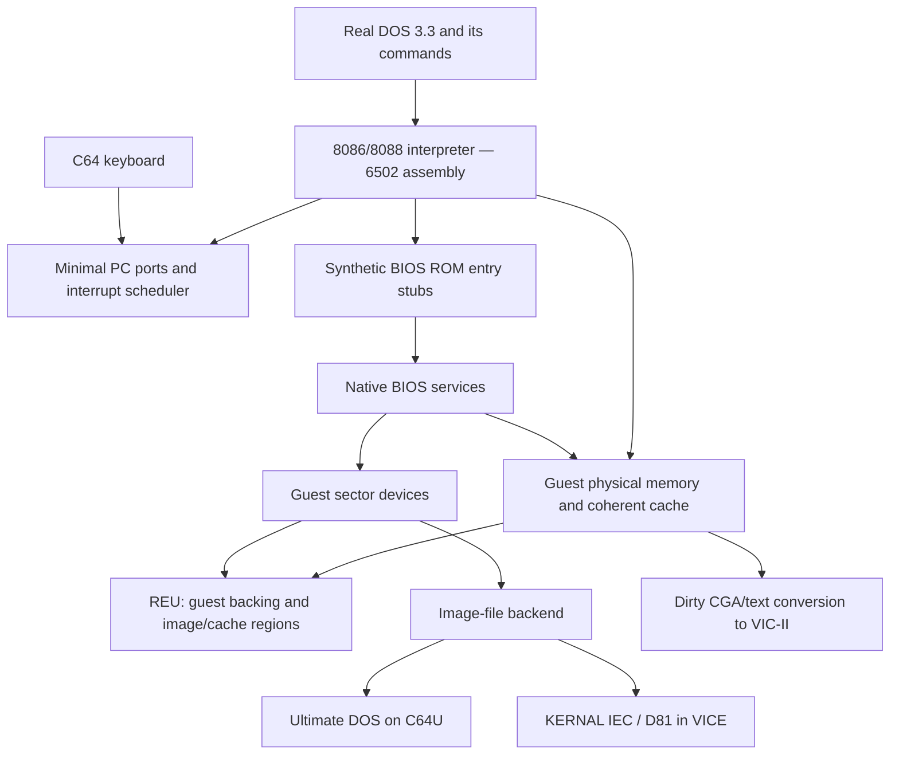

# Architecture contract

> Development note: see [current status](STATUS.md), [build instructions](BUILD.md) and [installation](INSTALL.md) for present qualification. Historical measurements below apply to their stated slice, not every current build.

This is the full-system architecture and remaining integration contract. The actual assembly CPU, coherent memory/disk services, synthetic logical BIOS, functional PIC, original clock/keyboard backend, generic asynchronous UCI transport and native CIA clock are implemented. In Peddle, genuine reset and unchanged DOS 3.3 binaries reach COMMAND.COM and execute verified VER/DIR through normal guest INT 21h and the assembled keyboard queue. Current functional evidence (local development record, not distributed).

The corrected physical CIA clock matrix validates the raw PAL CIA/raster domain at 1/16/64 MHz, independently of emulator throughput. Native FILE/TEXT commands/row rendering now share a tested REU overlay window; startup copies assets then idles. Real file import/persistence, native C64 font/VIC/input, scheduler/IRQ delivery and HD remain unfinished. The diagram combines implemented functional boundaries with the native system still to integrate; it does not claim that the complete program runs DOS on physical C64U. See current state (local development record, not distributed) and [overlay contract](OVERLAYS_IMPLEMENTATION.md).

## Ownership and execution

The host is a standalone C64 program. Target code is 6510 assembly, assembled with ca65 and linked with ld65. It owns a declared zero-page allocation, hardware-stack budget, IRQ/NMI gateways, C64 memory map, and REU arena. Host Zig tests use a small C ABI to Peddle's C++ CPU; that host boundary is not the target ABI.

DOS is not reimplemented. Its INT 21h handler, FCBs, file handles, FAT12/FAT16 code, PSP creation, process execution, MZ relocation, internal commands, and resident drivers run as guest instructions. Ultimate DOS sees raw image files, not individual guest DOS filenames. Its two target instances therefore need only an image-handle scheduler, not a DOS handle virtualization layer.

Logical module boundaries (assembly routines and shared structures, not necessarily dynamic modules):

| Boundary | Responsibility / rule |
|---|---|
| `cpu_step` / `cpu_run_budget` | Advance defined guest state; report traps/halt/events and counters |
| `guest_read/write8/16`, `guest_copy` | Sole authority for memory semantics, cache ownership, ROM/video writes, code invalidation |
| `bios_entry` | Service only recognized synthetic ROM entry points; preserve normal guest interrupt routing |
| `disk_read/write/verify/format` | Translate BIOS CHS to bounded guest sectors, return BIOS status, never parse guest filenames |
| `image_read/write_at`, `image_close`, `image_export` | File offsets, exact transferred counts, media identity, errors |
| `reu_transfer` | Explicit host and 24-bit REU addresses, length, mode, bank-safe critical section |
| `devices_tick`, `port_in/out` | PIC/PIT/keyboard/CGA minimum and deterministic unsupported behavior |
| `video_present`, `keyboard_poll` | Bounded host work outside the innermost CPU loop |

Use little-endian byte/word structures with generated or checked offsets. Every assembly routine states input/output registers, clobbers, scratch ownership, bank state, and whether it may yield or evict frames. Keep hot guest registers/direct pointers in a reserved ZP subset; keep canonical full state in resident RAM. Shared scratch must not be used reentrantly by host IRQs. Host arithmetic runs with decimal mode clear; guest BCD instructions are implemented explicitly.

## Boot and BIOS interception

1. Initialize host screen, keyboard, REU, memory tags, and storage. Probe required capabilities without destroying fixture contents; reject insufficient configuration clearly.
2. Populate a project-owned synthetic BIOS ROM, IVT, BIOS Data Area, equipment flags, 640 KiB memory report, disk parameter tables, CGA state, and timer/keyboard defaults. Supply required ROM identification/table data consistently with the selected PC profile.
3. Reset guest at the original reset location (`FFFF:0000`), enter the synthetic bootstrap, and load boot sector to physical `0000:7C00` with correct boot drive `DL`. Initialize only documented/project-defined BIOS state; do not depend on arbitrary initial register values.
4. Boot code loads the real DOS system files through BIOS disk services. DOS installs its own vectors and starts COMMAND.COM.

**Never intercept solely by interrupt number.** `INT n` pushes the guest flags/CS/IP, clears the required flags, and follows the writable guest IVT. A hook may chain by far jump or by `PUSHF; CALL FAR`. Native service entry is recognized only at reserved ROM stubs (for example a private hypercall port instruction inside those stubs). Callbacks return through the correct guest frame/IRET path and update saved return flags such as CF/ZF when the BIOS contract requires it. Tests must cover replaced vectors, far-call chains, recursive guest handlers, and stack wrapping. Arbitrary guest code cannot invoke the callback just by matching an opcode outside the allowed ROM entry.

The first BIOS contract covers INT 10h video, 11h equipment, 12h memory, 13h disk, 16h keyboard, 19h bootstrap, and 1Ah clock; IRQ0/INT 08h, IRQ1/INT 09h, INT 1Ch chaining, and BIOS data tables/vectors required by the actual DOS build. INT 14h/17h return consistent absent-device status; INT 18h ends boot with a controlled diagnostic. Add INT 15h or other services only from a documented profile requirement or an observed probe. Do not claim AT/RTC/EGA features that are not present. Microsoft BIOS reference: [Appendix O](https://msarchive.pcjs.org/mspl13/msdos/encyclopedia/appendix-o/).

## CPU semantics and coverage

Implement documented 8086/8088 instructions and their ModR/M forms: data movement, arithmetic/logical/BCD, shifts/rotates, control flow, stack, string operations, flags, interrupt/IRET, and I/O. Decode signed immediates/displacements, default SS for BP-based addressing, segment overrides, and implicit operands correctly. No 80186/286 extensions are silently accepted as such.

Mandatory edge tests: CF/OF/AF/PF/SF/ZF; flags preserved by INC/DEC/logical/rotate variants; ADC/SBB carry chains; count zero and counts >31; PUSH SP original-CPU result; divide overflow/zero and saved return IP; flags reserved bits and PUSHF/POPF/LAHF/SAHF; POP/MOV SS and STI interrupt inhibition; TF trap timing; HLT wakeup; far calls/returns; prefix lifetime; REP zero count/direction/restart; overlapping strings; self-modifying code and segment aliases. Use defined-flag masks and original-CPU references, not modern x86 behavior by assumption. [Microsoft compatibility notes](https://msarchive.pcjs.org/mspl13/msdos/encyclopedia/appendix-m/) and [hardware-generated tests](https://github.com/SingleStepTests/8088).

Begin with eager flags and a simple interpreter. Add lazy flags, fast dispatch, cached fetch pointers, and instruction-specific hot paths only behind differential tests. A full host x86 emulator is not a prerequisite: use small independent Zig semantic oracles and hardware test vectors. A minimal host machine model may later help trace boot, but must not become a second product delaying target tests.

There is no architectural invalid-opcode exception on an original 8088. Unsupported/undefined encodings initially cause an emulator diagnostic with CS:IP and bytes, not a fabricated guest 286-style INT 6. Keep a coverage manifest for undocumented encodings actually needed. Model ESC/WAIT consistently with no 8087 and test probes; no floating-point coprocessor emulation is promised. Prefix-only loops need a host cancellation/budget path without inventing a modern 15-byte instruction limit.

## Minimal machine timing and ports

Keep guest simulated time separate from host execution time. Deterministic tests drive guest events from an explicit virtual clock. Interactive mode derives pending timer ticks and keyboard work from elapsed host time with bounded servicing. PC timer frequency is based on the PC PIT, not one tick per PAL/NTSC frame. Pause/reset semantics are explicit. Avoid catch-up storms after blocking storage; retain and deliver pending events according to the chosen device model.

Implement the required subset of 8259 IRQ masking/EOI and 8253 channel-0 programming/latching, keyboard ports 60h/61h and BIOS ring-buffer state, CGA 3D4h/3D5h/3D8h/3D9h/3DAh. A toggling CGA status input must use virtual time so polling loops progress; it is not proof of cycle-accurate retrace. Identify any 8255/equipment-switch reads from boot traces. Guest IF=0 must not stop the host from collecting keyboard events or presenting its display.

Do not implement a floppy controller/8237 DMA or hard-disk controller initially: BIOS sector services bypass them. Log unsupported ports with bounded counters, return documented profile defaults, and fail development acceptance on unexpected required accesses. FORMAT/FDISK may require more BIOS calls or direct I/O; trace and implement the applicable behavior rather than fake success.

No guest networking, sound output, printer, or serial endpoint. Minimal register reads needed for programs to detect absent hardware are part of compatibility, not an expansion of peripheral scope.
