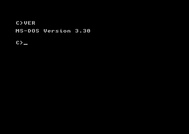
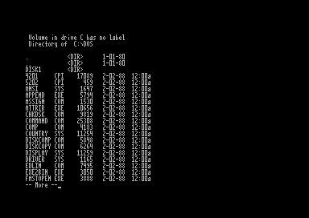

# Physical Ultimate screenshots

These are actual video-stream captures from the C64 Ultimate running at PAL Manual 64 MHz. The overview joins four original frames: DOS prompt, paged DIR, Turbo Pascal source, and the finished RIPPLE effect. Labels and layout are outside the screen contents. The screens are from different points in the demonstration, not one simultaneous session.

## DOS prompt

## Directory listing

## Turbo Pascal source

## Finished picture

RIPPLE uses 960 full-block text characters and eight selected colours. The complete 1,000-cell guest buffer matched the expected result; all six captures in that run matched native bitmap/matrix and active VIC pixels. The source editor showed all 18 intended lines. [Example source and data disk](../examples/README.md).

These are development-fixture demonstrations. They are not evidence that the native 20 MiB installer or all disk-management operations pass. [Current status](STATUS.md).
