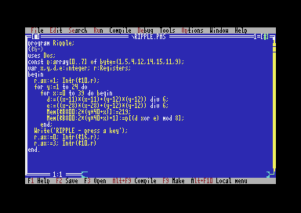
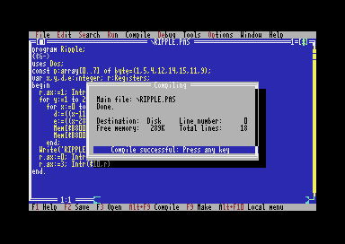
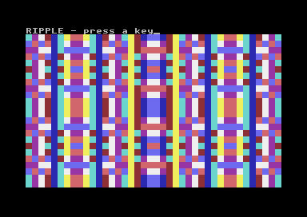

# RIPPLE on the Ultimate

Actual, unaltered video-stream screenshots from the physical C64 Ultimate at
PAL Manual64 MHz. The original Turbo Pascal 7.01 compiled the 18-line source to
Disk; DOS then ran the resulting `C:\RIPPLE.EXE`.

[Source](../../../examples/RIPPLE.PAS). Press a key to restore 80-column text
and return to DOS. This uses eight selected foreground colours and full-block
characters in 40-column text mode; it does not require 16-colour CGA graphics.

All 18 editor source lines and all 1,000 finished guest character/attribute
cells match their expectations. All six captures in the run pass the complete
8,000-byte native bitmap, 1,000-byte colour matrix and 64,000 active VIC pixel
checks. MANIFEST.json records the original PNG hashes.

The runtime still uses the explicitly host-prepared 20 MiB development fixture.
Native 20 MiB installer acceptance and CONFIG/floppy swap/Save/Finish/human
qualification remain open. This task did not repeat whole-image close or cold
persistence testing. At the end of this capture session the machine was left on the picture with
the native C backing channel open. This is a historical observation, not the
current state of another user's machine.
