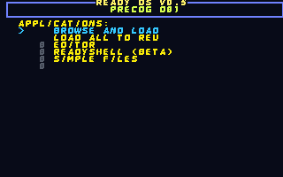

# C77 Cyberpunk 77

This is the Commodore 77 dual-bank character-ROM and Cyberpunk 77 palette experiment, originally developed in a ReadyOS checkout and preserved here as an independent experiment. It explores how a reconstructed text face and a deliberately vivid palette look across a full set of ReadyOS applications, including a CRT-style presentation.

## What is preserved

- [C77CYBER.VPL](C77CYBER.VPL): a 16-color palette for VICE/Ultimate use.
- [Dual-bank character ROM](assets/c77-photo-reconstruction-readyos-v3-chargen.bin): a 4,096-byte character ROM with the reconstructed A–Z/0–9 face in both selectable C64 banks.
- [Editor-compatible first bank](assets/c77-photo-reconstruction-readyos-v3.64c): a corresponding `.64c` file.
- [Clean dual-bank gallery](screenshots/c77-cyberpunk-77-charrom/README.md): 21 ReadyOS states, including the loader, launcher, editor, files, shell, utilities, games, IRC and UCI tester.
- [CRT gallery](screenshots/c77-cyberpunk-77-crt/README.md): the same application states with blur, scanlines and double-scan presentation.
- [Earlier palette gallery](screenshots/c77-cyberpunk-77/README.md): the retained first pass.



## Character-ROM behavior

The loader uses character bank 0 while ReadyOS applications select bank 1, so a single-bank replacement is insufficient. The experimental ROM changes letters, digits and their reverse-video equivalents in both banks. Bank 1 also receives uppercase aliases at screen codes 65–90 for applications that write screen codes directly. Punctuation, graphics and unrelated glyphs remain stock.

The clean captures are native 320×200 frames. Enlargements and contact sheets make comparisons easier. VICE's automation framebuffer is captured before its display shader; the CRT previews reproduce the selected blur/scanline treatment from those frames. `FONT-VERIFICATION.txt` in the CRT gallery records the bank-1 glyph comparison.

## Use and reproduce

Load the palette and character-ROM files with your emulator's palette/character-ROM settings and a compatible ReadyOS image. The preserved screenshots use the ReadyOS Precog D81; this project does not ship that whole operating-system image as a new standalone release.

`build_support/` contains a ROM-bank probe, gallery plan generator, screenshot collector, CRT renderer and Ultimate deployment helper. The palette apply/cycle scripts are snapshots of ReadyOS helpers. Some generation and deployment steps still assume a compatible ReadyOS source/release tree and the sibling automation harness; configure their documented input/output variables before use. The CRT renderer uses the ROM under `assets/` by default. Python image processing requires Pillow.

The recorded CRT settings include:

```text
VICIIfilter=1
VICIIdscan=enabled
VICIIcrtblur=350
VICIIcrtscanlineshade=650
VICIIoddlinesphase=1250
VICIIoddlinesoffset=1000
```

The original captures used IEC traps with true-drive emulation disabled. Different display settings and firmware may produce different results. The deployment helper writes to hardware; review and configure it before running it.

## Layout

`assets/` preserves the ROM experiment; `screenshots/` holds the galleries and their text metadata; `build_support/` holds reproducibility helpers. Generated `build/` packages, preview ZIPs and `logs/` stay local and ignored. The experiment shares the Ultimate Experiments repository rather than having its own Git history.

[HTML project overview](index.html) · [All experiments](../index.md)
