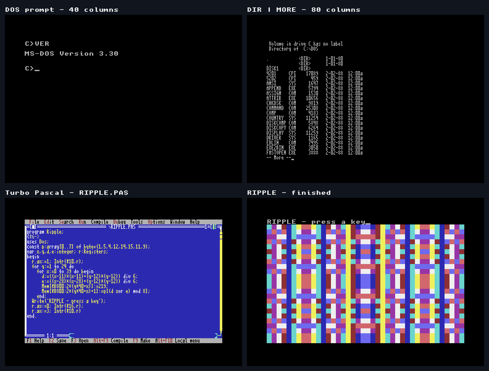

# Ultimate Experiments

[Source repository on GitHub](https://github.com/ReadyOS-C64/UltimateExperiments)

Outside ReadyOS—and sometimes before ReadyOS—we do random experiments for the Commodore 64 Ultimate. Some may become supported projects; some are one-offs and throwaways. Pick an experiment below for its guides, examples and downloads.

## SuperEditor

A standalone 6510-assembly editor for PETSCII Markdown-lite, with 40, 60 and
80-column source views plus editable GEOS-font hires and a formatted preview.
It includes color syntax for C64 BASIC and assembler, folding, wrapping and
panning, menus, session appearance settings, selection, clipboard, Undo/Redo,
search, navigation, and native D81 file dialogs. It remains a development
preview while performance and wider standalone qualification continue.


[Explore SuperEditor](supereditor/index.md) · [Download the preview ZIP](downloads/SuperEditor-preview.zip) · [Complete user guide](supereditor/USER_GUIDE.md) · [Screenshot gallery](supereditor/SCREENSHOTS.md)

## ReadyFS

ReadyFS aims to provide a full set of command-line tools and a coherent way to work with Ultimate DOS drives, mounted disk images or real C64 drives, SOFTIEC, and SD2IEC. That includes mounting disk images and accessing disk images on the Ultimate **without mounting them**, as if they were folders. A **unified path syntax** spans all these drive types, and disk operations such as **copy and move work between drive types**, so files can move from one kind of storage to another.


[Explore ReadyFS](readyfs/index.md) · [Illustrated guide](readyfs/READYFS_USER_GUIDE.md) · [Screenshot walkthrough](readyfs/tours/editor.md)

## DOS64 Ultimate

An 8088 PC/XT emulator written in 6502/6510 assembly for a C64 Ultimate at 64 MHz, with 640 KiB of guest RAM backed by REU. It boots genuine DOS 3.3 and demonstrates 40/80-column text, GW-BASIC and original Turbo Pascal. **Development preview:** 2 MiB native installation passes; 20 MiB native creation and final disk-management qualification remain open.



[Explore DOS64](dos64/index.md) · [Install the prebuilt preview](dos64/INSTALL.md) · [Build and tests](dos64/BUILD.md) · [Examples](dos64/examples/index.md)

## ReuSQL64

ReuSQL64 explores a SQL-like database engine that keeps its data in a 512 KB–16 MB REU. Create tables, query and join rows, group and aggregate results, and use explicit indexes through a C64 shell or a reusable engine API.

This is the real three-source sales benchmark: three explicit indexes, numeric and Boolean filters, a CHAR pattern, and five aggregate forms.

```sql
SELECT C.REGION,
       P.CATEGORY_ID,
       COUNT(*),
       SUM(O.ORDER_TOTAL),
       AVG(O.ITEM_COUNT),
       MIN(O.ORDER_TOTAL),
       MAX(O.ORDER_TOTAL)
FROM SALES_ORDERS AS O USING INDEX ORDER_BUYER_PROD
JOIN CUSTOMERS AS C USING INDEX CUSTOMER_ID_REGION
  ON C.CUSTOMER_ID = O.CUSTOMER_ID
JOIN PRODUCTS AS P USING INDEX PRODUCT_ID_CATEGORY
  ON P.PRODUCT_ID = O.PRODUCT_ID
WHERE O.ORDER_TOTAL >= 1000
  AND O.ITEM_COUNT >= 2
  AND O.DETAILS LIKE 'A%'
  AND C.ACTIVE = TRUE
  AND P.ACTIVE = TRUE
GROUP BY C.REGION, P.CATEGORY_ID;
```

> **Performance: some advanced queries are very slow right now.**
>
> Repeated relationship scans can be expensive. [Staging the work into indexed TEMP tables](reusql/performance.md) made this benchmark's full pipeline about 5.4× faster; the project guides explain the tradeoffs.


[Explore ReuSQL64](reusql/index.md) · [SQL language](reusql/sql-language.md) · [Interactive shell](reusql/shell.md)

## C77 Cyberpunk 77

A reconstructed dual-bank character ROM and Cyberpunk palette, explored across ReadyOS applications. Clean and CRT galleries show the same screens with different display treatments.


[Explore C77 Cyberpunk 77](c77/index.md) · [Clean gallery](c77/screenshots/c77-cyberpunk-77-charrom/README.md) · [CRT gallery](c77/screenshots/c77-cyberpunk-77-crt/README.md)
