# ReadyFS user guide

**Paths, commands, and a complete folder workflow** · Guide updated 13 October 2026 · Core screenshots: 9 October · SD2IEC screenshots: 13 October 2026

ReadyFS aims to provide a full set of command-line tools and a coherent way to work with Ultimate DOS drives, mounted disk images or real C64 drives, SOFTIEC, and SD2IEC. That includes mounting disk images and accessing disk images on the Ultimate **without mounting them**, as if they were folders. Its central idea is simple: **say where a file lives, then say what you want to do with it**. The same command language also addresses sequential tape. Storage endpoints retain their own capabilities and limits; the command references below describe the implemented behavior.

This guide starts with that model, explains command arguments and options, then follows the real nested-folder demonstration. Screenshots are frames from a physical C64 Ultimate running at 1 MHz; they show actual results. Other examples are identified as recipes or syntax examples. The complete [video walkthrough](https://readyfs-editor-demo.klumsy.chatgpt.site/) remains available alongside this guide.

## Contents

1. [Start here](#1-start-here)
2. [The path system](#2-the-path-system)
3. [Commands, arguments, and options](#3-commands-arguments-and-options)
4. [Patterns and selection](#4-patterns-and-selection)
5. [Editing and the two histories](#5-editing-and-the-two-histories)
6. [Inspect files before changing them](#6-inspect-files-before-changing-them)
7. [Worked example: copy, move, and delete a nested tree](#7-worked-example-copy-move-and-delete-a-nested-tree)
8. [Create text, compare files, and save a session](#8-create-text-compare-files-and-save-a-session)
9. [Devices, images, and advanced operations](#9-devices-images-and-advanced-operations)
10. [Complete command reference](#10-complete-command-reference)
11. [Limits, troubleshooting, and evidence](#11-limits-troubleshooting-and-evidence)
12. [SD2IEC: folders, batches, and disk images](#12-sd2iec-folders-batches-and-disk-images)

## 1. Start here

### Use the full application

Use **`readyfs-overlay.prg`** with **`readyfs-overlay-lab.d81`** on IEC device 8. The disk contains the 28 sidecars that startup caches in the REU. This build needs a detected REU of at least **1 MiB**. Keep the sidecars available during startup; loading them can take time on the C64. The smaller `readyfs.prg` is a diagnostic version and does not provide the complete editor and command-help experience described here.

From BASIC, with the lab image mounted on drive 8:

```text
LOAD"READYFS-OVERLAY",8,1
RUN
```

Wait for the `rf>` prompt and the editor legend before typing.

### Three useful first commands

```text
HELP
HELP DIR
PWD
```

`HELP` lists the command families. `HELP DIR` explains one command. `PWD` prints the shell's current location. You can also use the exact short names: `H DIR`, `H CP`, and `PW`.


*Figure 1. Cyan identifies submitted commands; white identifies results. The four input rows and gray legend belong to the live editor.*

### Read the screen

| What you see | Meaning |
| --- | --- |
| `rf>` | Start of the editable command. Do not type the prompt itself. |
| `..>` | Another visible row of the same command, or a continuation. |
| `ov>` | Overwrite mode is active. Insert toggles it. |
| Cyan command text | Your input and submitted command echoes. |
| White text | Ordinary command output, listings, and help. |
| Yellow text | Completion and plan summaries, plus the `-- more --` prompt. |
| Red text | Errors and failed operations in the 12 October source build. |
| Gray legend | Available editor or output-history keys. |
| `-- more --` | A listing or recursive preview is waiting for a key. Read the page, then continue. |

The 12 October source build adds these summary/error colors and two or more examples per command-help topic. These changes passed host and VICE checks; the latest physical tour also verifies cyan input, white help, yellow paging and red errors. The sixteen retained screenshots in this guide were recorded on 9 October and retain their original output colors, footer and shorter help. They have not been recolored. Two additional transfer screenshots from 12 October show the named preview and explicit skip-readback result. The companion site’s recorded script provides the latest capture evidence alongside the video.

The shell is a filesystem laboratory. It can address real storage. The recorded test runner restricted its writes to a fresh, marker-owned test folder; **manual shell commands do not automatically inherit that external ownership check**. An alias is a convenient path shortcut, not a general write-protection mechanism.

## 2. The path system

### A path has an endpoint and a location

```text
u: /usb1/READYFS_TEST/my-run/source/readme.seq
│  └──────────────── location ──────────────┘
└─ endpoint
```

The text before `:` selects the storage endpoint. The slash-separated part after it selects a location on that endpoint. `/` is the hierarchy separator; it is not a Windows backslash.


*Diagram 1. Different user spellings resolve to a canonical path. The driver then checks whether it can perform the requested operation.*

### Endpoint vocabulary

| Example | Read it as | Current meaning |
| --- | --- | --- |
| `8:/README` | Device 8, root, file README | A normal IEC device, often a floppy or an emulated floppy. |
| `9:/PROGRAM` | Device 9, root, file PROGRAM | The same syntax for another IEC unit. Supported units are 8–30. |
| `11.3:/games/HELLO` | Device 11, partition 3, folder games | A partitioned IEC path. Folder and partition operations require a suitable probed driver. |
| `u:/usb1/music/theme.sid` | Ultimate host storage, USB1 | Direct UltimateDOS access to a host filesystem. USB and SD roots depend on the hardware. |
| `s3:/games/HELLO` | SoftwareIEC logical partition 3 | A mapped SoftwareIEC root, reached through its discovered IEC bus. It is not IEC device 3. |
| `t:/NOTES` | Sequential tape, name NOTES | Tape has sequential read/write behavior, not a browsable folder tree. |
| `@lab:/source/readme.seq` | Alias lab, then this suffix | Expand the saved alias root and append the suffix. |
| `u:/usb1/demo.d81!/HELLO` | Host image, then contained file | `!/` explicitly marks an image boundary. Parsing it does not mean direct contained-file access is implemented. |

**One syntax does not imply identical devices.** A floppy has C64 block counts and short names. Ultimate host storage has folders and host names. Tape cannot rename, delete, or recurse. SoftwareIEC behavior depends on firmware and the mapping. Use `CAPABILITIES path`, `PROBE IEC 8:`, and `PROFILE IEC 8:` to inspect the relevant model and detected profile; capability summaries are not guarantees for every path shape.

### SoftwareIEC logical partitions and mappings

SoftwareIEC is the Ultimate's software IEC filesystem. `s0:/games/HELLO` selects SoftwareIEC logical partition 0 and a location within its mapped root. `s3:/games/HELLO` selects logical partition 3. These are not IEC device addresses or native SD2IEC partitions. ReadyFS discovers the SoftwareIEC IEC bus through the Ultimate Command Interface.

```text
PROBE SOFTIEC
DIR s0:/
ALIAS SOFT s0:/demo
DIR @soft:/
```

Use the mapping and folder names that exist in your setup. Mapping creation/removal and folder capabilities depend on the Ultimate firmware. The dedicated [SoftwareIEC guide](READYFS_SOFTWAREIEC_GUIDE.md) covers its commands, limits and a separate interoperability section.

### Native SD2IEC device and partition numbers

**`10.1:/games/HELLO` means IEC device 10, partition 1, then the path `/games/HELLO`.** `10.2:/games/HELLO` reaches partition 2 on the same SD2IEC, if it exists. ReadyFS is not restricted to the partition 1 used in the walkthrough. Explicit native partitions are 1–254 where the detected driver supports them; inspect the actual partition list rather than assuming that every number exists.

```text
IEC 10: PARTITIONS
IEC 10: PARTITION
IEC 10: PARTITION 2
DIR 10.2:/
```

The last two commands assume partition 2 is present. The first lists partitions, the second queries the current one, and the third queries partition 2 without selecting it. Explicit `10.2:/...` paths qualify the operation directly and do not change the current selection. `10:/...` uses the current partition, queried and pinned for each operation. To change that default deliberately, use `IEC 10: PARTITION 2 --SELECT`; this also clears the SD2IEC autoswap list.

Path suffixes and command arguments are decimal: a partition listed as `$0A` is addressed as `10.10:/`. `IEC 10: PARTITION 0` is the separate SYSTEM query, not an ordinary data-partition path. `s0:/` names a SoftwareIEC logical partition, not native partition 0 of device 10.

A partition and a mounted image are also different things. Mounting an SD image changes what the chosen partition exposes; it does not create another partition. Mount/unmount can close channels on other partitions of the same device, so finish transfers first. See [native SD2IEC support](SD2IEC_NATIVE.md) for the complete rules.

### Absolute, relative, and endpoint-root paths

Suppose `PWD` prints:

```text
u:/usb1/READYFS_TEST/my-run/source
```

| Input path | Resolved location |
| --- | --- |
| `readme.seq` | `u:/usb1/READYFS_TEST/my-run/source/readme.seq` |
| `beta/deep/three.seq` | `u:/usb1/READYFS_TEST/my-run/source/beta/deep/three.seq` |
| `.` | The current source folder. |
| `..` | `u:/usb1/READYFS_TEST/my-run` |
| `/usb1` | `u:/usb1` — the root of the current endpoint, then usb1. |
| `8:/README` | Device 8; the current `u:` location does not affect it. |

`/` alone means the root of the current **endpoint**, not the root of your alias or current test folder. Prefer a full endpoint path when crossing devices. Use explicit absolute endpoint forms such as `8:/...`; endpoint-relative forms such as `8:README` are not the ordinary file-operation contract.

`CD path` changes ReadyFS's current location. `CD` without a path prints it. `PWD` prints it too. A successful `CD` resolves and stores a path; it is **not proof that the directory exists or is readable**. Follow it with `DIR` or `TREE .` when you need to check access.

```text
CD @lab:/source
PWD
DIR
TREE .
CD ..
```

### Aliases shorten long paths

An alias is an exact-place bookmark. In this syntax example, substitute your own fresh test root:

```text
ALIAS LAB u:/usb1/READYFS_TEST/YOUR_FRESH_RUN
ALIAS
HEAD @lab:/source/readme.seq 2
```

The first command stores the bookmark. The second lists saved bookmarks. The third expands `@lab:/` to that root. `AL LAB ...` is equivalent to `ALIAS LAB ...`; `UA LAB` removes it.

Aliases have up to eight slots and names up to sixteen bytes. They live in the current REU session unless saved with `CONFIG SAVE`. Alias expansion does not chain aliases. Its suffix rejects `..` components, so `@lab:/../outside` is invalid. Ordinary relative `..` navigation is allowed within the endpoint root; it is not confined to an alias's subtree.

Paths are normalized: redundant slashes and `.` components are simplified; `..` cannot climb above the endpoint or image root. Both typed commands and expanded canonical paths have a 255-byte ceiling. A short alias can still expand into a path that exceeds that limit.

### Host files, displayed names, and images

UltimateDOS can expose an access spelling with bracketed hex bytes or an added C64 file-type annotation. ReadyFS keeps the actual access identity separate from the readable name used in selection. The current lookup accepts both an actual host spelling such as `work.seq` and its decoded logical spelling where applicable. Use the exact host filename when you know it; `STAT` can show display, access, and host identities.

`demo.d81` is a **host file**. A contained file can be addressed through an UltimateDOS slash path such as `u:/usb1/demo.d81/HELLO.prg`, or through a mounted IEC drive such as `8:/HELLO`. The explicit `!/` spelling remains a modeled boundary that current file operations reject; use ordinary `/` for UltimateDOS contained-file access. Mounting changes drive media; it is separate from changing `CD`. Do not access a container through UltimateDOS while it is also mounted on an IEC drive.

### Boundaries and possibilities: what are you copying?

**Start by deciding whether the path names a host file, a contained disk file, or a mounted device.** The same image can appear in two roles: `u:/usb1/readyos.d81` is one host file; with that image mounted on device 8, `8:/SHEET2` is one file inside its Commodore filesystem. Copying one does not mean copying the other.

| Location | What it addresses | Possibilities and boundaries |
| --- | --- | --- |
| `u:/usb1/folder/file.seq` | An ordinary Ultimate host file | Host files and nested folders. Recursive copy, move, and delete are demonstrated in this guide. Host names and C64 file types are separate concerns. |
| `8:/SHEET2` | A file on device 8's current media | Stream a supported file to/from another endpoint. A plain mounted D81 has a flat directory; adding slashes does not create host-style folders. Other IEC drivers may offer partitions or folders. |
| `u:/usb1/readyos.d81` | The entire image as one host file | Copy or back up the image as a whole. Its contained directory, allocation data, and file structures remain within the image. This does not extract any individual file. |
| `u:/usb1/work.d64/HELLO.prg` | Direct access to a contained file | The current overlay build supports SEQ/PRG/USR through ordinary slash paths. The physical contained-image matrix used D64; mounted IEC tests also used D81. Explicit `!/` remains rejected. |
| `s3:/games/HELLO` | A logical SoftwareIEC mapping | Access depends on the discovered bus, firmware, mapped root, and driver. `s3:` is not device 3. SoftwareIEC is not required to copy a file from an already mounted drive 8. |
| `@disk:/SHEET2` | An alias expanded to an underlying path | Same operations and limits as that underlying path. An alias adds neither image access nor write protection. |
| `t:/NOTES` | A named sequential tape stream | Sequential read/write, not a folder filesystem. No directory tree, rename, delete, or move. |

#### 1. Extract a file from the image already mounted on drive 8

With `readyos.d81` already mounted on device 8:

```text
DIR 8:/
COPY 8:/SHEET2 u:/usb1/SHEET2 --whatif
COPY 8:/SHEET2 u:/usb1/SHEET2
COMPARE 8:/SHEET2 u:/usb1/SHEET2
```

The source is **`8:/SHEET2`**, with the slash. `8:SHEET2` is an endpoint-relative spelling outside the current COPY contract and can report `unsupported`. For a single-file copy, name the destination file explicitly: `u:/usb1/SHEET2`. Do not use only `u:/usb1` and assume the shell will append the source name. This recipe writes the USB destination when executed; use an unused name if you want to retain an existing file.

These are syntax recipes, not a claim that your particular `SHEET2` was copied or tested. A preview shows intent; it does not establish that the later device I/O will succeed.

#### 2. Use aliases and shorter commands for the same transfer

```text
ALIAS DISK 8:/
AL USB u:/usb1
CP @disk:/SHEET2 @usb:/SHEET2 -w
CP @disk:/SHEET2 @usb:/SHEET2
COMPARE @disk:/SHEET2 @usb:/SHEET2
```

`AL` is `ALIAS`; `CP` is `COPY`; `-w` is `--whatif`. Here `@disk:/SHEET2` expands to `8:/SHEET2`. An alias to `u:/usb1/readyos.d81` would instead identify the host image file; it would not turn that file into a working browsable directory.

#### 3. Back up the whole image instead

Assuming `backups` already exists and the new destination name is unused:

```text
COPY u:/usb1/readyos.d81 u:/usb1/backups/readyos-copy.d81 --whatif
COPY u:/usb1/readyos.d81 u:/usb1/backups/readyos-copy.d81
COMPARE u:/usb1/readyos.d81 u:/usb1/backups/readyos-copy.d81
```

This transfers the entire image, not just `SHEET2`. Use an image that is not actively being written by a mounted drive so the backup has a stable source. An ordinary contained-file copy does not preserve every disk-level feature; a whole-image copy retains the image's stored structures.

#### 4. Put a host file into a mounted disk

For this recipe, device 9 must already contain a **writable disposable test disk**, with enough space and no existing file named `DEMO`:

```text
COPY u:/usb1/demo.prg 9:/DEMO --whatif
COPY u:/usb1/demo.prg 9:/DEMO
COMPARE u:/usb1/demo.prg 9:/DEMO
```

The destination is a Commodore directory entry. Its name, type, and size must fit the destination filesystem. COPY does not convert a SID, MP3, WAV, or document into an executable C64 program. Byte equality from COMPARE is useful evidence of file data, not proof of REL record structure, copy-protection data, or every item of disk metadata.

#### 5. Direct image paths in both directions

The current 28-sidecar overlay build supports contained SEQ, PRG, and USR files through **ordinary slash paths**. Use a writable, unmounted image you own, an existing output folder, and unused destination names:

```text
COPY u:/usb1/work.d64/HELLO.prg u:/usb1/out/HELLO.prg --whatif
COPY u:/usb1/work.d64/HELLO.prg u:/usb1/out/HELLO.prg
COPY u:/usb1/out/HELLO.prg u:/usb1/work.d64/HELLO2.prg
COMPARE u:/usb1/out/HELLO.prg u:/usb1/work.d64/HELLO2.prg
```

**Name the destination file explicitly.** A trailing `/` does not yet mean “keep the source filename.” A bare contained destination inherits the source type; an explicit `.prg`, `.seq`, or `.usr` must agree with it. Names are limited to 16 decoded CBM bytes. REL streams remain unsupported. Staging, replacement backups and renames preserve types; equivalent names for the same entry are rejected for self-copy/move/rename.

The hardware matrix passed COPY/MOVE in both directions between an SD2IEC-mounted image and a separate Ultimate-contained D64, including all three types, replacement/rename checks and independent saved-image bytes/types. This does not establish every disk format or firmware combination. Do not use this route while the same container is mounted on an IEC drive. Native SD image mounting and same-device folder/image transfers have separate rules; see [native SD2IEC support](SD2IEC_NATIVE.md).

### Why a path can parse but an operation can fail

Path resolution, driver support, and successful I/O are separate steps. A valid path can still encounter an unsupported operation, read-only media, a missing file, a name/type restriction, or insufficient space. `--force` does not add capabilities. `--whatif` does not prove read/write access. An alias does not bypass these boundaries.

Use `CAPABILITIES path` for the endpoint model, then `PROBE IEC 8:` and `PROFILE IEC 8:` for an IEC device. Use `DIR`, `STAT`, and a disposable test file to establish the behavior you actually need. For cross-endpoint transfers, ordinary PRG/SEQ/USR byte streams are the intended scope; REL and special disk structures require separate support rather than an assumption that every file is interchangeable.

### Can we tell which image is mounted on device 8 or 9?

**ReadyFS remembers mounts it makes itself, during the current session.** The normal REU-backed overlay build shows this context in `DRIVES` / `DV`, before a classic `DIR` listing, and in `STAT` and `VOLUME` for an IEC device. No network, REST connection, Mac relay, or saved disk registry is used by this feature.

```text
MOUNT u:/usb1/lab/demo.d81 9:
DRIVES
DIR 9:/
STAT 9:/HELLO
VOLUME 9:/
```

After an accepted native mount, the context looks like:

```text
9: last mounted by readyfs
u:/usb1/lab/demo.d81
may have changed elsewhere
```

**This is a historical hint, not a live check.** Changing the disk through the Ultimate menu, a disk-swap button, another application, or another client can make the remembered path out of date. The warning appears alongside the path each time. Mounts made before ReadyFS started, and mounts made elsewhere, show `image path unknown`. Unknown does not mean the drive has no disk.

Aliases are resolved before the path is remembered: `AL DISK u:/usb1/lab` then `MO @disk:/demo.d81 9:` remembers the absolute host path. `DISMOUNT` and `SWAP` invalidate the affected unit's hint when the real native operation is attempted. A mount attempt invalidates the old hint before issuing the native request and records the new path only after an OK response. `--whatif` does not change any hints. All hints clear when ReadyFS restarts. Remembering a path does not give permission to overwrite a disk or prove that writes will reach that host image; writable, read-only, and unlinked media remain separate concerns.

**Why not query the Ultimate directly?** The native UCI drive-information command (`0x29`) reports drive type, IEC bus number, and power state, but not the mounted image path. Native DOS `GET_PATH` returns that DOS target's current working directory, not the image mounted on device 8 or 9. The firmware's network API has more information, but ReadyFS deliberately does not use it. A firmware extension to expose mounted-image identity through native UCI would allow live discovery later. See the [native drive-information implementation](https://github.com/GideonZ/1541ultimate/blob/master/software/io/command_interface/control_target.cc) and [native DOS implementation](https://github.com/GideonZ/1541ultimate/blob/master/software/filemanager/dos.cc).

The compact monolithic diagnostic build retains the earlier drive listing; these remembered-path displays belong to the normal overlay build. Firmware acknowledgement is the signal available to ReadyFS: the checked firmware's native mount handler does not propagate every internal mount-action error, so an OK response is still not proof of current media. A directory's title and ID identify disk contents, not the host `.d81` filename.

## 3. Commands, arguments, and options

### Read a command from left to right

```text
COPY @lab:/source @lab:/copy --recursive --whatif
│    │            │          │           │
│    source       destination│           preview only
command                      include descendants
```

The **command** chooses the action. **Positional arguments** supply required values in order. **Options** modify that action; some take a following value. Put options after the command's required positional arguments.

These spellings have the same meaning:

```text
COPY @lab:/source @lab:/copy --recursive --whatif
CP   @lab:/source @lab:/copy -r -w
```

Command names and their registered aliases match whole tokens, case-insensitively. `CP` works because it is registered; `CO` is not an inferred abbreviation. Options are command-specific: recognizing an option token does not mean every command implements it.

### Quotes and command limits

Use double quotes around a complete argument containing spaces:

```text
WRITE "@lab:/field notes.seq" "First observation" --line --whatif
HEAD "@lab:/field notes.seq" 3
```

The quoted text is one argument. Quotes group arguments; they are not stored as part of the filename or text. The parser is deliberately small: at most **twelve tokens including the command**, inside a **255-byte logical line**. It is not a Unix shell: do not assume pipes, redirection, semicolon command lists, or general backslash escapes. DOS-style %NAME% variables and %1–%9 script arguments are supported; see the RUN reference below.

An open double quote or a trailing backslash followed by Return continues the same command by joining with a space. F7 or Shift+Return also joins. This does not insert a newline into file data. Use `--line` on WRITE or APPEND for a trailing carriage return.

### Options at a glance

| Long form | Short form | Purpose and scope |
| --- | --- | --- |
| `--whatif` or `--dry-run` | `-w` | Preview a supported mutation. Remove the preview option to execute an ordinary operation. |
| `--no-verify` | `-nv` | Skip destination readback for COPY/MOVE, including recursive transfers. Verification is on by default. |
| `--recursive` | `-r` | Select a tree for COPY, MOVE, or DELETE; ordinary single-file operations do not need it. |
| `--include PATTERN` | `-i PATTERN` | Select matching relative names for commands with filtering support. |
| `--exclude PATTERN` | `-x PATTERN` | Exclude matching relative names after inclusion. |
| `--force` | `-f` | Bypass a replacement/confirmation prompt where supported. It does not add driver capabilities. |
| `--yes` | `-y` | Explicit confirmation. Current confirmation lookup also accepts it where force is tested; use it carefully. |
| `--line` | `-l` | Append a carriage return after WRITE or APPEND text. |
| `--type seq` | `-t seq` | File creation type: SEQ, PRG, or USR. Default is SEQ. REL creation/transfer is not a general supported path. |
| `--continue` | `-c` | Let a recursive execution attempt later actions after a failure; default is stop on error. |
| `--native-pattern` | `-np` | Ask a supported IEC backend to enumerate its own pattern syntax. See section 9. |
| `--apply` | `-a` | Explicit execution opt-in for native-pattern mutations and formatting; not required for ordinary recursive COPY/MOVE/DELETE. |
| `--name NAME` | `-n NAME` | SoftwareIEC mapping identifier. |
| `--label LABEL` | `-lb LABEL` | Format label on supported disposable media. |
| `--id ID` | `-id ID` | Format disk ID on supported disposable media. |
| `--disposable` | `-ds` | Required disposable-media assertion for the format workflow. |

Recursive COPY, MOVE and DELETE previews print the source root, destination root when applicable, and each selected relative filename or folder. `would copy alpha/one.seq` means that exact file below the printed source root. A `dir` label identifies a folder. Unselected entries are omitted. Longer lists pause at the yellow `-- more --`; press a key after reading each page. The final `whatif: no files changed` confirms that the preview did not execute the plan.


*Current capture A · 12 October. Eight selected entries are individually named. Source and destination roots appear on the preceding preview page, available in the companion video and recorded script.*

**Preview does not queue an operation for later.** A what-if prints a plan and returns. To execute, enter another command with the same source/destination and selection options, but without `-w` / `--whatif` / `--dry-run`. A preview is not a guarantee that the later operation can complete: conflicts, device support, and I/O still matter.


*Figure 2. Per-command help accepts short names. `HELP CP` and `HELP COPY` select the same help topic.*

## 4. Patterns and selection

ReadyFS's normal matcher operates on a **complete relative stem**, not merely the last filename. A nested file might have the stem `beta/deep/three.seq` relative to the selected source root.

| Pattern | Meaning | Example |
| --- | --- | --- |
| `*` | Zero or more characters within a component; does not cross `/` or `!`. | `*.seq` matches a root-level SEQ name. |
| `?` | One character, excluding hierarchy/image separators. | `one.?eq` matches `one.seq`. |
| `**` | Zero or more characters, including separators. | `beta/**` reaches descendants below beta. |
| `**/` | Zero or more complete directory prefixes. | `**/*.seq` includes root-level and nested SEQ names. |

Test a pattern without touching storage:

```text
MATCH "*.seq" "alpha/one.seq"
MATCH "**/*.seq" "alpha/one.seq"
```

The first is no; the second is yes. Matching is case-folded. The matcher does not provide a general regular-expression or bracket-character-class language. Quote patterns when useful for clarity; ordinary path arguments are not automatically wildcard-expanded.

For a read-only tree search:

```text
TREE @lab:/source
FIND @lab:/source --include "beta/**"
FI @lab:/source -i "**/*.seq" -x "alpha/**"
```

An Ultimate directory entry may carry an extra type annotation. Selection normalizes that representation and retains the access name separately. Inspect the actual TREE/FIND results before applying a filter to mutations. A suffix in host storage is not itself a universal C64 type guarantee.

For filtered copying, preview the selection first:

```text
COPY @lab:/source @lab:/subset -r -i "beta/**" -w
```

Do not interpret a small selected count as proof that a filter is correct. It is a count of the plan's selected entries; directories can be entries too. The worked example deliberately uses an unfiltered tree to make every folder and file easy to account for.

## 5. Editing and the two histories

The `-- more --` prompt is yellow: press a key to continue a paged listing. The next page returns to ordinary white output.

### One logical command, four visible rows

The editor holds 255 bytes but displays four rows of 36 command characters. The view follows the cursor through longer input. Wrapping changes the view, not the command. Ordinary typing updates the changed cells, rather than repainting the entire display on every key.

| Key | Action |
| --- | --- |
| Left / Right | Move within the command. |
| Home / Shift+Home | Go to its beginning / end. |
| Delete | Delete the character before the cursor. |
| Insert | Toggle insert and overwrite; `ov>` marks overwrite mode. |
| Return | Execute a complete command. |
| F7 / Shift+Return | Join another part with a space. This shortcut remains active but is omitted from the bottom legend. |
| Run/Stop at live input | Cancel the draft. |

In the demonstration, `HED @lab:/source/readme.seq 2` is corrected by moving to the beginning, moving right twice, and inserting `A`. The resulting `HEAD` reads two lines. This is an edit to the command before execution, not a rename of the file.


*Figure 3. HEAD displays the beginning of the file. The source text says “source stays safe.”*


*Figure 4. A 255-byte command still fits the logical buffer even when only its end is visible. The recorded WRITE uses what-if and creates no file.*

### Command recall versus output paging

| Task | Keys | What is preserved |
| --- | --- | --- |
| Recall a command to edit or run again | Up / Down | Your unfinished draft, cursor, and insert mode return when you go Down past the newest command. |
| Read earlier results | F1 older / F3 newer | The live screen, colors, and unfinished input are restored on return. |
| Leave output history immediately | Run/Stop or Return | Return to the live editor; this Return does not execute its draft. |

Commodore+Up/Down also provide output paging. F1 enters the recent output page and continues older. F3 at the newest page returns to live input; F3 while already live leaves the draft alone. Command recall stores 32 entries. Output history stores 800 physical screen rows and their colors, with up to 23 rows per page. Oldest rows are replaced when full. `CLEAR` clears the live display while retaining scrollback. History is a session feature, not a permanent audit log.


*Figure 5. This is output history, not command recall. The gray `output:` legend distinguishes the mode. Cyan command echoes keep their color.*

## 6. Inspect files before changing them

### DIR: one directory, in familiar C64 form

```text
DIR 8:/
LS @lab:/source
```

IEC disk listings show a quoted reverse-video disk header, a block count, a quoted name, and a type such as PRG, SEQ, USR, REL, or DIR. The final `BLOCKS FREE.` count is also in C64 blocks, not bytes. A long listing pauses at `-- more --`; continue only when you have read it.


*Figure 6. A real lab D81 listing. The numbers on the left are blocks; the names and types retain the familiar C64 directory layout.*


*Figure 7. The free-space line is real device output. It will differ on other media.*

Ultimate host DIR uses the same quoted-name presentation, but shows `?` when the listing stream supplies no size. Host directories show DIR; an unknown file type can show `---`. It would be misleading to invent block counts for those entries. `STAT file` can retrieve more metadata, including exact byte size on a supported Ultimate host file.


*Figure 8. `CD @lab:/source`, then `DIR`, uses the shell's current directory. A `?` is missing size metadata, not a zero-byte file.*

### TREE and FIND: see the descendants

`DIR` shows one level. `TREE path` traverses a supported tree. `FIND path [pattern]` uses the same walker with selection; `--include` and `--exclude` make the selection explicit. A regular floppy root can be listed, but does not gain nested folders merely because TREE exists.

### TYPE, HEAD, TAIL, and CRC32

```text
TYPE @lab:/source/readme.seq
HEAD @lab:/source/readme.seq 2
TL @lab:/source/readme.seq 1
CRC32 @lab:/source/readme.seq
```

TYPE prints text; bytes outside its printable range appear as dots. HEAD and TAIL default to ten lines and accept counts from 1 to 255. HEAD can stop after enough lines. TAIL reads the input and retains a small ring of trailing content, so very long lines or a large requested tail can be truncated; read the report. These are bounded C64 views, not a desktop text editor. CRC32 reads a file and prints a checksum. COMPARE reads two files to check equality; unlike a matching directory block count, that is a content check.

## 7. Worked example: copy, move, and delete a nested tree

### Prepare a disposable workspace

The recorded run used a newly created folder under `/usb1/READYFS_TEST/`, an exact ownership marker checked externally, and this source tree:

```text
source/
├── readme.seq                 38 bytes
├── alpha/
│   ├── one.seq                10 bytes
│   └── two.seq                10 bytes
└── beta/
    ├── four.seq               10 bytes
    └── deep/
        └── three.seq          13 bytes
```

Five files, three child folders, and 81 source bytes make the results easy to verify. The exact recorded root names in screenshots are historical evidence. **Do not reuse or clean up those roots.** For your own exercise, prepare a different empty, disposable folder and point LAB there. If an agent runs it on the physical C64U, it must also create and validate the matching ownership marker before mutations, as required by the repo's AGENTS rules.

A manual setup recipe, after LAB has been pointed at your fresh workspace, is:

```text
MKDIR @lab:/source
MKDIR @lab:/source/alpha
MKDIR @lab:/source/beta
MKDIR @lab:/source/beta/deep
WRITE @lab:/source/readme.seq "READYFS NESTED DEMO" -l
APPEND @lab:/source/readme.seq "SOURCE STAYS SAFE" -l
WRITE @lab:/source/alpha/one.seq "ALPHA ONE" -l
WRITE @lab:/source/alpha/two.seq "ALPHA TWO" -l
WRITE @lab:/source/beta/four.seq "BETA FOUR" -l
WRITE @lab:/source/beta/deep/three.seq "THREE LEVELS" -l
TREE @lab:/source
```

This is a recipe, not another executed hardware test. Enter one command at a time and wait for the prompt. Confirm the names and source contents before proceeding.

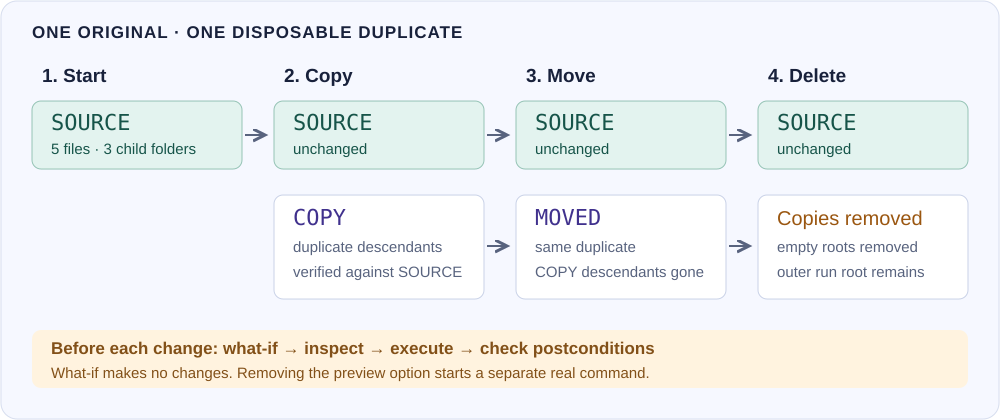

*Diagram 2. Copy duplicates descendants into COPY. Move transfers those descendants into MOVED. Delete removes the demonstration descendants and then their empty roots. SOURCE remains throughout.*

### Step A: preview the copy

```text
CP @lab:/source @lab:/copy -r -w
```

`-r` selects descendants. `-w` plans only. The recorded display reports eight selected entries: five files plus three directories. The historical capture’s `DONE W0 D0 M0` line says no writes, deletes, or metadata actions were completed. The current build additionally lists all eight selected relative paths and ends with `whatif: no files changed`; the new companion video shows the complete pages. Independent before/after snapshots also matched; the display alone was not the test's only evidence.

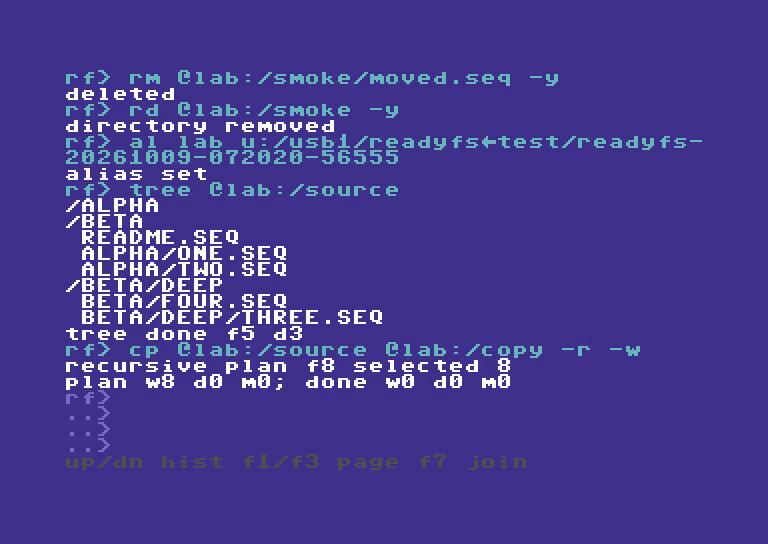

*Figure 9. A preview can enumerate and read. It does not create the COPY destination or write its files.*

### Step B: create the destination, then copy

```text
MD @lab:/copy
COPY @lab:/source @lab:/copy --recursive
TREE @lab:/copy
```

For this workflow, the destination is a **container you create first**. ReadyFS copies the source's descendants into that container, so the result is `copy/alpha/one.seq`, not `copy/source/alpha/one.seq`. A single-file COPY is different: its destination argument names the destination file; do not assume desktop-style implicit directory handling.

By default, COPY stages a file, rereads that staged destination to check its signature, then commits the replacement. The current display names the full source path before transfer and prints the filename with its byte count afterward, for example `copied one.seq: 10 bytes`. Verification status is explicit: `verify: identical` or `verify: skipped`. A recursive transfer concludes with `BATCH DONE 8/8 FAIL 0`. That eight is the batch's action count here, not “eight files.”

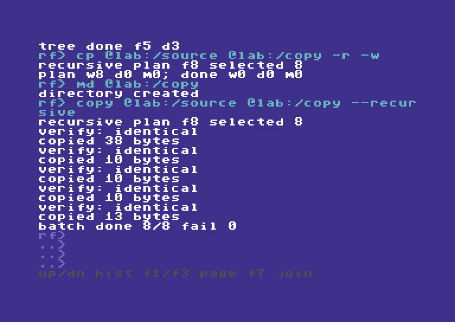

*Figure 10. Five verified file transfers plus directory actions complete the eight-entry copy plan. Independent hashes and directory-shape checks matched the source.*

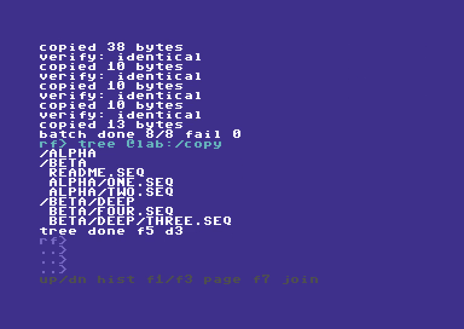

*Figure 11. The copied tree has five files and three child directories. SOURCE is still present and unchanged.*

### Step C: preview and execute the move

```text
MKDIR @lab:/moved
MOVE @lab:/copy @lab:/moved --recursive --whatif
MV @lab:/copy @lab:/moved -r
TREE @lab:/moved
```

MOVE normally means copy and verify, then remove the source entries. With `--no-verify` / `-nv`, it copies and commits successfully before removing each source, but skips the destination integrity readback. It can take longer than COPY. It is not a claim of an atomic filesystem rename, and a failure can leave partial progress that should be inspected.

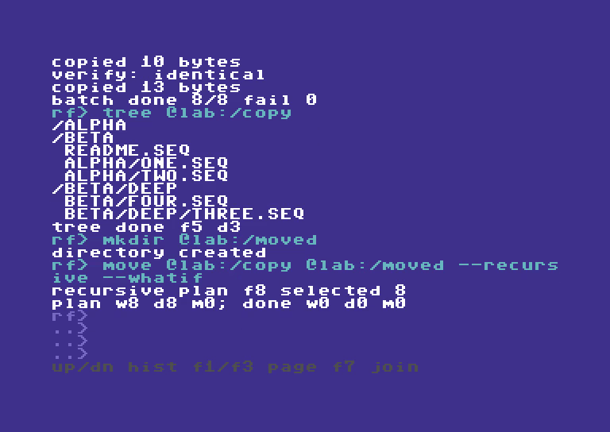

*Figure 12. The preview shows both sides of the move. The independent snapshot stayed unchanged.*


*Figure 13. The move's 11 actions include source-directory cleanup. The completed action total can differ from the eight selected entries. Checks confirmed the MOVED subtree matched SOURCE and COPY had no remaining descendants.*

### Optional readback: choose when to check

Verification remains enabled for every ordinary COPY/MOVE unless that command includes `--no-verify` or `-nv`. The setting is per command, including all files in a recursive batch; it is not a sticky session preference. Remove the switch for the next verified transfer.

```text
COPY @lab:/source/readme.seq @lab:/checked.seq
CP @lab:/source/readme.seq @lab:/fast.seq --no-verify
COMPARE @lab:/source/readme.seq @lab:/fast.seq
COPY @lab:/source @lab:/copy -r -nv
MV @lab:/copy @lab:/moved -r --no-verify
```


*Current capture B · 12 October. The disk-to-host copy above was verified by default. The next host-to-disk copy explicitly skips readback; the following recorded COMPARE checks it independently.*

These are alternatives to use with fresh, inspected disposable destinations, not an extra sequence to repeat over the worked example. `COMPARE` (aliases `CM` and `VERIFY`) explicitly reads both files later. For a MOVE, the moved source is gone, so compare against a separate preserved original when available, such as `COMPARE @lab:/source/alpha/one.seq @lab:/moved/alpha/one.seq`.

Skipping readback saves an extra destination read. It retains source opening, checked writes, staging, replacement/rollback handling and normal move-source cleanup, but **cannot detect a silently corrupted completed write before committing or removing the moved source**. Source-byte accounting/signature accumulation remains in the transfer loop. Tape destinations already cannot provide immediate readback and report that limitation; the switch does not make tape verifiable. WRITE, APPEND, RENAME and explicit COMPARE keep their own checking behavior.

The COPY root itself remains empty. The workflow removes that root explicitly later. The original SOURCE was never the move input.

### Step D: preview deletion, then remove only the demonstration copies

```text
H RM
DELETE @lab:/moved --recursive --whatif
RM @lab:/moved -r -y
RD @lab:/moved -y
RMDIR @lab:/copy --yes
```

The first DELETE plans the descendants. The real recursive DELETE removes files and child directories, then leaves the selected root. `RMDIR` removes an empty root; it is not a second spelling of recursive DELETE. `-y` provides explicit confirmation for these deliberate, disposable targets.


*Figure 14. The selected target is MOVED. SOURCE and the outer run root are not deletion targets.*


*Figure 15. The real delete reports completion, then RD/RMDIR remove the empty MOVED and COPY roots. Nothing outside this run's designated copies was a cleanup target.*

### Step E: check the survivors

```text
CD @lab:/source
DIR
TREE .
HEAD readme.seq 2
```

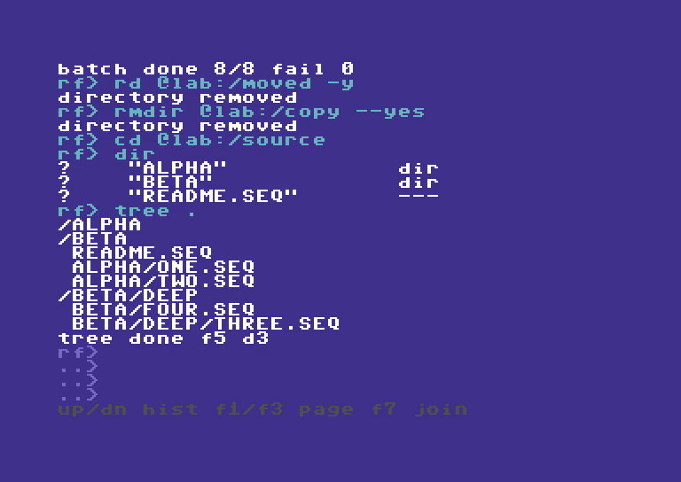

*Figure 16. The final source tree is intact. Independent snapshots checked names, directory shape, file sizes, and SHA-256 for all five files; the ownership marker was checked separately.*

### Understand the reports

| Report | Read it as |
| --- | --- |
| `RECURSIVE PLAN F8 SELECTED 8` | Eight serialized entries, including directories. Do not read the letter F here as a five-versus-eight file census. |
| `PLAN W8 D0 M0; DONE W0 D0 M0` | Planned writes/deletes/metadata actions; completed counts remain zero in what-if. |
| `VERIFY: IDENTICAL` | The staged file passed the transfer verification step. |
| `COPIED README.SEQ: 38 BYTES` | The transferred source filename and byte count, not disk blocks. Historical captures show the shorter byte-only form. |
| `VERIFY: SKIPPED` | This COPY/MOVE explicitly omitted destination readback. It is not an integrity check. |
| `WOULD COPY ALPHA/ONE.SEQ` | A selected relative file under the printed roots; a preview only. |
| `BATCH DONE 11/11 FAIL 0` | Completed/attempted execution actions and failures. Actions can include folder cleanup. |
| `TREE DONE F5 D3` | The walk saw five files and three directories. |

If a move reports `COPY OK; DELETE FAIL`, treat it as partial progress: inspect both paths before retrying. Do not assume the source was removed. If a batch fails, preserve evidence and inspect what completed; a script or `--continue` setting is not a transaction-wide undo facility.

## 8. Create text, compare files, and save a session

These are **syntax recipes**, not additional screenshot-backed execution claims. Keep write examples inside your own disposable LAB root.

### NEW, WRITE, and APPEND do different jobs

```text
NEW @lab:/empty.seq --type seq
WRITE "@lab:/notes with spaces.seq" "First line" --line --whatif
WRITE "@lab:/notes with spaces.seq" "First line" --line
APPEND "@lab:/notes with spaces.seq" "Second line" -l
HEAD "@lab:/notes with spaces.seq" 2
```

NEW creates an empty file and refuses an existing destination. WRITE writes the supplied text; replacing a file can prompt. APPEND adds to an existing file and follows the supported append/staging path. Use `--type seq`, `--type prg`, or `--type usr` where creation types are supported; the implementation reads the **option**. Marking text as PRG does not make it executable program code.

`--line` adds one carriage return after the text. Without it, repeated text operations can concatenate on one line. Text arguments are not a mechanism for pasting arbitrary binary data. `-f` / `--force` bypasses supported replacement prompts; it does not verify that you chose the right file.

### Single-file copy, move, rename, and compare

```text
CP @lab:/source/readme.seq @lab:/readme-copy.seq -w
CP @lab:/source/readme.seq @lab:/readme-copy.seq
COMPARE @lab:/source/readme.seq @lab:/readme-copy.seq
MV @lab:/readme-copy.seq @lab:/readme-moved.seq
RENAME @lab:/readme-moved.seq @lab:/readme-final.seq
```

COPY keeps the source. MOVE removes its source after the supported copy commits; verification is included unless explicitly skipped. RENAME is a supported same-endpoint rename; it is not a substitute for moving across devices. Ordinary Ultimate host rename currently requires the same parent folder. IEC rename rules depend on the driver. COMPARE / VERIFY checks two file contents; CRC32 provides a checksum you can record separately. Staged transfer verification uses its own bounded signature policy; do not confuse it with the CRC32 command or the external SHA-256 checks used for the filmed demo.

### Save aliases and profiles

```text
CONFIG SAVE @lab:/readyfs.cfg
CONFIG LOAD @lab:/readyfs.cfg
ALIAS
```

Configuration saves/restores the current directory, aliases and variables marked `/P`; it does not save command/output history or the contents of your files. With no explicit path, CONFIG uses `8:/readyfs.cfg`. Saving is a filesystem write and replacement can require confirmation. Loading restores configuration state; it is not a no-change query.

### RUN scripts: parameters, previews and reliable execution

`RUN script-path [arg1 ... arg9]` (short form `RU`) executes a text script of ReadyFS commands in the **overlay application with working REU and sidecars**. It reads and stages the whole file, closes its input stream, then dispatches commands one at a time. This is ReadyFS command scripting; it does not load and start a C64 PRG or BASIC program.

#### What parameters belong where?

| Where | Example | Meaning |
|---|---|---|
| RUN invocation | `RUN @lab:/INSPECT.SEQ` | Script path, optionally followed by up to nine arguments. |
| Short invocation | `RU 8:/INSPECT` | Same command; use the actual disk directory name. IEC names do not automatically gain `.SEQ`. |
| Quoted script path | `RUN "@lab:/INSPECT NOTES.SEQ"` | One path containing spaces. |
| Inside the script | `COPY @src:/README.SEQ @dst:/README.SEQ --whatif` | COPY receives its source, destination and options. |
| Session setup | `ALIAS SRC u:/usb1/READYFS_TEST/YOUR_FRESH_RUN/source` | An alias supplies a reusable location to script commands. |

#### DOS-style variables and flow control

The current overlay build supports session variables, saved variables, script arguments, branches, counted loops and label subroutines. Type `HELP BATCH` or `HELP SET` on the C64 for the compact reference.

| Command or expansion | Behavior |
|---|---|
| `SET NAME=value` | Set a session variable. A plain SET changes an existing saved variable to session-only. |
| `SET /P NAME=value` | Mark this variable for the next `CONFIG SAVE`. `/P` means persistent in ReadyFS. |
| `SET NAME=` | Delete a variable, including its persistent flag. |
| `SET` / `SET NAME` | List variables with `/P` markers, or show one value. |
| `%NAME%` / `%ERRORLEVEL%` | Expand a variable or the preceding command result. Undefined variables expand to empty text. Names are case-insensitive. ERRORLEVEL is read-only. |
| `%0`, `%1` … `%9` | Script path and up to nine RUN arguments. Missing arguments expand to empty text. |
| `%%` | Insert a literal percent sign. |
| `SET /A N=N+1` | Evaluate an unsigned 16-bit integer, or one addition/subtraction. Operands are decimal literals or variable names; undefined operands are zero. Results wrap at 65536. Use `SET /P /A` to retain the persistent flag. |
| `ECHO text` / `REM comment` | Print text or ignore the whole line. Whole-line `#` comments also work. |
| `:LABEL` / `GOTO LABEL` | Declare a label or jump to it. Labels are case-insensitive, up to 16 bytes; the first matching label wins. |
| `CALL :LABEL` | Run a label subroutine in the same staged script, sharing variables and arguments. Maximum nesting: eight. |
| `EXIT /B [code]` / `GOTO :EOF` | Return from a subroutine, or finish the top-level script. EXIT /B can set a result from 0 to 255. Reaching the physical end of a subroutine also returns. |
| `IF [NOT] ERRORLEVEL n command` | Run the command when the preceding result is **greater than or equal to** n, optionally negated. |
| `IF [NOT] DEFINED name command` | Test whether a variable exists. |
| `IF [NOT] EXIST path command` | Test the filesystem through ReadyFS's normal path and backend handling. A lookup failure stops the script with result 8. |
| `IF [NOT] "a"=="b" command` | Compare exact, case-sensitive strings. A spaced `a == b` comparison also works. |
| `IF [NOT] n EQU\|NEQ\|LSS\|LEQ\|GTR\|GEQ n command` | Compare unsigned integers from 0 to 65535. Expand variables explicitly, for example `IF %N% LSS 3 GOTO LOOP`. |

For example, save this with real line breaks and run `RUN 8:/COUNT WORLD`:

```text
REM ARGUMENTS AND A COUNTED LOOP
SET WHO=%1
SET /A N=0
:LOOP
SET /A N=N+1
ECHO HELLO "%WHO%" %N%
IF %N% LSS 3 GOTO LOOP
CALL :FINISH
EXIT /B 0
:FINISH
ECHO DONE
EXIT /B
```

Expansion happens once before tokenization on each executed line. Quote an expanded value when it must remain one argument: `COPY "%SOURCE%" "%TARGET%"`. Values are not expanded recursively. To write literal variable references into a script from the interactive prompt, double their percent signs, for example `WRITE 8:/SHOW "ECHO %%NAME%%" --line`. RUN arguments such as `--yes` are ordinary `%1`/`%2` values; they do not become global confirmation or preview options. Put those options on the intended operation inside the script.

There are 16 variable slots, with names up to 16 bytes and values up to 127 bytes. Names use letters, underscores and digits after the first character. Variables can be used interactively and inside scripts. `CONFIG SAVE` writes only variables marked `/P`, alongside the current directory and aliases, in the new RFC2 format. `CONFIG LOAD` validates the complete file before applying it, replaces the saved-variable set, and preserves unrelated session variables. A loaded saved variable takes precedence over a session variable with the same name. If the merged table would exceed 16 slots, loading fails without changing the session. Legacy RFC1 configs still load their directory and aliases and leave variables alone. Loading config is explicit after startup.

RUN remains bounded to a 16 KiB staged script and 255 bytes per expanded line, with at most 12 tokens. Tabs and spaces separate arguments; balanced double quotes can occur within an argument. Excess tokens, unmatched quotes and invalid expansion produce result 4 before command dispatch. Scripts stop after 10,000 executed lines to bound accidental loops; RUN/STOP cancels execution between interpreted lines with result 3. Filesystem operations retain their existing cancellation behavior. ONERROR STOP remains the default; use ONERROR CONTINUE before a command whose failure you intend to inspect with IF ERRORLEVEL. Comments, labels and false IF branches preserve the preceding result; SET and ECHO produce their own result.

This is a bounded DOS-style language. Loops use labels, arithmetic and conditional GOTO; CALL targets labels in the same file. Nested RUN, external-script CALL, FOR, SETLOCAL, pipes and redirection are not implemented. Scripts share aliases and the current directory, and relative paths resolve against that directory rather than the directory containing the script.


#### Parameters: arguments, environment and local subroutines

`RUN` supplies a new set of up to nine positional arguments for that top-level run. `%0` is the script path; `%1` through `%9` are its inputs. Missing arguments become empty text. Use quotes to keep a path or value containing spaces together:

```text
SET SOURCE=@lab:/source/readme.seq
SET TARGET=@lab:/saved notes.seq
RUN @lab:/BACKUP.SEQ "%SOURCE%" "%TARGET%" PREVIEW
```

Inside BACKUP.SEQ, `%1` is the source, `%2` the destination, and `%3` the mode. The outer quotes group an argument and are not part of its value; quote it again when expanding it into a command. `$1`, `%*`, SHIFT and `%~1` modifiers are not implemented. RUN options are not special: `RUN file.seq --yes` passes the ordinary string `--yes` as `%1`; confirmation must be on the intended filesystem command.

Named variables are session-wide. A script can read variables set at the prompt, and its changes remain after it returns. Aliases and the current directory also remain shared. There are no local scopes or automatic save/restore of working variables.

`CALL :LABEL` runs a subroutine in the **same file**. It accepts only the label: `CALL :COPYONE source destination` is not implemented. The routine sees the original RUN arguments and the shared named environment. Pass different inputs by setting named variables before each call:

```text
SET WHO=ALPHA
CALL :GREET
SET WHO=BETA
CALL :GREET
EXIT /B 0
:GREET
ECHO HELLO %WHO%
GOTO :EOF
```

The two calls print ALPHA and BETA. `GOTO :EOF` returns to the caller; `EXIT /B code` also supplies a result. At top level both end the script. Calls can nest eight levels deep, but each level still shares named variables and the original RUN arguments. Keep the top-level `EXIT /B` before routine definitions to prevent execution from falling through into a routine.

**Separate script files cannot call each other yet.** Nested RUN and external-script CALL are unavailable. Two scripts run sequentially from the interactive prompt can exchange named variables. This differs from DOS 6.2, where `CALL OTHER.BAT %1 %2` calls a separate file with its own positional arguments and returns when that file ends.

#### Worked example: preview and verify a single-file backup

This is the one downloadable example used in the appended physical C64 Ultimate video chapter. It takes source, destination and PREVIEW/APPLY arguments, refuses an existing destination on APPLY, calls a local copy/compare routine, and increments a session counter only after success. It deliberately does not replace an existing file. Create the destination's parent folder first.

[Download BACKUP.SEQ](examples/BACKUP.SEQ). The download contains uppercase ASCII command and option bytes and real CR line endings, matching the physical recording fixture. Host-created script options must also use uppercase bytes (for example --WHATIF); do not rely on lowercase ASCII option spelling being normalized like interactive keyboard input.

```text
REM BACKUP SOURCE DEST PREVIEW OR APPLY
ONERROR STOP
SET "SRC=%1"
SET "DST=%2"
IF "%SRC%"=="" GOTO USAGE
IF "%DST%"=="" GOTO USAGE
IF NOT EXIST "%SRC%" GOTO MISSING
IF "%3"=="PREVIEW" GOTO PREVIEW
IF NOT "%3"=="APPLY" GOTO USAGE
IF EXIST "%DST%" GOTO EXISTS
CALL :COPYONE
IF NOT DEFINED BACKUPS SET BACKUPS=0
SET /A BACKUPS=BACKUPS+1
ECHO BACKUPS THIS SESSION: %BACKUPS%
EXIT /B 0
:COPYONE
COPY "%SRC%" "%DST%"
COMPARE "%SRC%" "%DST%"
ECHO BACKUP VERIFIED
EXIT /B 0
:PREVIEW
COPY "%SRC%" "%DST%" --WHATIF
EXIT /B
:EXISTS
ECHO DEST EXISTS - CHOOSE NEW NAME
EXIT /B 6
:MISSING
ECHO SOURCE NOT FOUND: "%SRC%"
EXIT /B 5
:USAGE
ECHO RUN BACKUP SOURCE DEST PREVIEW
ECHO RUN BACKUP SOURCE DEST APPLY
EXIT /B 4
```

With LAB pointing at your own fresh test folder containing `source/readme.seq` and the downloaded script:

```text
SET BACKUPS=0
TYPE @lab:/BACKUP.SEQ
RUN @lab:/BACKUP.SEQ @lab:/source/readme.seq @lab:/saved.seq PREVIEW
RUN @lab:/BACKUP.SEQ @lab:/source/readme.seq @lab:/saved.seq APPLY
TYPE @lab:/saved.seq
ECHO COMPLETED BACKUPS: %BACKUPS%
```

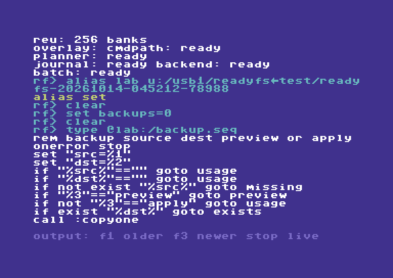

*Physical C64 Ultimate: TYPE reads the real file; F1 reveals the earlier lines after streaming.*


*The actual APPLY run reports both verification checks, the shared counter and RUN result 0.*

TYPE streams the file onto the display. Use F1 to enter output history and move to earlier lines, F3 for newer lines, and RUN/STOP to return to live input. The video reads both halves this way.

The preview writes nothing and does not increment BACKUPS. APPLY copies and compares, then reports `BACKUPS THIS SESSION: 1` and result 0. Running APPLY again with the same destination prints `DEST EXISTS - CHOOSE NEW NAME`, returns 6 and leaves the count at 1. Missing source returns 5; absent arguments or a mode other than uppercase PREVIEW/APPLY return 4. An empty destination is checked before any write. The script uses three named variable slots: SRC, DST and BACKUPS.

STOP is deliberate: a failed copy or comparison terminates the whole run, including from inside CALL. Read the filesystem reports as well as the final RC; legacy result mapping is not complete and COPY/COMPARE are not a transaction. The preview is not a queued operation or proof of later write capability. BACKUPS counts successful script runs, not every copy ever made, and its arithmetic wraps after 65535. Avoid reusing these working variable names for unrelated session values.

#### More examples: conditions, loops, results and persistence

These short examples supplement the recorded backup script. They are reference recipes, not claims that every branch is demonstrated in the video.

**Comments, missing parameters and literal percent signs**

```text
REM FULL-LINE DOS-STYLE COMMENT
## ANOTHER FULL-LINE COMMENT
ECHO SCRIPT: %0
IF "%1"=="" GOTO USAGE
ECHO FIRST ARGUMENT: "%1"
ECHO LITERAL PERCENT: 100%%
EXIT /B 0
:USAGE
ECHO PLEASE SUPPLY ONE ARGUMENT
EXIT /B 4
```

**String, defined-variable and existence conditions**

```text
IF NOT DEFINED MODE SET MODE=PREVIEW
IF "%MODE%"=="PREVIEW" ECHO PREVIEW SELECTED
IF NOT "%MODE%"=="APPLY" ECHO WRITES DISABLED
IF EXIST "@lab:/source/readme.seq" ECHO SOURCE PRESENT
IF NOT EXIST "@lab:/missing.seq" ECHO NO SUCH FILE
IF DEFINED MODE IF NOT "%MODE%"=="APPLY" ECHO NO WRITE MODE
```

The last line combines two tests by nesting IF. OR-style decisions need separate branches. Each IF executes a single command, which can itself be IF, GOTO, CALL or EXIT. There are no ELSE blocks. String comparisons are case-sensitive. IF EXIST performs a normal path lookup; an I/O lookup error stops the run with 8 rather than being treated as an absent file.

**A counted loop and every numeric comparison**

```text
SET /A N=0
:LOOP
SET /A N=N+1
ECHO PASS %N%
IF %N% LSS 3 GOTO LOOP
IF %N% EQU 3 ECHO EQUAL TO THREE
IF %N% NEQ 0 ECHO NOT ZERO
IF %N% LEQ 3 ECHO AT MOST THREE
IF %N% GTR 2 ECHO GREATER THAN TWO
IF %N% GEQ 3 ECHO AT LEAST THREE
IF NOT %N% EQU 4 ECHO NOT FOUR
SET /A N=N-1
ECHO AFTER SUBTRACTION: %N%
EXIT /B 0
```

Numeric IF operands must be unsigned decimal values from 0 to 65535; expand variables explicitly. Arithmetic can assign a literal or variable, or perform one addition/subtraction; an undefined arithmetic variable is zero. There is no multiplication, division, signed arithmetic or expression precedence. An invalid numeric value causes result 4, not a false test. For example, `IF %MAXTRIES% LSS 1` cannot validate that MAXTRIES is numeric before checking its range. Every revisited line counts toward the 10,000-line execution limit.

**Inspect and preserve a failure result**

```text
ONERROR CONTINUE
NOTACOMMAND
EXPECT RC 1
SET LAST=%ERRORLEVEL%
ECHO SAVED RESULT: %LAST%
IF %LAST% EQU 1 ECHO EXPECTED UNKNOWN COMMAND
IF %LAST% NEQ 1 EXIT /B 9
ONERROR STOP
EXIT /B 0
```

NOTACOMMAND deliberately returns 1. Successful EXPECT leaves that result available for capture. SET captures the preceding result before replacing it with SET's own result; subsequent ECHO cannot change LAST. `IF ERRORLEVEL 1` means result >= 1, not equality; `IF NOT ERRORLEVEL 1` means result 0. Test it immediately after the operation, or capture `%ERRORLEVEL%` before another command changes it. STOP is the default and must be changed **before** an expected failure. EXPECT accepts only one-digit codes 0–9; EXIT /B can return 0–255.

**Save only selected variables, then load them explicitly**

```text
SET PRIVATE=THIS SESSION
SET /P SAVED=KEEP ME
SET /P /A TOTAL=TOTAL+1
CONFIG SAVE @lab:/batch-config.seq
SET SAVED=CHANGED
CONFIG LOAD @lab:/batch-config.seq
ECHO RESTORED: %SAVED%
ECHO SESSION: %PRIVATE%
SET SAVED
SET
SET PRIVATE=
```

Use a new config filename for the save. SAVED and TOTAL are marked persistent; PRIVATE is not. Loading restores saved values and preserves unrelated session variables. Plain `SET SAVED=CHANGED` clears its persistent flag until LOAD restores the saved record. `SET PRIVATE=` deletes that variable. CONFIG does not load automatically after launch. The table has only 16 slots, so a load whose merged variables would overflow it fails without changing the environment.

#### Compared with MS-DOS 6.2 / 6.22

The target here is classic COMMAND.COM batch, not Windows cmd.exe. Both languages offer `%1`–`%9`, `%NAME%`, SET, REM, ECHO, labels/GOTO, NOT, IF EXIST, case-sensitive string equality and threshold IF ERRORLEVEL.

| Classic DOS facility | ReadyFS boundary |
|---|---|
| `CALL OTHER.BAT arguments` | No external-file calls. ReadyFS instead adds same-file `CALL :LABEL` with shared inputs. |
| `SHIFT` | No parameter shifting and no access to arguments beyond nine. |
| `FOR %%F IN (*.SEQ) DO command` | No iteration over filename selections or literal lists. Counter loops use IF/GOTO. |
| CHOICE / PAUSE | No batch menu/keypress command or pause command. |
| Pipes and input/output redirection | No `|`, `<`, `>` or `>>`; filesystem WRITE/APPEND are explicit operations. |
| `@ECHO OFF`, `@command`, `ECHO.` | No DOS command-echo control syntax; ECHO prints text (bare ECHO prints a blank line). |

ELSE/parenthesized command blocks, IF /I, SETLOCAL, `%*`, `%~` modifiers, delayed expansion, FOR /F and SET /A were **not standard DOS 6.2 batch features**. Their absence is not a gap against this target. ReadyFS already adds numeric IF comparisons, IF DEFINED, simple SET /A arithmetic, local label calls, EXIT /B result codes and explicitly saved variables.

For historical syntax, see Microsoft's archived [DOS CALL](https://www.infania.net/misc/dos622help/call.html), [SHIFT](https://www.infania.net/misc/dos622help/shift.html), [FOR](https://www.infania.net/misc/dos622help/for.html), [IF](https://www.infania.net/misc/dos622help/if.html) and [SET](https://www.infania.net/misc/dos622help/set.html) help.

The five original recipes below remain reference examples. The parameterized backup example above is the one demonstrated in the appended batch video chapter; the other recipes are not additional recorded steps. Set `@lab`, `@src` and `@dst` to your own intended locations before use. Mutation examples belong in a fresh disposable test folder.

#### Example 1 — a small read-only script

Save this as `INSPECT.SEQ`, with real line breaks:

```text
## READ-ONLY INSPECTION
ONERROR STOP
PWD
EXPECT RC 0
MATCH "*" "ABC"
EXPECT RC 0
HEAD @src:/README.SEQ 2
EXPECT RC 0
```

Set its source location and run it:

```text
ALIAS LAB u:/usb1/READYFS_TEST/YOUR_FRESH_RUN
ALIAS SRC @lab:/source
RUN @lab:/INSPECT.SEQ
```

`HEAD` receives two parameters: a filename and the number of lines to display. `MATCH` receives a pattern and a candidate string. Successful assertions print `EXPECT RC OK`. A complete successful run ends with a `RUN DONE ... RC 0` summary. The line/command totals depend on comments, directives and line endings; ordinary commands count separately from `ONERROR` and `EXPECT`.

You can create a tiny script directly in ReadyFS, using a new filename:

```text
WRITE @lab:/CHECK.SEQ "ONERROR STOP" --LINE
APPEND @lab:/CHECK.SEQ "PWD" --LINE
APPEND @lab:/CHECK.SEQ "EXPECT RC 0" --LINE
HEAD @lab:/CHECK.SEQ 10
RUN @lab:/CHECK.SEQ
```

Each `--line` writes a real carriage return. Typing `\n` in a quoted string does not create a new script line. Existing-file replacement may prompt; use a fresh name unless replacement is intentional.

#### Example 2 — reuse one script with different locations

Save this as `PREVIEW.SEQ`:

```text
ONERROR STOP
COPY @src:/README.SEQ @dst:/README.SEQ --WHATIF
EXPECT RC 0
COPY @src:/ALPHA/ONE.SEQ @dst:/ONE.SEQ --WHATIF
EXPECT RC 0
```

First location pair:

```text
ALIAS SRC @lab:/source
ALIAS DST @lab:/first-copy
RUN @lab:/PREVIEW.SEQ
```

Second location pair, same script:

```text
AL DST @lab:/second-copy
RU @lab:/PREVIEW.SEQ
```

The script resolves the aliases when each command runs. These previews do not create destination folders or prove that source files exist, that media is writable, or that the backend supports the eventual copy. Inspect the paths separately before executing real writes. For a single-file COPY, the destination names a **file**; a recursive COPY uses an existing destination **container**.

#### Example 3 — preview a tree, then execute a separate copy script

First create `PLAN.SEQ`:

```text
ONERROR STOP
COPY @src:/ @dst:/ --RECURSIVE --WHATIF
EXPECT RC 0
```

Set `@src` to the source directory and `@dst` to an intended new container, then run `RUN @lab:/PLAN.SEQ`. Read the named selection. A preview performs no mutation and is not a queued job.

For the real operation, prepare `COPYTREE.SEQ` separately:

```text
ONERROR STOP
MKDIR @dst:/
EXPECT RC 0
COPY @src:/ @dst:/ --RECURSIVE
EXPECT RC 0
TREE @dst:/
EXPECT RC 0
```

Then execute it with `RUN @lab:/COPYTREE.SEQ`. The destination must be new for this recipe; MKDIR failing on an existing folder is a reason to stop and inspect it. Copy includes verification by default. `ONERROR STOP` stops after a nonzero command result; it does not roll back an earlier successful MKDIR or partially completed copy. Check the COPY reports, batch failure count and resulting tree as well as the script RC.

For a deliberately chosen copy without destination readback, change the COPY line to:

```text
CP @src:/ @dst:/ -r -nv
```

`--no-verify` / `-nv` is a COPY/MOVE option, not a RUN option. You can later run `COMPARE @src:/README.SEQ @dst:/README.SEQ` for a specific file. One comparison does not verify an entire tree.

#### Example 4 — supply explicit confirmation inside the script

RUN cannot answer interactive confirmation prompts. An operation that would ask returns `BATCH NEEDS --YES` and script result 3 instead.

| Intended script operation | Parameters on that script line |
|---|---|
| Preview deletion | `DELETE @lab:/scratch --recursive --whatif` |
| Delete only approved disposable descendants | `DELETE @lab:/scratch --recursive --yes` |
| Remove the resulting empty root | `RMDIR @lab:/scratch --yes` |
| Intentionally replace one destination file | `COPY @src:/README.SEQ @dst:/README.SEQ --force` |
| Ordinary fresh copy | `COPY @src:/README.SEQ @dst:/README.SEQ` — no replacement approval is needed if it is genuinely new. |

Inspect each target before adding confirmation. `--force` authorizes supported replacement; it does not add a missing backend capability. Current confirmation lookup also accepts `--yes` where force is checked, so it can authorize replacement too. Use the option that expresses your intention rather than adding both to every line. Native-pattern mutations additionally require `--apply` on that command; formatting has separate disposable-media requirements. There is no universal “make this script succeed” switch.

#### Example 5 — expect an error deliberately, then continue

```text
ONERROR CONTINUE
BOGUS
EXPECT RC 1
ONERROR STOP
PWD
EXPECT RC 0
```

This intentionally dispatches an unknown command, checks its code, then restores normal stopping. `ONERROR CONTINUE` must appear **before** a command whose nonzero result you want to examine; with STOP, execution ends before the following EXPECT can run.

A mismatched EXPECT sets result 3. Under CONTINUE, the next ordinary command may overwrite that result, so a final `RC 0` does **not** prove every earlier command/assertion passed. Read all mismatch/error lines. An EXPECT that successfully checks a nonzero code does not reset that code to zero. RUN's printed RC is its latest stored result, not an accumulated error count. That final result is also available to STATUS and `%ERRORLEVEL%` after RUN.

#### Result codes and current limits

| RC | Meaning | RC | Meaning |
|---:|---|---:|---|
| 0 | OK | 6 | Destination conflict |
| 1 | Unknown command | 7 | Unsupported operation |
| 2 | Unavailable feature | 8 | I/O failure |
| 3 | Interaction denied / script assertion error | 9 | Verification failure |
| 4 | Usage error | 10 | Partial operation |
| 5 | Not found | 11 | Internal failure |

`EXPECT RC N` currently accepts **one digit, 0–9 only**, even though result codes 10 and 11 exist. It checks the most recent command result, including SET/ECHO, and needs a preceding result; blank lines, comments and policy directives do not supply a new command result. Typed-result conversion is still incomplete across legacy handlers, so code 0 alone is not proof of all filesystem postconditions.

Use plain C64/PETSCII-compatible text, uppercase command fixtures and real CR or LF line breaks. Avoid smart quotes, a UTF-8 BOM and host lowercase ASCII command files. CRLF is readable but its two terminators can increase reported line totals. The line total counts executed lines, including revisits in loops; the command total counts commands dispatched to the filesystem shell rather than interpreter builtins.

#### If the script did not do what you expected

| Symptom | Check or action |
|---|---|
| `RUN FILE [ARGS]` usage text | Supply a script path and at most nine arguments; quote paths/arguments with spaces. Put operation options inside the script. |
| File not found | Use the actual directory entry: `DIR 8:/` then `RUN 8:/INSPECT` if the IEC name is INSPECT. Check aliases and the current directory. |
| `RUN NEEDS OVERLAY`, `BATCH OFF`, or REU trouble | Use the overlay application with its matching sidecars and working REU. |
| `SCRIPT TOO LARGE` or `LINE TOO LONG` | Split into separate top-level runs or shorten lines. RUN cannot call another RUN. |
| Several commands appear on one line | Create real CR/LF separators; WRITE/APPEND `--line` adds CR. |
| Unknown command from a host-created file | Check C64-compatible text encoding, uppercase command bytes, BOM, smart quotes and tabs. |
| `BATCH NEEDS --YES` / RC 3 | Identify the specific operation that needs approval; put its explicit confirmation on that line. |
| Only a plan appears | Remove `--whatif` / `--dry-run` / `-w` from the intended operation in a separately reviewed execution script. |
| `EXPECT RC MISMATCH` | Read the preceding command's output and use the expected typed code; do not hide it with CONTINUE. |
| `BATCH FLOW ERROR` / RC 4 | Check label spelling, CALL depth, IF syntax and EXIT /B result range. |
| `BATCH STEP LIMIT` / RC 3 | Inspect loop termination; execution exceeded 10,000 lines. |
| Script stops early | STOP is the default. Inspect its first failure, complete arguments, device capability and destination state. |
| Final RC 0 but earlier errors | CONTINUE may have allowed a later success to replace an earlier error; inspect the entire output and filesystem results. |


## 9. Devices, images, and advanced operations

### Learn what the endpoint can do

```text
DRIVES
PROBE UCI
PROBE UDOS
PROBE SOFTIEC
PROBE IEC 8:
PROFILE IEC 8:
CAPABILITIES u:/usb1
```

DRIVES discovers responding IEC units and reports Ultimate/SoftwareIEC/tape endpoints. PROBE checks an interface or detects a specific IEC driver's identity. PROFILE queries the saved detected profile, optionally for an operation such as `PROFILE IEC 11: MOUNT`. CAPABILITIES prints the endpoint model, size units, path/leaf limits, and whether support is provisional. A broad `images` capability does not remove the current direct `!/` access limitation.

### Native translation and native patterns

NATIVE is a **translation diagnostic**. For example:

```text
NATIVE OPEN 11.3:/games/HELLO.PRG
NATIVE RENAME 11.3:/games/OLD.SEQ 11.3:/games/NEW.SEQ
```

It shows the backend command spelling; it does not perform the named write or rename. Its operation words are OPEN, DIR, SCRATCH, MKDIR, RMDIR, RENAME, MOUNT, and UNMOUNT. This is useful for understanding why a parsed path may need a particular driver.

`--native-pattern` is separate from normal shell filtering. It permits a supported IEC backend to enumerate a native pattern as a read-only directory query. It must never become a wildcard scratch/write command. The execution plan freezes the exact returned names.

```text
DIR 8:/RF* --native-pattern
COPY 8:/RF* 9:/ --native-pattern --whatif
```

The second example is a **preview syntax example**, not permission to modify any mounted media. A real native-pattern mutation needs explicit `--apply`, plus ordinary conflict/confirmation checks and disposable targets. Native multi-file IEC destinations must use the supported flat-root form. Unsupported directory or REL selections can reject the entire plan. Ordinary recursive host COPY does not require `--apply`; this extra gate is specific to native-pattern execution.

### Mounted IEC images and disk swap

```text
MOUNT u:/usb1/images/example.d81 8: --whatif
DISMOUNT 8: --whatif
SWAP 8: --whatif
```

These are preview examples for an Ultimate image mounted on an IEC drive. Executing MOUNT changes its media; DISMOUNT detaches that media. SoftwareIEC folder mappings have a separate section below. **SWAP currently takes only `DRIVE:` and advances the firmware disk-swap list**; it does not take an image path. Do not replace the lab disk on device 8 casually while using the application.

### SoftwareIEC folder mappings

These preview commands describe a host-folder mapping to SoftwareIEC logical partition 3, followed by removal of that mapping:

```text
MOUNT u:/usb1/READYFS_TEST/YOUR_FRESH_RUN s3: --name LAB --whatif
DISMOUNT s3: --whatif
```

Execution requires firmware support for map/unmap; the tested Ultimate firmware 3.14 lacks those commands. Existing mappings can still be used for the verified file transfers. SoftwareIEC is provisional and firmware-sensitive. Some firmware versions have incomplete directory enumeration, folder-operation restrictions, or limits when a parent contains many host entries. Prefer dedicated shallow test roots. See the [SoftwareIEC guide](READYFS_SOFTWAREIEC_GUIDE.md).

### Native SD2IEC configuration and image views

Use `PROBE IEC 10:` for a native SD2IEC and `IEC 10: PARTITIONS` to discover its partitions. `10.1:/` is the native device/partition path. Native image MOUNT changes that partition's media view; it is different from the SoftwareIEC host-folder mapping above. The [SD2IEC walkthrough](READYFS_SD2IEC_TUTORIAL.md) and [native configuration reference](READYFS_IEC_CONFIGURATION.md) cover these operations and their limits.

### Sequential tape

Tape uses `t:/NAME` with names up to sixteen bytes and sequential SEQ read/write behavior; do not expect directory browsing, deletion, rename, append, or move.

### Formatting is a separate, deliberate operation

FORMAT is exposed as `FORMAT path --label LABEL --id ID` with a supported backend. Real formatting additionally requires `--disposable` and `--apply`; `--whatif` is the preview path. It destroys media contents and belongs only in the dedicated disposable-media workflow. This guide does not execute formatting or ask you to format the lab disk. Check `HELP FORMAT` and the repo safety documentation before planning that separate task.

## 10. Complete command reference

Square brackets mean optional input in this reference; do not type the brackets. `PATH`, `SOURCE`, `DEST`, and uppercase placeholders describe values you supply. Shell commands below have exact registered names; short names have the same validation and behavior. The separate scripting table lists interpreter builtins. `PRG`, `SEQ`, and `USR` are type words, not additional executable shell commands.

### Orientation and session

| Command and aliases | Syntax / example | Use and detail |
| --- | --- | --- |
| **HELP** · H | `HELP [command]` · `H RM` | List families or show a command topic; aliases work as topics. |
| **EXIT** · Q, QUIT | `EXIT` | Leave ReadyFS for BASIC. |
| **PWD** · PW | `PWD` | Print the canonical current location. |
| **CD** | `CD [path]` · `CD ..` | Store a resolved current path; without an argument, print it. Verify access separately. |
| **HISTORY** · HI | `HISTORY` | List the session's recalled commands; Up/Down performs interactive recall. |
| **CLEAR** · CL, CLS | `CLEAR` | Clear the live screen while retaining output scrollback. |
| **STATUS** · SS | `STATUS` | Show the previous typed result and session information; read operation output too. |
| **ALIAS** · AL | `ALIAS [name path]` · `AL LAB u:/usb1/test` | List bookmarks or set an absolute root. Does not create the folder. |
| **UNALIAS** · UA | `UNALIAS LAB` | Remove one saved bookmark. Does not delete its folder. |
| **CONFIG** · CF | `CONFIG SAVE [path]` / `CONFIG LOAD [path]` | Save/restore directory, aliases and persistent variables; default path is `8:/readyfs.cfg`. |
| **RUN** · RU | `RUN @lab:/inspect.seq` | One script path plus up to nine arguments; `%NAME%`, SET, IF/GOTO and CALL provide bounded scripting. HELP BATCH lists syntax. No nested RUN or batch prompts. |
| **TEST** · TS | `TEST` | Run built-in core self-tests; not a destructive storage test suite. |

### Scripting builtins

The complete examples and expansion rules are in the RUN section. SET and ECHO also work at the interactive prompt; flow commands and ONERROR/EXPECT belong inside RUN scripts.

| Builtin | Syntax / example | Use and detail |
| --- | --- | --- |
| **SET** | `SET NAME=value` / `SET NAME=` / `SET [NAME]` | Set, delete, show one variable, or list variables. |
| **SET /P** | `SET /P NAME=value` | Include this value in CONFIG SAVE. Persistence, not keyboard input. |
| **SET /A** | `SET /A N=N+1` / `SET /P /A N=N+1` | Unsigned 16-bit assignment or one addition/subtraction. |
| **ECHO** | `ECHO HELLO %1 %NAME%` | Print expanded text; bare ECHO prints a blank line. |
| **REM / #** | `REM COMMENT` / `# COMMENT` | Whole-line comments, with no variable expansion. |
| **IF** | `IF [NOT] condition command` | ERRORLEVEL threshold, DEFINED, EXIST, string equality or unsigned numeric comparison. |
| **GOTO** | `GOTO LABEL` / `GOTO :EOF` | Jump to a label, or return/end the script. |
| **CALL** | `CALL :LABEL` | Same-file subroutine; shared variables and original RUN arguments; no CALL arguments. |
| **EXIT /B** | `EXIT /B [code]` | Return from a routine or finish the top-level script; code 0–255. Plain EXIT inside a script stops the script. |
| **ONERROR** | `ONERROR STOP` / `ONERROR CONTINUE` | Select failure policy; STOP is the default. |
| **EXPECT** | `EXPECT RC 0` | Assert the latest result; accepts only one digit, 0–9. |

### Inspect, search, and verify

| Command and aliases | Syntax / example | Use and detail |
| --- | --- | --- |
| **DIR** · D, LS | `DIR [path]` · `DIR 8:/` | One directory; default is current location. IEC sizes are blocks; host listing sizes can be `?`. |
| **TREE** · TR | `TREE path [-i pattern] [-x pattern]` | Traverse a supported tree and report files/directories. |
| **FIND** · FI | `FIND path [pattern]` · `FI @lab:/source -i "beta/**"` | Search with the tree walker and shell filters. |
| **STAT** · ST | `STAT @lab:/source/readme.seq` | Inspect file metadata/identities; Ultimate host exact-byte size when available. |
| **VOLUME** · VL, FREE | `VOLUME [path]` · `FREE 8:/` | Space or mapping information when supported; not all endpoints expose free bytes. |
| **MATCH** · MT | `MATCH pattern text` · `MT "**/*.seq" "a/b.seq"` | Test the pure matcher without filesystem writes. |
| **TYPE** · TY, CAT | `TYPE path` | Read printable text; nonprintable bytes appear as dots. |
| **HEAD** · HD | `HEAD path [lines]` · `HD readme.seq 2` | First lines, default ten; count 1–255. |
| **TAIL** · TL | `TAIL path [lines]` | Bounded trailing content; long tails can truncate. |
| **CRC32** · CR | `CRC32 path` | Read the file and calculate its CRC32. |
| **COMPARE** · CM, VERIFY | `COMPARE source dest` | Compare two file contents; does not synchronize them. |

### Change files and folders

| Command and aliases | Syntax / example | Use and detail |
| --- | --- | --- |
| **NEW** · NW | `NEW path [--type seq]` | Create an empty new file; existing destination is a conflict. |
| **WRITE** · WR | `WRITE path text [--line] [--type seq]` | Write supplied text; replacement can prompt. `--whatif` previews. |
| **APPEND** · AP | `APPEND path text [--line]` | Add text to an existing file on a supported endpoint. |
| **COPY** · CP | `COPY source dest [-r] [-w] [-nv]` | Keep source; single-file dest is a filename, recursive dest is the prepared container. |
| **MOVE** · MV | `MOVE source dest [-r] [-w] [-nv]` | Copy, normally verify, then source cleanup; `-nv` skips readback. Inspect partial failures. |
| **RENAME** · RN, REN | `RENAME source dest` | Supported same-endpoint rename; ordinary host path requires the same parent. |
| **DELETE** · DL, RM | `DELETE path [-r] [-y] [-w]` | Delete one file or selected tree descendants; recursive root remains. |
| **MKDIR** · MD | `MKDIR path` | Create one directory, not an implicit chain of missing parents. |
| **RMDIR** · RD | `RMDIR path [-y]` | Remove an empty directory. Use DELETE -r for descendants first. |

### Device and advanced commands

| Command and aliases | Syntax / example | Use and detail |
| --- | --- | --- |
| **DRIVES** · DV | `DRIVES` | Discover responding IEC devices and report other endpoints. |
| **PROBE** · PB | `PROBE [ALL\|UCI\|UDOS\|SOFTIEC\|RECOVER]` / `PROBE IEC 8:` | Inspect interface/driver state; RECOVER services the UCI recovery path. |
| **PROFILE** · PF | `PROFILE IEC 8: [operation]` | Query the saved detected driver/capability record. |
| **CAPABILITIES** · CA | `CAPABILITIES [path]` | Report endpoint model and limits; default is current location. |
| **NATIVE** · NT | `NATIVE operation path [dest]` | Display translated backend syntax; does not execute that native mutation. |
| **MOUNT** · MO | `MOUNT image drive:` / `MOUNT folder s3: --name NAME` | Mount media or add a SoftwareIEC mapping. Preview with `--whatif`. |
| **DISMOUNT** · UM, UNMOUNT | `DISMOUNT drive:` · `UM s3:` | Detach media / remove a mapping when supported. |
| **SWAP** · SW | `SWAP 8:` | Advance the existing firmware disk-swap list on that drive. |
| **FORMAT** · FM | `FORMAT path --label LABEL --id ID` | Supported disposable-media formatting; real execution also requires `--disposable --apply`. |

## 11. Limits, troubleshooting, and evidence

### Practical boundaries

| Boundary | Current value or rule |
| --- | --- |
| Command / canonical path | 255 bytes each; alias expansion must also fit. |
| Parsed tokens | Twelve including the command. |
| Visible input | Four rows × 36 command characters. |
| Command recall | 32 entries, session only. |
| Output history | 800 physical rows with colors; oldest rows are replaced. |
| Aliases | Eight, names up to sixteen bytes. |
| Directory/tree work | Bounded at 512 entries and tree depth 32; serialized queue/plan byte capacity can limit it earlier. |
| Script staging | Up to 16 KiB; line and token limits still apply. |
| Legacy IEC / tape names | Typically sixteen bytes; driver-specific translation may impose additional limits. |
| Image-contained `!/` I/O | Modeled by syntax, not general direct-access support in this build. |
| Cross-tree mutation | Can have partial progress; no promise of a global undo/atomic transaction. |

### If something is unexpected

| Symptom | Next useful check |
| --- | --- |
| A name with spaces is split | Quote the entire argument, beginning with `"`. |
| A short command is unknown | Use the registered aliases in section 10; prefixes are not abbreviations. |
| `CD` succeeds but listing fails | CD stores a resolved location; check existence/access with DIR, and confirm the endpoint. |
| `?` in DIR | Host directory metadata does not include size; use STAT on a supported file. |
| Filter misses nested names | Test with MATCH; use `**/` when a pattern must cross folders. Inspect normalized TREE/FIND stems. |
| Alias path rejects `..` | Alias suffixes prohibit parent components. Navigate with ordinary relative paths if appropriate. |
| Input seems to stop accepting text | Check the 255-byte limit; shorten it or remove text with Delete. |
| What-if reports a plan but nothing changed | That is expected; remove the preview option for a separately authorized real run. |
| COPY/MOVE sees an existing destination | Inspect it before choosing replacement; do not add force blindly. |
| RMDIR cannot remove a folder | Confirm it is empty, or preview a descendant DELETE inside the intended disposable scope. |
| `COPY OK; DELETE FAIL` | Inspect source and destination. The destination may be valid while the source still exists. |
| An image or partition operation is unsupported | Check driver/profile/path shape. Parsed syntax alone does not enable a backend. |
| A batch failed or STATUS looks optimistic | Read the command's reports and inspect postconditions; typed-result coverage is still evolving. |
| SoftwareIEC can see only some host entries | Consider firmware enumeration limits and a dedicated shallow mapping; preserve failed evidence. |

### What the screenshots prove

The sixteen retained guide screenshots come from the earlier 10:20 demonstration, recorded from the physical VIC video stream at 1 MHz. That historical video joins passing editor chapters from one take to the passing folder workflow from a fresh take. It has 31,100 frames, no missing source frames, and no speed changes within the selected demonstrations. It records 37 passing checks. Those historical images were reused without extra storage mutations. The two new transfer images come from the current marker-owned hardware test tour.

The nested workflow's source had five files and three child directories. External checks compared directory shape, byte counts, and SHA-256 hashes, checked moved-source absence and deleted-copy absence, and verified unchanged what-if snapshots. The source and ownership marker were preserved. The hardware's original CPU and drive settings were restored. Other command-reference examples explain the implementation; they are not all claims of fresh physical execution on every device.

The updated 12 October companion tour uses the same passing physical take, edited to about 8:06. Repeated command entry, directory pages and per-file transfer waits are condensed with edit notices above the picture. Complete commands, meaningful editing actions and named file outcomes remain; the first named-file preview receives extra reading time. Input typing and editing retain the 1.4× presentation speed. Concise descriptions appear in a separate band above the C64 picture; the navigation track contains chapter titles only. It includes native session mount hints, device 8/9 context, alias-based disk-to-host and host-to-disk copies, the yellow pager and a red unsupported error, plus the named COPY/MOVE/DELETE preview pages and optional readback. Its 9 chapters and 37 recorded steps have fresh screenshots and actual console snapshots in the site’s [complete recorded script](https://readyfs-editor-demo.klumsy.chatgpt.site/#script-tour). All 62 recording checks passed with no missing source frames. Separate saved-evidence checks confirm all five files and three directories are named in each recursive preview, skipped verification works for a single file and a recursive move, and default verification returns on the next ordinary copy. The exported disk image independently contains the 38-byte host file as SEQ; the 84-byte disk-to-host copy matches its source. Original drive and CPU settings were restored. The earlier 55-check tour remains preserved. The two current transfer screenshots in this guide supplement its sixteen historical stills.

The 13 October update appends chapter 10, **Parameterized batch backup**, to that retained tour. The original nine chapters and 37 steps remain; seven new recorded steps show SET, TYPE with F1 output history, parameterized PREVIEW/APPLY runs, refusal of an existing destination, reading the backup and the shared counter. The full tour now has 10 chapters and 44 steps. This is a separate physical C64 Ultimate take on the current DOS-style build in a new owned USB1 root. The appended example is [BACKUP.SEQ](examples/BACKUP.SEQ); its logic and all other scripting features are explained in the RUN reference. The SD2IEC tour remains a separate recording.

### Source map and keeping this guide current

- Command names and aliases: `src/apps/readyfs/readyfs_commands.c`.
- Command dispatch, I/O, and device boundaries: `src/apps/readyfs/readyfs.c`.
- Path parsing, normalization, and matching: `readyfs_path.c`, `readyfs_match.c`.
- Editor, option shorthand, and help: `readyfs_ui.c`, `readyfs_present.c`.
- Scripts and bounded text views: `readyfs_batch.c`, `readyfs_content.c`.
- Further notes: [Interactive editor](READYFS_INTERACTIVE_UI.md), [path research](READYFS_PATH_RESEARCH.md), [safety rules](READYFS_SAFETY.md), and the project `AGENTS.md`.
- Historical screenshot times and source-video hash: [guide-assets/screenshots.json](guide-assets/screenshots.json). New transfer capture provenance: [guide-assets/transfer-screenshots-2026-10-12.json](guide-assets/transfer-screenshots-2026-10-12.json).
- Printable/offline edition: [READYFS_USER_GUIDE.html](portable-guide.html).

This guide follows the current overlay implementation. On-device HELP is compact but now includes varied examples; NEW documents `--type` and SWAP documents `drive:`. The retained screenshots show the older help. When behavior changes, update this Markdown source, its evidence captions, and regenerate the HTML rather than letting the editions drift.


## Native IEC configuration and SD2IEC support

The current build provides `iec 10: status`, `iec 10: config`, partition
queries and explicit configuration setters. See the [configuration reference](READYFS_IEC_CONFIGURATION.md)
for commands, examples and the distinction between running and saved settings.
Configuration inspection/temporary restoration and native reads passed physical
checks at 1/16/64 MHz. Native recursive folder, full image COPY/MOVE, and final
four-endpoint regression suites passed with restoration. Native destination
SEQ/PRG/USR types were also checked. The new SD2IEC walkthrough demonstrates these storage paths; the original editor tour remains available. See
[native SD2IEC support](SD2IEC_NATIVE.md) for current evidence and limitations.


## 12. SD2IEC: folders, batches, and disk images

Updated 13 October 2026. Companion to the new [physical SD2IEC walkthrough](https://readyfs-editor-demo.klumsy.chatgpt.site/sd2iec.html). The examples below use short, readable locations; the recording uses uniquely named, marker-checked test folders. Substitute folders and images you own, with unused destination names.

This guide is about the **native SD2IEC device**, addressed with paths such as `10.1:/`. Ultimate SoftwareIEC has its own [separate guide](READYFS_SOFTWAREIEC_GUIDE.md); the SoftwareIEC material below is explicitly about transfers between the two systems.

### The short answer

**Yes, you can copy more than one file, preserve nested SD folders, and work on files inside an image stored on SD2IEC.** The important difference is how you enter the image:

- **SD2IEC folders:** `10.1:/demo/tree/alpha/one` is a native path on device 10, partition 1. Use `COPY … --recursive` for a whole supported folder tree.
- **SD2IEC image contents:** first `MOUNT 10.1:/demo/work.d64 --force`, then use `10.1:/FILE`. Mounting changes what partition 1 exposes. Use `DISMOUNT 10.1:/ --force` to return to SD folders.
- **UltimateDOS image contents:** `u:/usb1/work.d64/FILE.prg` accesses an entry inside an unmounted host image directly. It does not change SD2IEC's media view.

Automatic native paths such as `10.1:/demo/work.d64/FILE` or `10.1:/demo/work.d64!/FILE` are **not implemented**. An alias cannot add that capability. Image-listing mode `dirs` or `both` changes the directory presentation; it does not make automatic traversal work on the tested SD2IEC firmware.

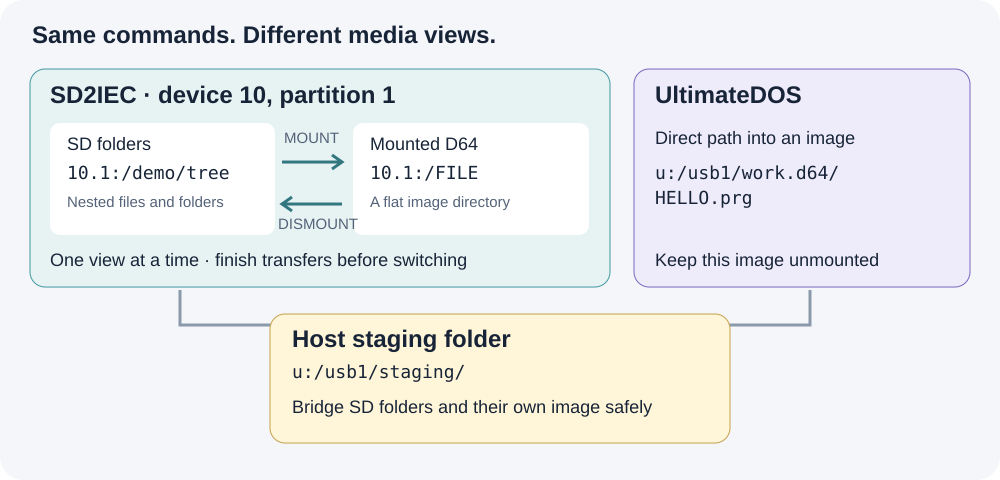

*SD mount/unmount is an explicit media transition. Keep the intermediate host folder accessible while the SD partition changes views.*

### 1. Inspect the device and choose your roots

```text
PROBE IEC 10:
IEC 10: CONFIG
IEC 10: PARTITIONS
IEC 10: PARTITION 1
ALIAS LAB u:/usb1/mydemo
ALIAS CARD 10.1:/mydemo
```

#### More than one partition on the same device

**`10.1:` means device 10, partition 1.** The `.1` is not another device number or an image slot. ReadyFS can also address `10.2:/games` for partition 2, or another existing native partition on that same device. The examples use partition 1 because that is the recorded setup, not because ReadyFS is limited to it.

Run `IEC 10: PARTITIONS` to see what the device offers. If partition 2 exists, `IEC 10: PARTITION 2` inspects it and `DIR 10.2:/` lists its root. These queries do not change the current selection. Explicit paths qualify their own operation; `10:/` instead uses the device's current partition, which ReadyFS queries and pins for that operation. `IEC 10: PARTITION 2 --SELECT` deliberately changes the current selection; it is not needed before an explicit `10.2:/...` path.

Partition arguments and path suffixes are decimal, while `$`-prefixed numbers in the listing are hexadecimal. Available partitions depend on the card, device and firmware; naming one does not create it. An alias such as `ALIAS ARCHIVE 10.2:/backups` can bookmark a folder on an existing second partition. See the [native partition reference](SD2IEC_NATIVE.md).

The media type is a separate question. A `G-P` type of FAT OR DNP is ambiguous between those two hierarchical formats; type `$02` identifies the D64 view used in the recording. Mounting an image changes the view of its selected partition, and mount/unmount may close buffers on other partitions of that device too. Finish open transfers before changing media.

Create the example roots separately before using these aliases. `CONFIG` is an inspection command. ReadyFS does not change extension modes just because you probe or copy. `save-config` explicitly saves firmware-supported extended settings together, including the address; it does not save your folder or mounted image. See the [configuration reference](READYFS_IEC_CONFIGURATION.md).

### 2. Copy a whole nested folder to SD2IEC

Assume `@lab:/source` contains this tree:

```text
source/
  readme.seq
  alpha/
    one.seq
    two.seq
  beta/
    four.seq
    deep/
      three.seq
```

```text
TREE @lab:/source
MKDIR @card:/tree
COPY @lab:/source @card:/tree --recursive --whatif
COPY @lab:/source @card:/tree --recursive
TREE @card:/tree
```

The destination is an **existing container**. This copies the contents under `tree`, preserving the relative folder layout; it does not insert an extra `source` directory. `-R` is the short form of `--recursive`, and `-W` previews the plan. Ordinary path arguments do not expand shell wildcards: use the recursive selector and its `--include` / `--exclude` options when filtering.

The preview lists selected entries without writing. Actual COPY verifies each destination by default. Read the final `FAIL 0` as well as the individual completions; the batch count includes directory actions, so it is not necessarily the number of files. A failed batch can leave completed earlier files in place; it is not an all-or-nothing transaction.

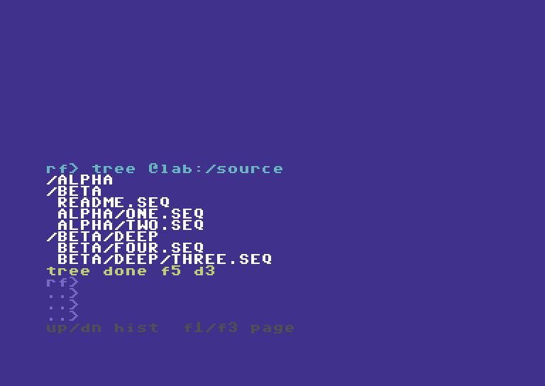

*The source includes three subdirectories and five files. The recorded workflow keeps the original source intact.*


*One COPY command handles the tree. The walkthrough separately verifies every native destination against its source.*

#### Why some names lose `.seq`

Ultimate host names and CBM logical names are different. In the tested SD extension configuration, `one.seq` is exposed on SD as the logical SEQ name `ONE`. ReadyFS preserves the file type; this is not data loss. Inspect `DIR`, `STAT` and `IEC 10: CONFIG` instead of guessing an outer FAT filename from the logical name. Native components are limited to 16 bytes in this implementation.

### 3. Copy the tree back, or move an owned copy

```text
MKDIR @lab:/returned
CP @card:/tree @lab:/returned -R
TREE @lab:/returned
COMPARE @card:/tree/alpha/one @lab:/returned/alpha/one
```

The returned host tree uses the names enumerated by the SD directory. In this configuration those logical names omit the `.seq` suffix. The recording independently checks all five returned files, not just the example COMPARE above.

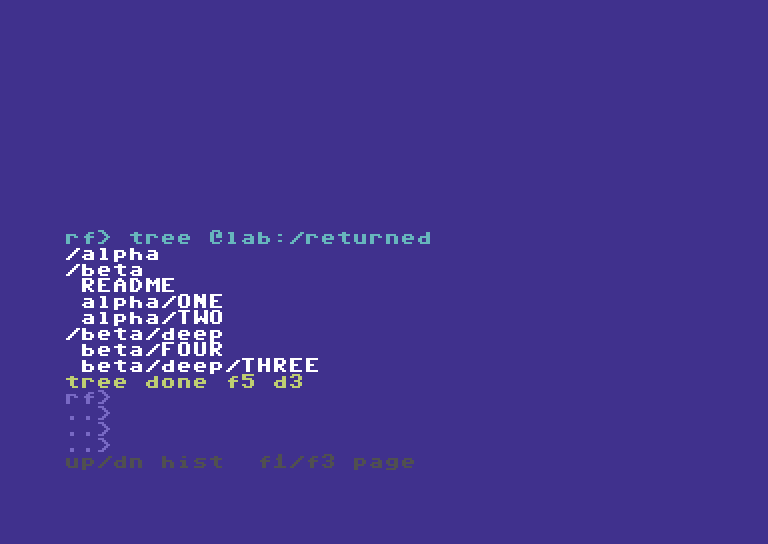

*The return copy exercises SD directory traversal and host directory creation, then checks the resulting bytes independently.*

MOVE uses the same selector but removes each source after its successful verified copy. For a disposable SD copy, prepare the destination first:

```text
MKDIR @card:/moved
MOVE @card:/tree @card:/moved -R -W
MOVE @card:/tree @card:/moved -R
```

This recipe changes the `tree` used above; run it only when finished with the copy examples. A partially completed MOVE is not a rollback transaction. The earlier hardware acceptance covers this recursive move and nested cleanup; the new recording concentrates on copying and image boundaries.

### 4. Copy several files to other IEC endpoints

A mounted D64/D71/D81 is flat. A nested SD tree does not acquire a valid flat destination layout automatically. Choose the files and give them distinct short names:

```text
COPY @card:/tree/alpha/one 9:/DEMO-ONE
COPY @card:/tree/alpha/two 9:/DEMO-TWO
```

Use your own mounted test image on device 9. The recording uses an owned image, not the user's existing mounted disk. Both entries are independently extracted after unmounting and checked for bytes and SEQ type.

#### Interoperability: native SD2IEC and SoftwareIEC

SoftwareIEC is a distinct Ultimate backend, addressed with `s0:/...`; SD2IEC retains its native `10.1:/...` paths. For SoftwareIEC setup and standalone use, see its [own guide](READYFS_SOFTWAREIEC_GUIDE.md). For this cross-backend transfer, first identify its logical partition and mapping. `s0:` is **not** IEC device 0. If its root exposes `/USB1`, and the destination folder already exists:

```text
ALIAS SOFT s0:/mydemo
CP @card:/tree/alpha/one @soft:/DEMO-ONE
CP @card:/tree/alpha/two @soft:/DEMO-TWO
```

SoftwareIEC filename translation and folder operations depend on its firmware and mapping. The recording verifies these two files independently. It does not claim that recursive trees work on every SoftwareIEC implementation.

To bring those file sets back, choose unused SD destination names:

```text
COPY 9:/DEMO-ONE @card:/from9-one
COPY 9:/DEMO-TWO @card:/from9-two
CP @soft:/DEMO-ONE @card:/froms-one
CP @soft:/DEMO-TWO @card:/froms-two
```

These reverse recipes use the same ordinary file operations verified by the full four-endpoint acceptance matrix. The new video shows representative selected-file transfers plus the complete nested-folder round trip. Use COMPARE to check any returned file against its retained source.

For a repeatable multi-file job, the same explicit COPY commands can go in a ReadyFS text script with `ONERROR STOP`, executed using `RUN @lab:/COPYSET.SEQ`. `RUN script-path [arg1 ... arg9]` accepts up to nine arguments, available as `%1`–`%9` inside the commands. Named variables and local label subroutines are also supported; external-file CALL and nested RUN are not. See the [RUN guide](READYFS_RUN_GUIDE.md) for the parameterized BACKUP.SEQ example and the complete batch reference. Inspect the individual results as well as the final result code. This is a scripting recipe, separate from the newly recorded interactive examples.

### 5. Work inside an image stored on SD2IEC

```text
MOUNT 10.1:/mydemo/work.d64 --force
IEC 10: PARTITION 1
DIR 10.1:/
COPY @lab:/returned/alpha/one 10.1:/DEMO-ONE
COPY @lab:/returned/alpha/two 10.1:/DEMO-TWO
COPY 10.1:/DEMO-ONE @lab:/image-one.seq
DISMOUNT 10.1:/ --force
```

The example assumes `work.d64` already exists as a valid mountable image. Copying an entire image file onto SD is a separate operation: some SD extension modes create X00 wrappers. A logical byte comparison alone does not prove that such a host file can be mounted. Use the explicit raw-image procedure in the [native support reference](SD2IEC_NATIVE.md), including restoration of the previous extension mode and hiding flag.

**While the image is mounted, `10.1:/` is its directory.** The earlier SD FAT path `10.1:/mydemo/tree/...` is no longer the same accessible view. This is why the example reads from the host return copy rather than simultaneously reading an SD FAT folder.

The implementation supports ordinary COPY, COMPARE, MOVE, same-filesystem RENAME and DELETE for supported files inside the mounted image. SEQ, PRG and USR are supported byte streams; REL is not. Use explicit filenames and preserve file types. A normal flat disk image does not support arbitrary nested folders.

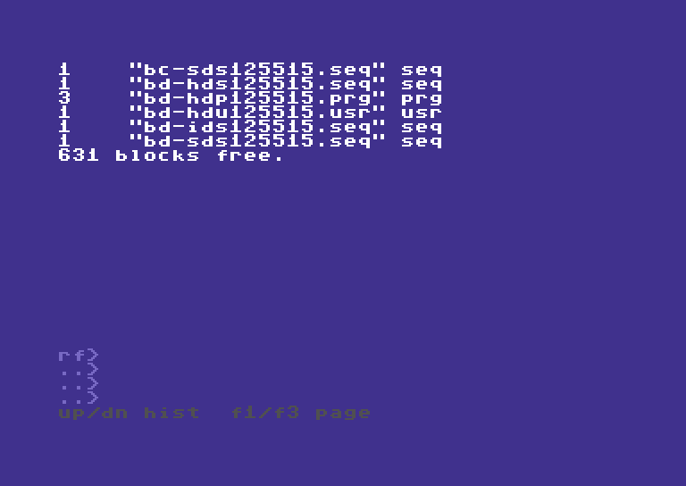

*DIR operates inside the mounted SD image. The mount hint is session information, not a guarantee against changes made by another program.*

### 6. Copy between SD image contents and an Ultimate image

Use a separate, writable Ultimate image that is **not also mounted on an IEC drive**:

```text
MOUNT 10.1:/mydemo/work.d64 --force
COPY 10.1:/DEMO-ONE u:/usb1/other.d64/ONE.seq
COPY 10.1:/DEMO-TWO u:/usb1/other.d64/TWO.seq
COPY u:/usb1/other.d64/HELLO.prg 10.1:/DEMO-PRG
STAT 10.1:/DEMO-PRG
```

Here the SD side uses a mounted media view, while the Ultimate side uses direct slash paths. The destination filename must be explicit; a trailing slash does not yet mean “keep the source filename.” A typed suffix on an Ultimate-contained destination must agree with the source type. The physical typed contained-image matrix covered D64; mounted IEC tests also covered D81. This is not evidence for every image format or firmware combination.

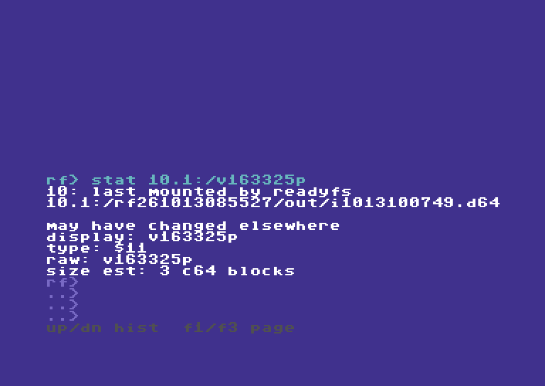

*STAT reports the native type as `$11` (PRG). Independent byte checks and type checks answer different questions.*

### 7. Move data between SD folders and an image on that same SD2IEC

Use host storage as an intermediate. Every command completes and closes its channels before the mount changes:

```text
COPY 10.1:/DEMO-PRG @lab:/fromimg.prg
DISMOUNT 10.1:/ --force
COPY @lab:/fromimg.prg @card:/fromimg.prg
COMPARE @card:/fromimg.prg @lab:/fromimg.prg
```

For the opposite direction, copy the SD-folder files into an existing host staging folder first, mount the SD image, and copy the selected staging files into its root. A folder tree cannot be preserved inside a flat D64; explicitly choose names and avoid collisions. Keep the staging copy until verification finishes.

This uses the C64's native filesystem commands. The intermediate is storage reached by ReadyFS, not a Mac relay or runtime network service.

### Boundaries at a glance

| Route | Multiple-file approach | Image or folder boundary |
| --- | --- | --- |
| Ultimate host folders ↔ SD folders | Recursive COPY; nested five-file round trip recorded and independently checked | Prepare the destination container; 16-byte native components |
| SD folders → mounted IEC disk | Explicit chosen files, or a reviewed command script | Flat disk: no automatic flattening of a tree |
| SD folders → SoftwareIEC | Explicit chosen files in the verified mapping | Firmware/mapping-dependent; no blanket recursive guarantee |
| SD image contents ↔ Ultimate host or another IEC endpoint | Mount SD image, then ordinary file operations | Device path refers to the mounted image |
| SD image contents ↔ Ultimate image contents | Mounted SD paths on one side; ordinary Ultimate slash paths on the other | Ultimate image must be separate and unmounted |
| SD folders ↔ an image on the same SD device | Intermediate host files plus explicit mount/unmount | The partition cannot expose both views to one simultaneous stream |
| `10.1:/disk.d64/FILE` or `!/FILE` | Not automatic in this build | Mount explicitly first |

The [native support reference](SD2IEC_NATIVE.md) and [IEC configuration reference](READYFS_IEC_CONFIGURATION.md) document firmware caveats. Existing test roots and images are retained as evidence. No user files were deleted to make the demonstrations.
