# ReadyFS editor and filesystem screenshot walkthrough

These physical C64 screenshots follow help, editing, history, previews, transfers and the parameterized backup example. Earlier captures show their contemporary build; use the current user guide for current limits. This edition preserves the commands and still images without requiring video. The original editor tour and appended backup demonstration used separate owned fixtures.

[User guide](../READYFS_USER_GUIDE.md) · [Current acceptance](../READYFS_ACCEPTANCE.md)

## 01 · Help & directories

Full commands and shortcuts share the same help.

### Step 1

Read command-specific help and varied examples.

```text
HELP DIR
```

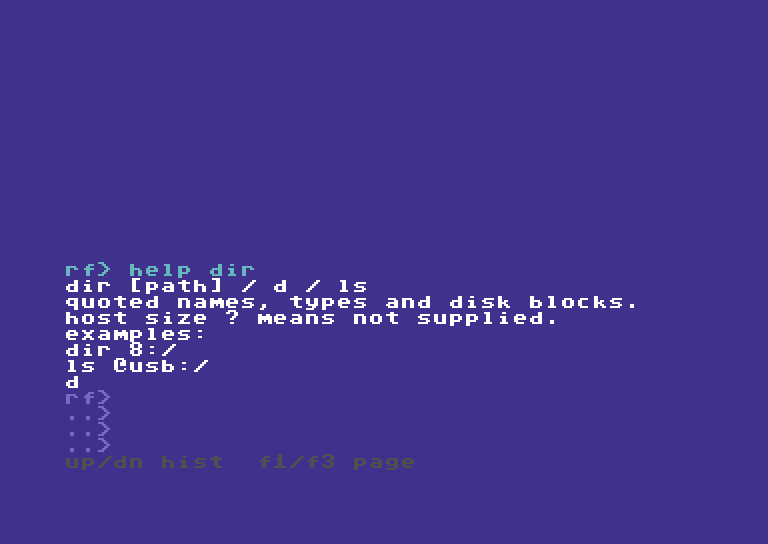

```text


RF> HELP DIR
DIR .PATH. / D / LS
QUOTED NAMES, TYPES AND DISK BLOCKS.
HOST SIZE ? MEANS NOT SUPPLIED.
EXAMPLES:
DIR 8:/
LS @USB:/
D
RF>
..>
..>
..>
UP/DN HIST  F1/F3 PAGE
```

### Step 2

List the current directory; disk files use classic names, types and block counts.

```text
DIR 9:/
```

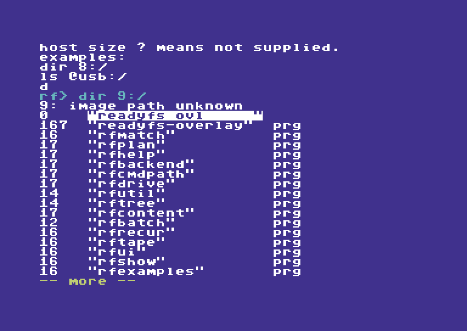

```text
HOST SIZE ? MEANS NOT SUPPLIED.
EXAMPLES:
DIR 8:/
LS @USB:/
D
RF> DIR 9:/
9: IMAGE PATH UNKNOWN
0    "READYFS OVL     "
167  "READYFS-OVERLAY"  PRG
16   "RFMATCH"          PRG
17   "RFPLAN"           PRG
17   "RFHELP"           PRG
17   "RFBACKEND"        PRG
17   "RFCMDPATH"        PRG
17   "RFDRIVE"          PRG
14   "RFUTIL"           PRG
14   "RFTREE"           PRG
17   "RFCONTENT"        PRG
12   "RFBATCH"          PRG
16   "RFRECUR"          PRG
16   "RFTAPE"           PRG
16   "RFUI"             PRG
16   "RFSHOW"           PRG
16   "RFEXAMPLES"       PRG
-- MORE --
```

### Step 3

Read command-specific help and varied examples.

```text
HELP CP
```

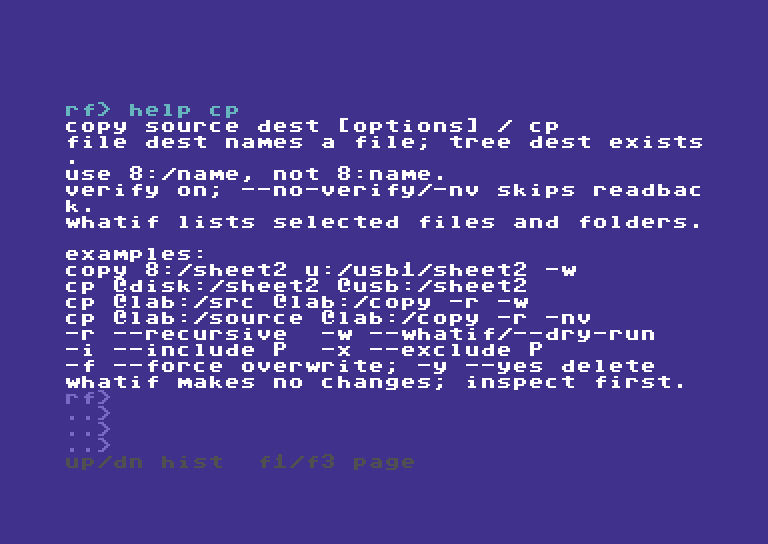

```text


RF> HELP CP
COPY SOURCE DEST .OPTIONS. / CP
FILE DEST NAMES A FILE; TREE DEST EXISTS
.
USE 8:/NAME, NOT 8:NAME.
VERIFY ON; --NO-VERIFY/-NV SKIPS READBAC
K.
WHATIF LISTS SELECTED FILES AND FOLDERS.

EXAMPLES:
COPY 8:/SHEET2 U:/USB1/SHEET2 -W
CP @DISK:/SHEET2 @USB:/SHEET2
CP @LAB:/SRC @LAB:/COPY -R -W
CP @LAB:/SOURCE @LAB:/COPY -R -NV
-R --RECURSIVE  -W --WHATIF/--DRY-RUN
-I --INCLUDE p  -X --EXCLUDE p
-F --FORCE OVERWRITE; -Y --YES DELETE
WHATIF MAKES NO CHANGES; INSPECT FIRST.
RF>
..>
..>
..>
UP/DN HIST  F1/F3 PAGE
```

### Step 4

Give an absolute location a short, reusable name.

```text
AL LAB u:/usb1/READYFS_TEST/readyfs-20261013-013111-90069
```

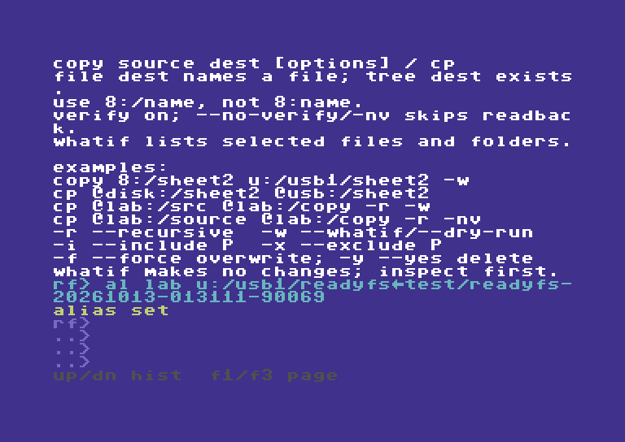

```text
COPY SOURCE DEST .OPTIONS. / CP
FILE DEST NAMES A FILE; TREE DEST EXISTS
.
USE 8:/NAME, NOT 8:NAME.
VERIFY ON; --NO-VERIFY/-NV SKIPS READBAC
K.
WHATIF LISTS SELECTED FILES AND FOLDERS.

EXAMPLES:
COPY 8:/SHEET2 U:/USB1/SHEET2 -W
CP @DISK:/SHEET2 @USB:/SHEET2
CP @LAB:/SRC @LAB:/COPY -R -W
CP @LAB:/SOURCE @LAB:/COPY -R -NV
-R --RECURSIVE  -W --WHATIF/--DRY-RUN
-I --INCLUDE p  -X --EXCLUDE p
-F --FORCE OVERWRITE; -Y --YES DELETE
WHATIF MAKES NO CHANGES; INSPECT FIRST.
RF> AL LAB U:/USB1/READYFS.TEST/READYFS-
20261013-013111-90069
ALIAS SET
RF>
..>
..>
..>
UP/DN HIST  F1/F3 PAGE
```

### Step 5

Show the folder structure and nested files.

```text
TREE @LAB:/SOURCE
```

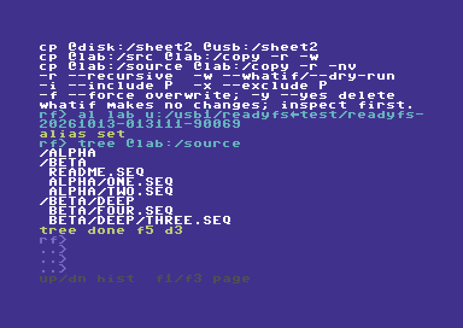

```text
CP @DISK:/SHEET2 @USB:/SHEET2
CP @LAB:/SRC @LAB:/COPY -R -W
CP @LAB:/SOURCE @LAB:/COPY -R -NV
-R --RECURSIVE  -W --WHATIF/--DRY-RUN
-I --INCLUDE p  -X --EXCLUDE p
-F --FORCE OVERWRITE; -Y --YES DELETE
WHATIF MAKES NO CHANGES; INSPECT FIRST.
RF> AL LAB U:/USB1/READYFS.TEST/READYFS-
20261013-013111-90069
ALIAS SET
RF> TREE @LAB:/SOURCE
/alpha
/beta
 readme.seq
 alpha/one.seq
 alpha/two.seq
/beta/deep
 beta/four.seq
 beta/deep/three.seq
TREE DONE F5 D3
RF>
..>
..>
..>
UP/DN HIST  F1/F3 PAGE
```

## 02 · Native mounts

Mount paths are hints and may become stale.

### Step 6

List responding devices. Only mounts made by ReadyFS have a remembered host path.

```text
DRIVES
```

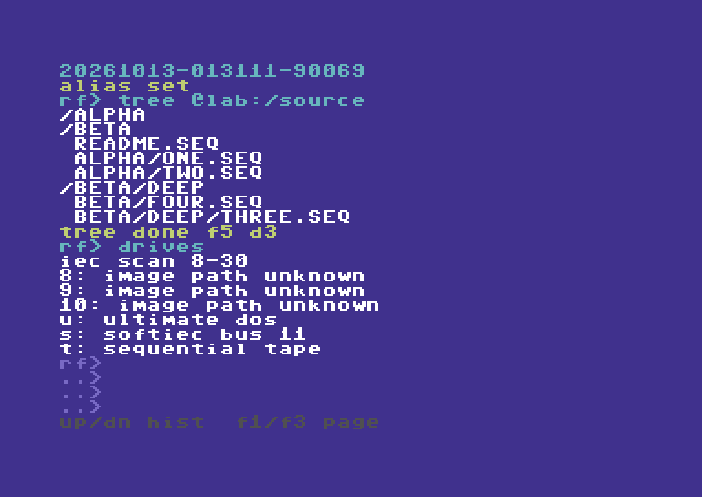

```text
20261013-013111-90069
ALIAS SET
RF> TREE @LAB:/SOURCE
/alpha
/beta
 readme.seq
 alpha/one.seq
 alpha/two.seq
/beta/deep
 beta/four.seq
 beta/deep/three.seq
TREE DONE F5 D3
RF> DRIVES
IEC SCAN 8-30
8: IMAGE PATH UNKNOWN
9: IMAGE PATH UNKNOWN
10: IMAGE PATH UNKNOWN
U: ULTIMATE DOS
S: SOFTIEC BUS 11
T: SEQUENTIAL TAPE
RF>
..>
..>
..>
UP/DN HIST  F1/F3 PAGE
```

### Step 7

List the current directory; disk files use classic names, types and block counts.

```text
DIR 8:/
```

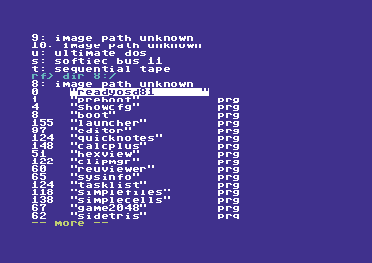

```text
9: IMAGE PATH UNKNOWN
10: IMAGE PATH UNKNOWN
U: ULTIMATE DOS
S: SOFTIEC BUS 11
T: SEQUENTIAL TAPE
RF> DIR 8:/
8: IMAGE PATH UNKNOWN
0    "READYOSD81      "
1    "PREBOOT"          PRG
4    "SHOWCFG"          PRG
8    "BOOT"             PRG
155  "LAUNCHER"         PRG
97   "EDITOR"           PRG
124  "QUICKNOTES"       PRG
148  "CALCPLUS"         PRG
51   "HEXVIEW"          PRG
122  "CLIPMGR"          PRG
60   "REUVIEWER"        PRG
65   "SYSINFO"          PRG
124  "TASKLIST"         PRG
118  "SIMPLEFILES"      PRG
138  "SIMPLECELLS"      PRG
67   "GAME2048"         PRG
62   "SIDETRIS"         PRG
-- MORE --
```

### Step 8

Mount our disposable image through native UCI and remember its resolved path for this session.

```text
MOUNT @LAB:/MEDIA.D81 9: --force
```

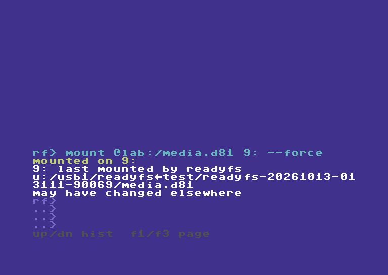

```text


RF> MOUNT @LAB:/MEDIA.D81 9: --FORCE
MOUNTED ON 9:
9: LAST MOUNTED BY READYFS
U:/USB1/READYFS.TEST/READYFS-20261013-01
3111-90069/MEDIA.D81
MAY HAVE CHANGED ELSEWHERE
RF>
..>
..>
..>
UP/DN HIST  F1/F3 PAGE
```

### Step 9

The short form of DRIVES shows the same last-mount hints.

```text
DV
```

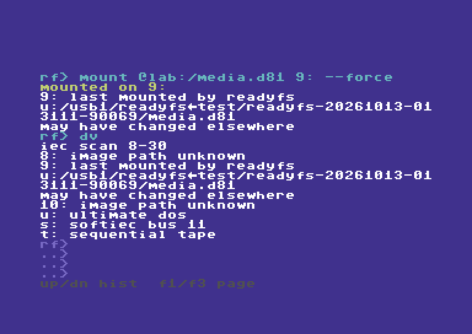

```text


RF> MOUNT @LAB:/MEDIA.D81 9: --FORCE
MOUNTED ON 9:
9: LAST MOUNTED BY READYFS
U:/USB1/READYFS.TEST/READYFS-20261013-01
3111-90069/MEDIA.D81
MAY HAVE CHANGED ELSEWHERE
RF> DV
IEC SCAN 8-30
8: IMAGE PATH UNKNOWN
9: LAST MOUNTED BY READYFS
U:/USB1/READYFS.TEST/READYFS-20261013-01
3111-90069/MEDIA.D81
MAY HAVE CHANGED ELSEWHERE
10: IMAGE PATH UNKNOWN
U: ULTIMATE DOS
S: SOFTIEC BUS 11
T: SEQUENTIAL TAPE
RF>
..>
..>
..>
UP/DN HIST  F1/F3 PAGE
```

### Step 10

List the current directory; disk files use classic names, types and block counts.

```text
DIR 9:/
```

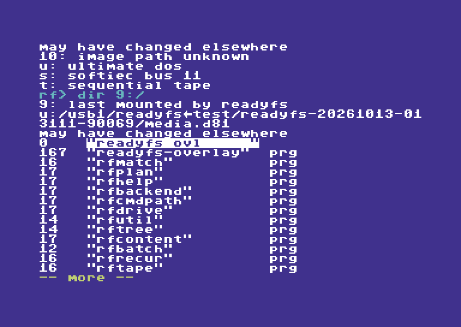

```text
MAY HAVE CHANGED ELSEWHERE
10: IMAGE PATH UNKNOWN
U: ULTIMATE DOS
S: SOFTIEC BUS 11
T: SEQUENTIAL TAPE
RF> DIR 9:/
9: LAST MOUNTED BY READYFS
U:/USB1/READYFS.TEST/READYFS-20261013-01
3111-90069/MEDIA.D81
MAY HAVE CHANGED ELSEWHERE
0    "READYFS OVL     "
167  "READYFS-OVERLAY"  PRG
16   "RFMATCH"          PRG
17   "RFPLAN"           PRG
17   "RFHELP"           PRG
17   "RFBACKEND"        PRG
17   "RFCMDPATH"        PRG
17   "RFDRIVE"          PRG
14   "RFUTIL"           PRG
14   "RFTREE"           PRG
17   "RFCONTENT"        PRG
12   "RFBATCH"          PRG
16   "RFRECUR"          PRG
16   "RFTAPE"           PRG
-- MORE --
```

### Step 11

Inspect file metadata with a last-mount hint for an IEC file.

```text
STAT 9:/RFVIEW
```

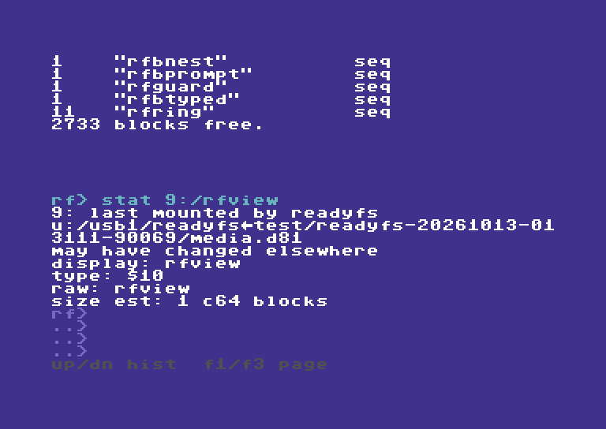

```text
1    "RFBNEST"          SEQ
1    "RFBPROMPT"        SEQ
1    "RFGUARD"          SEQ
1    "RFBTYPED"         SEQ
11   "RFRING"           SEQ
2733 BLOCKS FREE.


RF> STAT 9:/RFVIEW
9: LAST MOUNTED BY READYFS
U:/USB1/READYFS.TEST/READYFS-20261013-01
3111-90069/MEDIA.D81
MAY HAVE CHANGED ELSEWHERE
DISPLAY: RFVIEW
TYPE: $10
RAW: RFVIEW
SIZE EST: 1 C64 BLOCKS
RF>
..>
..>
..>
UP/DN HIST  F1/F3 PAGE
```

### Step 12

Show volume details with the same clearly marked historical mount hint.

```text
VOLUME 9:/
```

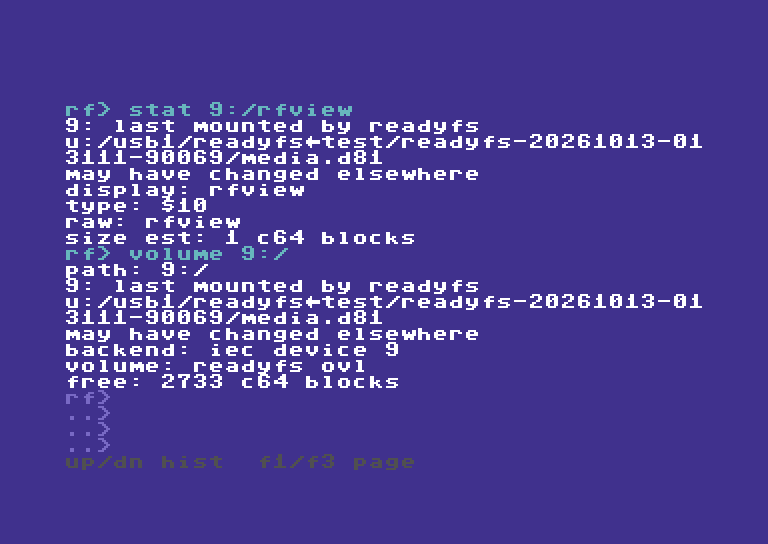

```text


RF> STAT 9:/RFVIEW
9: LAST MOUNTED BY READYFS
U:/USB1/READYFS.TEST/READYFS-20261013-01
3111-90069/MEDIA.D81
MAY HAVE CHANGED ELSEWHERE
DISPLAY: RFVIEW
TYPE: $10
RAW: RFVIEW
SIZE EST: 1 C64 BLOCKS
RF> VOLUME 9:/
PATH: 9:/
9: LAST MOUNTED BY READYFS
U:/USB1/READYFS.TEST/READYFS-20261013-01
3111-90069/MEDIA.D81
MAY HAVE CHANGED ELSEWHERE
BACKEND: IEC DEVICE 9
VOLUME: READYFS OVL
FREE: 2733 C64 BLOCKS
RF>
..>
..>
..>
UP/DN HIST  F1/F3 PAGE
```

### Step 13

Give an absolute location a short, reusable name.

```text
AL DISK 9:/
```

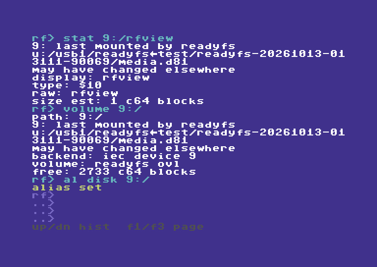

```text
RF> STAT 9:/RFVIEW
9: LAST MOUNTED BY READYFS
U:/USB1/READYFS.TEST/READYFS-20261013-01
3111-90069/MEDIA.D81
MAY HAVE CHANGED ELSEWHERE
DISPLAY: RFVIEW
TYPE: $10
RAW: RFVIEW
SIZE EST: 1 C64 BLOCKS
RF> VOLUME 9:/
PATH: 9:/
9: LAST MOUNTED BY READYFS
U:/USB1/READYFS.TEST/READYFS-20261013-01
3111-90069/MEDIA.D81
MAY HAVE CHANGED ELSEWHERE
BACKEND: IEC DEVICE 9
VOLUME: READYFS OVL
FREE: 2733 C64 BLOCKS
RF> AL DISK 9:/
ALIAS SET
RF>
..>
..>
..>
UP/DN HIST  F1/F3 PAGE
```

## 03 · Disk to host, and back

Copy both ways; compare when you choose.

### Step 14

Copy an ordinary byte stream or a selected recursive tree.

```text
COPY @DISK:/RFVIEW @LAB:/FROM-DISK.SEQ
```

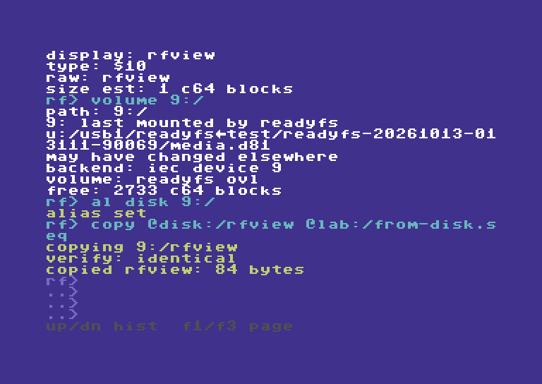

```text
DISPLAY: RFVIEW
TYPE: $10
RAW: RFVIEW
SIZE EST: 1 C64 BLOCKS
RF> VOLUME 9:/
PATH: 9:/
9: LAST MOUNTED BY READYFS
U:/USB1/READYFS.TEST/READYFS-20261013-01
3111-90069/MEDIA.D81
MAY HAVE CHANGED ELSEWHERE
BACKEND: IEC DEVICE 9
VOLUME: READYFS OVL
FREE: 2733 C64 BLOCKS
RF> AL DISK 9:/
ALIAS SET
RF> COPY @DISK:/RFVIEW @LAB:/FROM-DISK.S
EQ
COPYING 9:/RFVIEW
VERIFY: IDENTICAL
COPIED RFVIEW: 84 BYTES
RF>
..>
..>
..>
UP/DN HIST  F1/F3 PAGE
```

### Step 15

Read both files and check their contents.

```text
COMPARE @DISK:/RFVIEW @LAB:/FROM-DISK.SEQ
```

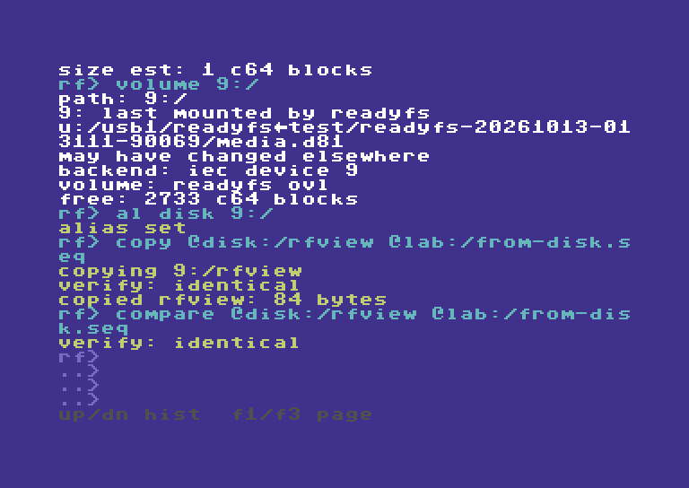

```text
SIZE EST: 1 C64 BLOCKS
RF> VOLUME 9:/
PATH: 9:/
9: LAST MOUNTED BY READYFS
U:/USB1/READYFS.TEST/READYFS-20261013-01
3111-90069/MEDIA.D81
MAY HAVE CHANGED ELSEWHERE
BACKEND: IEC DEVICE 9
VOLUME: READYFS OVL
FREE: 2733 C64 BLOCKS
RF> AL DISK 9:/
ALIAS SET
RF> COPY @DISK:/RFVIEW @LAB:/FROM-DISK.S
EQ
COPYING 9:/RFVIEW
VERIFY: IDENTICAL
COPIED RFVIEW: 84 BYTES
RF> COMPARE @DISK:/RFVIEW @LAB:/FROM-DIS
K.SEQ
VERIFY: IDENTICAL
RF>
..>
..>
..>
UP/DN HIST  F1/F3 PAGE
```

### Step 16

The short form of COPY works with aliases and endpoint paths.

```text
CP @LAB:/SOURCE/README.SEQ @DISK:/HOSTSEQ --no-verify
```


```text
MAY HAVE CHANGED ELSEWHERE
BACKEND: IEC DEVICE 9
VOLUME: READYFS OVL
FREE: 2733 C64 BLOCKS
RF> AL DISK 9:/
ALIAS SET
RF> COPY @DISK:/RFVIEW @LAB:/FROM-DISK.S
EQ
COPYING 9:/RFVIEW
VERIFY: IDENTICAL
COPIED RFVIEW: 84 BYTES
RF> COMPARE @DISK:/RFVIEW @LAB:/FROM-DIS
K.SEQ
VERIFY: IDENTICAL
RF> CP @LAB:/SOURCE/README.SEQ @DISK:/HO
STSEQ --NO-VERIFY
COPYING U:/USB1/READYFS.TEST/READYFS-202
61013-013111-90069/SOURCE/README.SEQ
VERIFY: SKIPPED
COPIED README.SEQ: 38 BYTES
RF>
..>
..>
..>
UP/DN HIST  F1/F3 PAGE
```

### Step 17

Read both files and check their contents.

```text
COMPARE @DISK:/HOSTSEQ @LAB:/SOURCE/README.SEQ
```

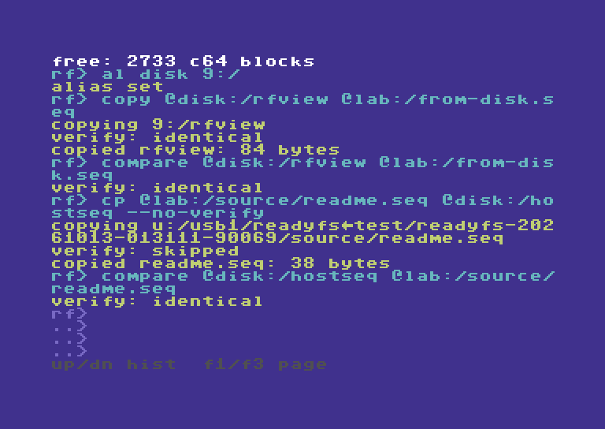

```text
FREE: 2733 C64 BLOCKS
RF> AL DISK 9:/
ALIAS SET
RF> COPY @DISK:/RFVIEW @LAB:/FROM-DISK.S
EQ
COPYING 9:/RFVIEW
VERIFY: IDENTICAL
COPIED RFVIEW: 84 BYTES
RF> COMPARE @DISK:/RFVIEW @LAB:/FROM-DIS
K.SEQ
VERIFY: IDENTICAL
RF> CP @LAB:/SOURCE/README.SEQ @DISK:/HO
STSEQ --NO-VERIFY
COPYING U:/USB1/READYFS.TEST/READYFS-202
61013-013111-90069/SOURCE/README.SEQ
VERIFY: SKIPPED
COPIED README.SEQ: 38 BYTES
RF> COMPARE @DISK:/HOSTSEQ @LAB:/SOURCE/
README.SEQ
VERIFY: IDENTICAL
RF>
..>
..>
..>
UP/DN HIST  F1/F3 PAGE
```

### Step 18

Show the boundary of a flat mounted disk: a nested folder path is unsupported, and the error appears in red.

```text
DIR 9:/FOLDER
```

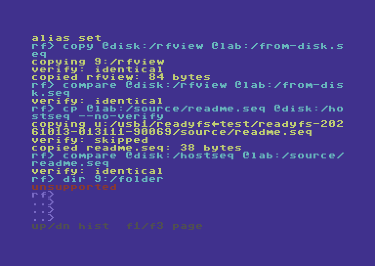

```text
ALIAS SET
RF> COPY @DISK:/RFVIEW @LAB:/FROM-DISK.S
EQ
COPYING 9:/RFVIEW
VERIFY: IDENTICAL
COPIED RFVIEW: 84 BYTES
RF> COMPARE @DISK:/RFVIEW @LAB:/FROM-DIS
K.SEQ
VERIFY: IDENTICAL
RF> CP @LAB:/SOURCE/README.SEQ @DISK:/HO
STSEQ --NO-VERIFY
COPYING U:/USB1/READYFS.TEST/READYFS-202
61013-013111-90069/SOURCE/README.SEQ
VERIFY: SKIPPED
COPIED README.SEQ: 38 BYTES
RF> COMPARE @DISK:/HOSTSEQ @LAB:/SOURCE/
README.SEQ
VERIFY: IDENTICAL
RF> DIR 9:/FOLDER
UNSUPPORTED
RF>
..>
..>
..>
UP/DN HIST  F1/F3 PAGE
```

## 04 · Edit a command

Insert, overwrite and navigate a long command.

### Step 19

Insert the missing A in HED using Home and cursor movement, then execute HEAD.

```text
HEAD @LAB:/SOURCE/README.SEQ 2
```

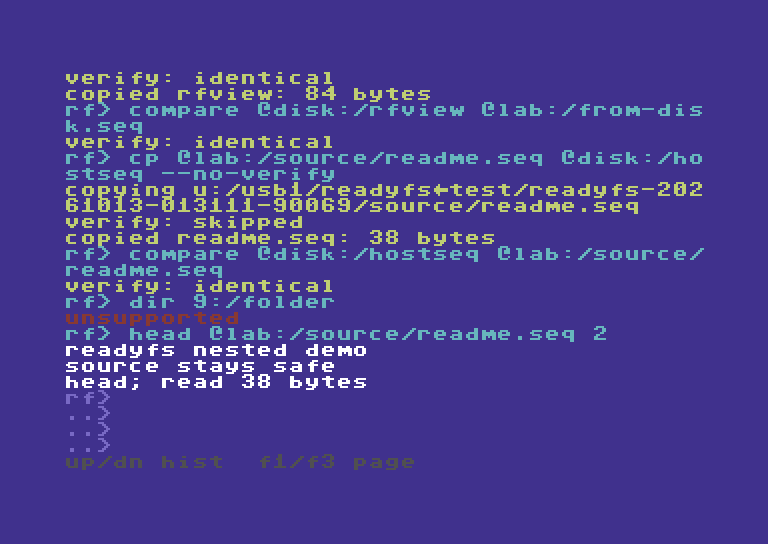

```text
VERIFY: IDENTICAL
COPIED RFVIEW: 84 BYTES
RF> COMPARE @DISK:/RFVIEW @LAB:/FROM-DIS
K.SEQ
VERIFY: IDENTICAL
RF> CP @LAB:/SOURCE/README.SEQ @DISK:/HO
STSEQ --NO-VERIFY
COPYING U:/USB1/READYFS.TEST/READYFS-202
61013-013111-90069/SOURCE/README.SEQ
VERIFY: SKIPPED
COPIED README.SEQ: 38 BYTES
RF> COMPARE @DISK:/HOSTSEQ @LAB:/SOURCE/
README.SEQ
VERIFY: IDENTICAL
RF> DIR 9:/FOLDER
UNSUPPORTED
RF> HEAD @LAB:/SOURCE/README.SEQ 2
READYFS NESTED DEMO
SOURCE STAYS SAFE
HEAD; READ 38 BYTES
RF>
..>
..>
..>
UP/DN HIST  F1/F3 PAGE
```

### Step 20

Edit a 255-byte quoted command using Home, End and overwrite mode. Execute only its preview. What-if previews the plan without changing storage.

```text
WRITE "@LAB:/FIELD NOTES.SEQ" "LONG INPUT, SMALL REDRAWS. USE HOME AND END TO NAVIGATE THE FOUR ROW EDITOR. LONG INPUT, SMALL REDRAWS. USE HOME AND END TO NAVIGATE THE FOUR ROW EDITOR. LONG INPUT, SMALL REDRAWS. USE HOME AND END TO NAVIGATE THX " --WHATIF
```

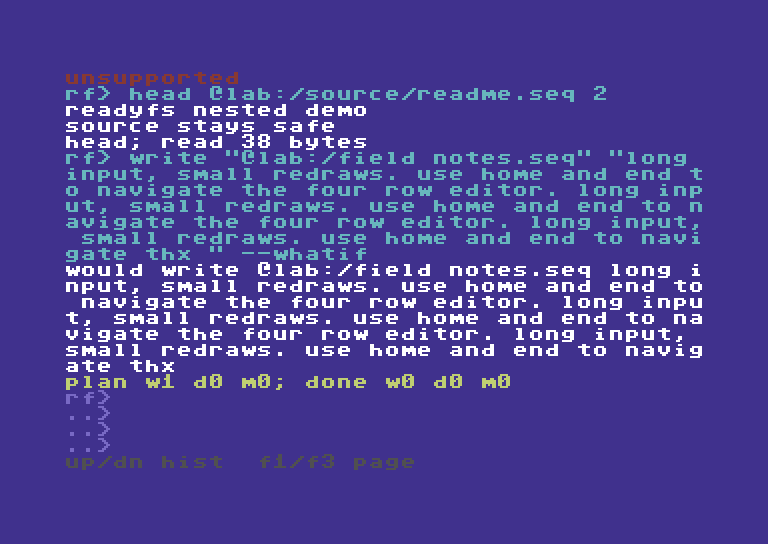

```text
UNSUPPORTED
RF> HEAD @LAB:/SOURCE/README.SEQ 2
READYFS NESTED DEMO
SOURCE STAYS SAFE
HEAD; READ 38 BYTES
RF> WRITE "@LAB:/FIELD NOTES.SEQ" "LONG
INPUT, SMALL REDRAWS. USE HOME AND END T
O NAVIGATE THE FOUR ROW EDITOR. LONG INP
UT, SMALL REDRAWS. USE HOME AND END TO N
AVIGATE THE FOUR ROW EDITOR. LONG INPUT,
 SMALL REDRAWS. USE HOME AND END TO NAVI
GATE THX " --WHATIF
WOULD WRITE @LAB:/FIELD NOTES.SEQ LONG I
NPUT, SMALL REDRAWS. USE HOME AND END TO
 NAVIGATE THE FOUR ROW EDITOR. LONG INPU
T, SMALL REDRAWS. USE HOME AND END TO NA
VIGATE THE FOUR ROW EDITOR. LONG INPUT,
SMALL REDRAWS. USE HOME AND END TO NAVIG
ATE THX
PLAN W1 D0 M0; DONE W0 D0 M0
RF>
..>
..>
..>
UP/DN HIST  F1/F3 PAGE
```

## 05 · History & paging

Recall commands, restore drafts and page output.

### Step 21

Recall older commands, restore an unsent draft, page output with F1/F3, then execute the preserved draft.

```text
HD @LAB:/SOURCE/README.SEQ 1
```

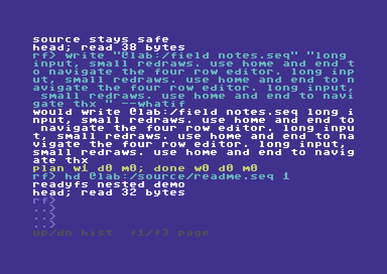

```text
SOURCE STAYS SAFE
HEAD; READ 38 BYTES
RF> WRITE "@LAB:/FIELD NOTES.SEQ" "LONG
INPUT, SMALL REDRAWS. USE HOME AND END T
O NAVIGATE THE FOUR ROW EDITOR. LONG INP
UT, SMALL REDRAWS. USE HOME AND END TO N
AVIGATE THE FOUR ROW EDITOR. LONG INPUT,
 SMALL REDRAWS. USE HOME AND END TO NAVI
GATE THX " --WHATIF
WOULD WRITE @LAB:/FIELD NOTES.SEQ LONG I
NPUT, SMALL REDRAWS. USE HOME AND END TO
 NAVIGATE THE FOUR ROW EDITOR. LONG INPU
T, SMALL REDRAWS. USE HOME AND END TO NA
VIGATE THE FOUR ROW EDITOR. LONG INPUT,
SMALL REDRAWS. USE HOME AND END TO NAVIG
ATE THX
PLAN W1 D0 M0; DONE W0 D0 M0
RF> HD @LAB:/SOURCE/README.SEQ 1
READYFS NESTED DEMO
HEAD; READ 32 BYTES
RF>
..>
..>
..>
UP/DN HIST  F1/F3 PAGE
```

## 06 · Preview & copy

List selected files, then copy with verification.

### Step 22

The short form of COPY works with aliases and endpoint paths. What-if previews the plan without changing storage.

```text
CP @LAB:/SOURCE @LAB:/COPY -R -W
```

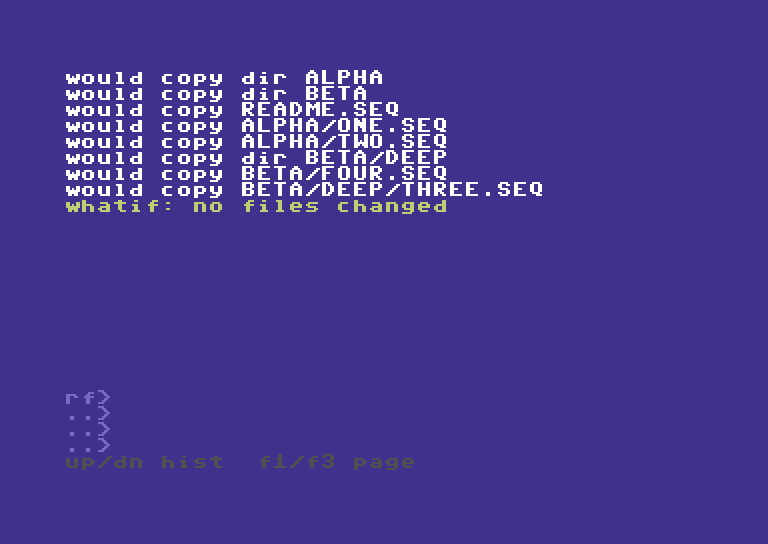

```text
WOULD COPY DIR alpha
WOULD COPY DIR beta
WOULD COPY readme.seq
WOULD COPY alpha/one.seq
WOULD COPY alpha/two.seq
WOULD COPY DIR beta/deep
WOULD COPY beta/four.seq
WOULD COPY beta/deep/three.seq
WHATIF: NO FILES CHANGED


RF>
..>
..>
..>
UP/DN HIST  F1/F3 PAGE
```

Earlier preview page:

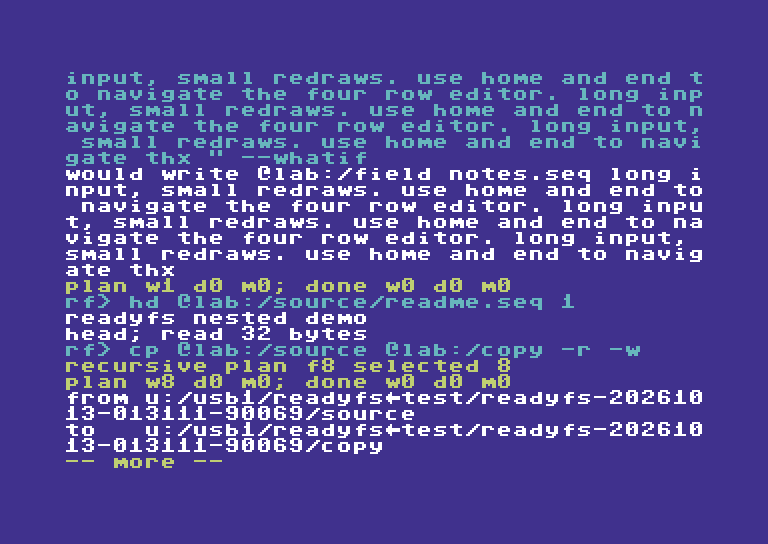

```text
INPUT, SMALL REDRAWS. USE HOME AND END T
O NAVIGATE THE FOUR ROW EDITOR. LONG INP
UT, SMALL REDRAWS. USE HOME AND END TO N
AVIGATE THE FOUR ROW EDITOR. LONG INPUT,
 SMALL REDRAWS. USE HOME AND END TO NAVI
GATE THX " --WHATIF
WOULD WRITE @LAB:/FIELD NOTES.SEQ LONG I
NPUT, SMALL REDRAWS. USE HOME AND END TO
 NAVIGATE THE FOUR ROW EDITOR. LONG INPU
T, SMALL REDRAWS. USE HOME AND END TO NA
VIGATE THE FOUR ROW EDITOR. LONG INPUT,
SMALL REDRAWS. USE HOME AND END TO NAVIG
ATE THX
PLAN W1 D0 M0; DONE W0 D0 M0
RF> HD @LAB:/SOURCE/README.SEQ 1
READYFS NESTED DEMO
HEAD; READ 32 BYTES
RF> CP @LAB:/SOURCE @LAB:/COPY -R -W
RECURSIVE PLAN F8 SELECTED 8
PLAN W8 D0 M0; DONE W0 D0 M0
FROM U:/USB1/READYFS.TEST/READYFS-202610
13-013111-90069/SOURCE
TO   U:/USB1/READYFS.TEST/READYFS-202610
13-013111-90069/COPY
-- MORE --
```

### Step 23

Create an empty destination inside the test root.

```text
MD @LAB:/COPY
```

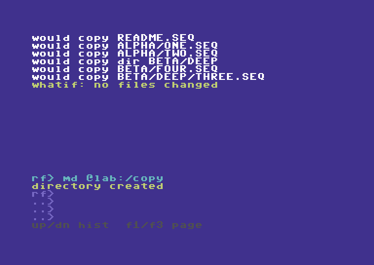

```text
WOULD COPY readme.seq
WOULD COPY alpha/one.seq
WOULD COPY alpha/two.seq
WOULD COPY DIR beta/deep
WOULD COPY beta/four.seq
WOULD COPY beta/deep/three.seq
WHATIF: NO FILES CHANGED


RF> MD @LAB:/COPY
DIRECTORY CREATED
RF>
..>
..>
..>
UP/DN HIST  F1/F3 PAGE
```

### Step 24

Copy an ordinary byte stream or a selected recursive tree.

```text
COPY @LAB:/SOURCE @LAB:/COPY --recursive
```

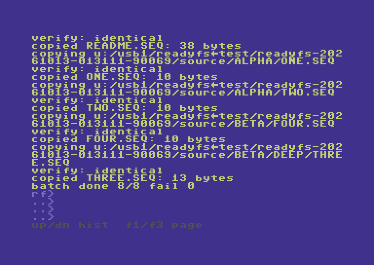

```text
VERIFY: IDENTICAL
COPIED readme.seq: 38 BYTES
COPYING U:/USB1/READYFS.TEST/READYFS-202
61013-013111-90069/SOURCE/alpha/one.seq
VERIFY: IDENTICAL
COPIED one.seq: 10 BYTES
COPYING U:/USB1/READYFS.TEST/READYFS-202
61013-013111-90069/SOURCE/alpha/two.seq
VERIFY: IDENTICAL
COPIED two.seq: 10 BYTES
COPYING U:/USB1/READYFS.TEST/READYFS-202
61013-013111-90069/SOURCE/beta/four.seq
VERIFY: IDENTICAL
COPIED four.seq: 10 BYTES
COPYING U:/USB1/READYFS.TEST/READYFS-202
61013-013111-90069/SOURCE/beta/deep/thre
e.seq
VERIFY: IDENTICAL
COPIED three.seq: 13 BYTES
BATCH DONE 8/8 FAIL 0
RF>
..>
..>
..>
UP/DN HIST  F1/F3 PAGE
```

### Step 25

Show the folder structure and nested files.

```text
TREE @LAB:/COPY
```

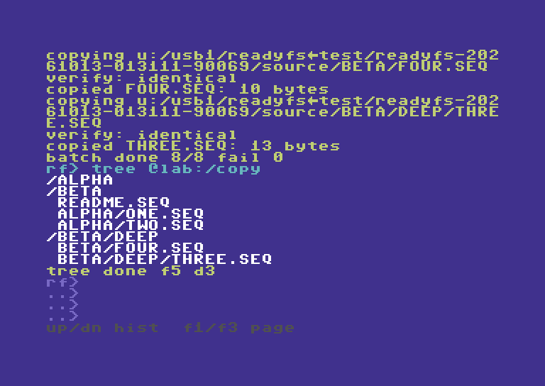

```text
COPYING U:/USB1/READYFS.TEST/READYFS-202
61013-013111-90069/SOURCE/beta/four.seq
VERIFY: IDENTICAL
COPIED four.seq: 10 BYTES
COPYING U:/USB1/READYFS.TEST/READYFS-202
61013-013111-90069/SOURCE/beta/deep/thre
e.seq
VERIFY: IDENTICAL
COPIED three.seq: 13 BYTES
BATCH DONE 8/8 FAIL 0
RF> TREE @LAB:/COPY
/alpha
/beta
 readme.seq
 alpha/one.seq
 alpha/two.seq
/beta/deep
 beta/four.seq
 beta/deep/three.seq
TREE DONE F5 D3
RF>
..>
..>
..>
UP/DN HIST  F1/F3 PAGE
```

## 07 · Move without readback

Use -nv; check the moved files independently.

### Step 26

Create a destination with the full command name.

```text
MKDIR @LAB:/MOVED
```

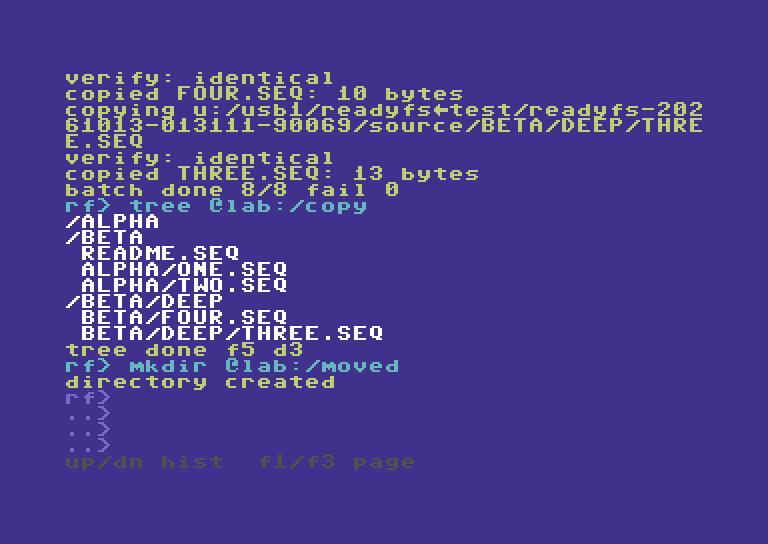

```text
VERIFY: IDENTICAL
COPIED four.seq: 10 BYTES
COPYING U:/USB1/READYFS.TEST/READYFS-202
61013-013111-90069/SOURCE/beta/deep/thre
e.seq
VERIFY: IDENTICAL
COPIED three.seq: 13 BYTES
BATCH DONE 8/8 FAIL 0
RF> TREE @LAB:/COPY
/alpha
/beta
 readme.seq
 alpha/one.seq
 alpha/two.seq
/beta/deep
 beta/four.seq
 beta/deep/three.seq
TREE DONE F5 D3
RF> MKDIR @LAB:/MOVED
DIRECTORY CREATED
RF>
..>
..>
..>
UP/DN HIST  F1/F3 PAGE
```

### Step 27

Move the copied tree, keeping the original source safe. What-if previews the plan without changing storage.

```text
MOVE @LAB:/COPY @LAB:/MOVED --recursive --whatif
```


```text
WOULD MOVE DIR alpha
WOULD MOVE DIR beta
WOULD MOVE readme.seq
WOULD MOVE alpha/one.seq
WOULD MOVE alpha/two.seq
WOULD MOVE DIR beta/deep
WOULD MOVE beta/four.seq
WOULD MOVE beta/deep/three.seq
WHATIF: NO FILES CHANGED


RF>
..>
..>
..>
UP/DN HIST  F1/F3 PAGE
```

Earlier preview page:

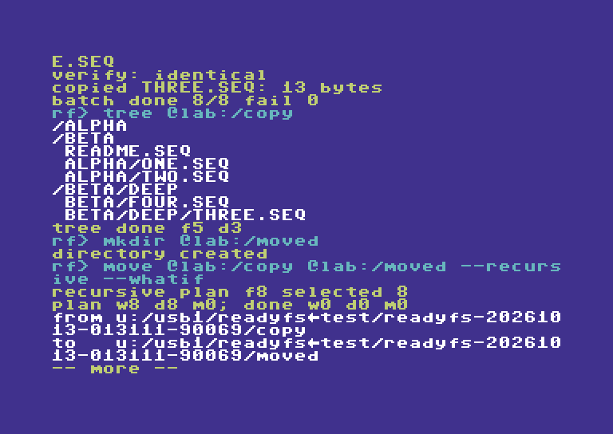

```text
e.seq
VERIFY: IDENTICAL
COPIED three.seq: 13 BYTES
BATCH DONE 8/8 FAIL 0
RF> TREE @LAB:/COPY
/alpha
/beta
 readme.seq
 alpha/one.seq
 alpha/two.seq
/beta/deep
 beta/four.seq
 beta/deep/three.seq
TREE DONE F5 D3
RF> MKDIR @LAB:/MOVED
DIRECTORY CREATED
RF> MOVE @LAB:/COPY @LAB:/MOVED --RECURS
IVE --WHATIF
RECURSIVE PLAN F8 SELECTED 8
PLAN W8 D8 M0; DONE W0 D0 M0
FROM U:/USB1/READYFS.TEST/READYFS-202610
13-013111-90069/COPY
TO   U:/USB1/READYFS.TEST/READYFS-202610
13-013111-90069/MOVED
-- MORE --
```

### Step 28

Move nested folders with the short command and option forms.

```text
MV @LAB:/COPY @LAB:/MOVED -R -NV
```

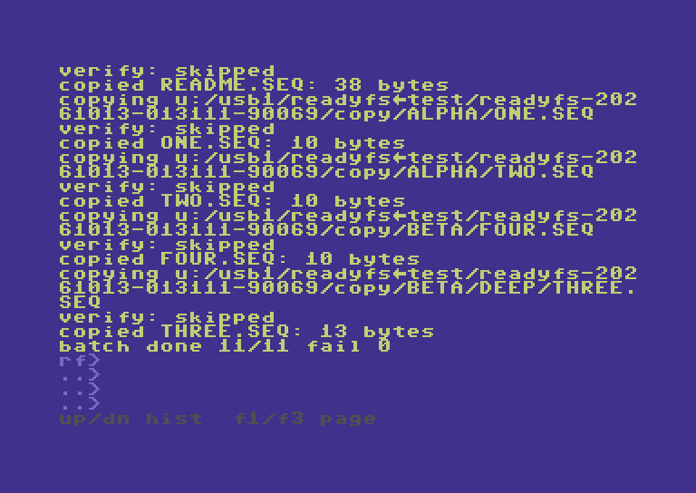

```text
VERIFY: SKIPPED
COPIED readme.seq: 38 BYTES
COPYING U:/USB1/READYFS.TEST/READYFS-202
61013-013111-90069/COPY/alpha/one.seq
VERIFY: SKIPPED
COPIED one.seq: 10 BYTES
COPYING U:/USB1/READYFS.TEST/READYFS-202
61013-013111-90069/COPY/alpha/two.seq
VERIFY: SKIPPED
COPIED two.seq: 10 BYTES
COPYING U:/USB1/READYFS.TEST/READYFS-202
61013-013111-90069/COPY/beta/four.seq
VERIFY: SKIPPED
COPIED four.seq: 10 BYTES
COPYING U:/USB1/READYFS.TEST/READYFS-202
61013-013111-90069/COPY/beta/deep/three.
seq
VERIFY: SKIPPED
COPIED three.seq: 13 BYTES
BATCH DONE 11/11 FAIL 0
RF>
..>
..>
..>
UP/DN HIST  F1/F3 PAGE
```

### Step 29

Show the folder structure and nested files.

```text
TREE @LAB:/MOVED
```

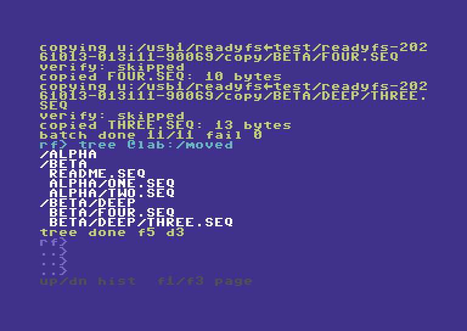

```text
COPYING U:/USB1/READYFS.TEST/READYFS-202
61013-013111-90069/COPY/beta/four.seq
VERIFY: SKIPPED
COPIED four.seq: 10 BYTES
COPYING U:/USB1/READYFS.TEST/READYFS-202
61013-013111-90069/COPY/beta/deep/three.
seq
VERIFY: SKIPPED
COPIED three.seq: 13 BYTES
BATCH DONE 11/11 FAIL 0
RF> TREE @LAB:/MOVED
/alpha
/beta
 readme.seq
 alpha/one.seq
 alpha/two.seq
/beta/deep
 beta/four.seq
 beta/deep/three.seq
TREE DONE F5 D3
RF>
..>
..>
..>
UP/DN HIST  F1/F3 PAGE
```

## 08 · Delete test copies

Preview deletion; keep the original source.

### Step 30

Command help also accepts short command names.

```text
H RM
```

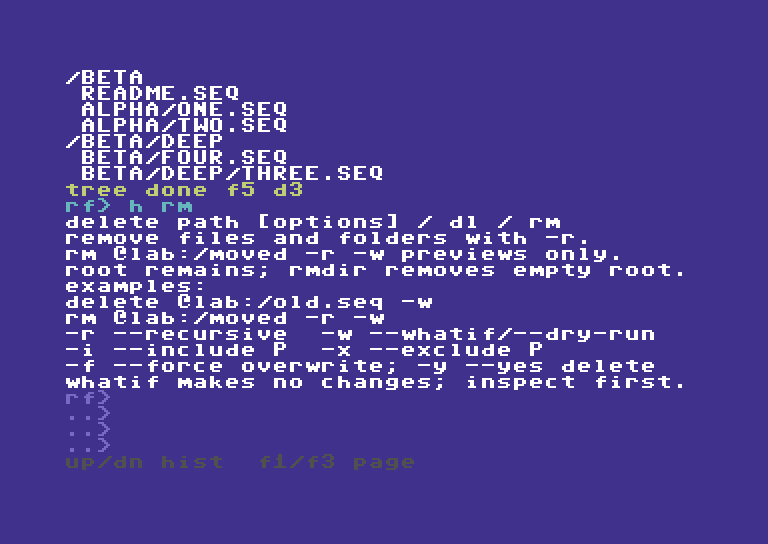

```text
/beta
 readme.seq
 alpha/one.seq
 alpha/two.seq
/beta/deep
 beta/four.seq
 beta/deep/three.seq
TREE DONE F5 D3
RF> H RM
DELETE PATH .OPTIONS. / DL / RM
REMOVE FILES AND FOLDERS WITH -R.
RM @LAB:/MOVED -R -W PREVIEWS ONLY.
ROOT REMAINS; RMDIR REMOVES EMPTY ROOT.
EXAMPLES:
DELETE @LAB:/OLD.SEQ -W
RM @LAB:/MOVED -R -W
-R --RECURSIVE  -W --WHATIF/--DRY-RUN
-I --INCLUDE p  -X --EXCLUDE p
-F --FORCE OVERWRITE; -Y --YES DELETE
WHATIF MAKES NO CHANGES; INSPECT FIRST.
RF>
..>
..>
..>
UP/DN HIST  F1/F3 PAGE
```

### Step 31

Preview removal of the copied test data. What-if previews the plan without changing storage.

```text
DELETE @LAB:/MOVED --recursive --whatif
```

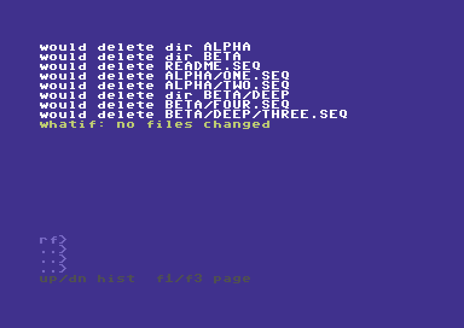

```text
WOULD DELETE DIR alpha
WOULD DELETE DIR beta
WOULD DELETE readme.seq
WOULD DELETE alpha/one.seq
WOULD DELETE alpha/two.seq
WOULD DELETE DIR beta/deep
WOULD DELETE beta/four.seq
WOULD DELETE beta/deep/three.seq
WHATIF: NO FILES CHANGED


RF>
..>
..>
..>
UP/DN HIST  F1/F3 PAGE
```

Earlier preview page:

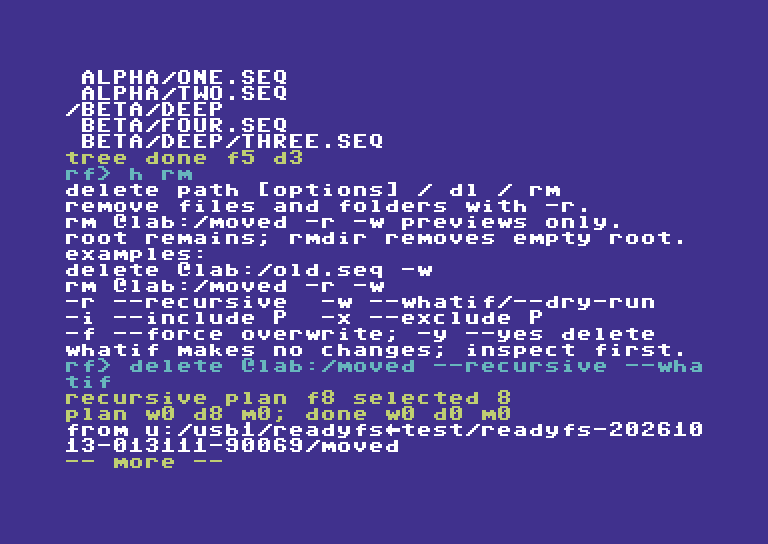

```text
 alpha/one.seq
 alpha/two.seq
/beta/deep
 beta/four.seq
 beta/deep/three.seq
TREE DONE F5 D3
RF> H RM
DELETE PATH .OPTIONS. / DL / RM
REMOVE FILES AND FOLDERS WITH -R.
RM @LAB:/MOVED -R -W PREVIEWS ONLY.
ROOT REMAINS; RMDIR REMOVES EMPTY ROOT.
EXAMPLES:
DELETE @LAB:/OLD.SEQ -W
RM @LAB:/MOVED -R -W
-R --RECURSIVE  -W --WHATIF/--DRY-RUN
-I --INCLUDE p  -X --EXCLUDE p
-F --FORCE OVERWRITE; -Y --YES DELETE
WHATIF MAKES NO CHANGES; INSPECT FIRST.
RF> DELETE @LAB:/MOVED --RECURSIVE --WHA
TIF
RECURSIVE PLAN F8 SELECTED 8
PLAN W0 D8 M0; DONE W0 D0 M0
FROM U:/USB1/READYFS.TEST/READYFS-202610
13-013111-90069/MOVED
-- MORE --
```

### Step 32

Delete only the owned demonstration descendants.

```text
RM @LAB:/MOVED -R -Y
```

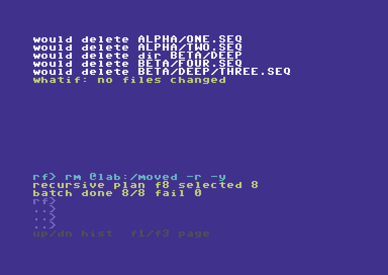

```text
WOULD DELETE alpha/one.seq
WOULD DELETE alpha/two.seq
WOULD DELETE DIR beta/deep
WOULD DELETE beta/four.seq
WOULD DELETE beta/deep/three.seq
WHATIF: NO FILES CHANGED


RF> RM @LAB:/MOVED -R -Y
RECURSIVE PLAN F8 SELECTED 8
BATCH DONE 8/8 FAIL 0
RF>
..>
..>
..>
UP/DN HIST  F1/F3 PAGE
```

### Step 33

Remove an empty test directory.

```text
RD @LAB:/MOVED -Y
```

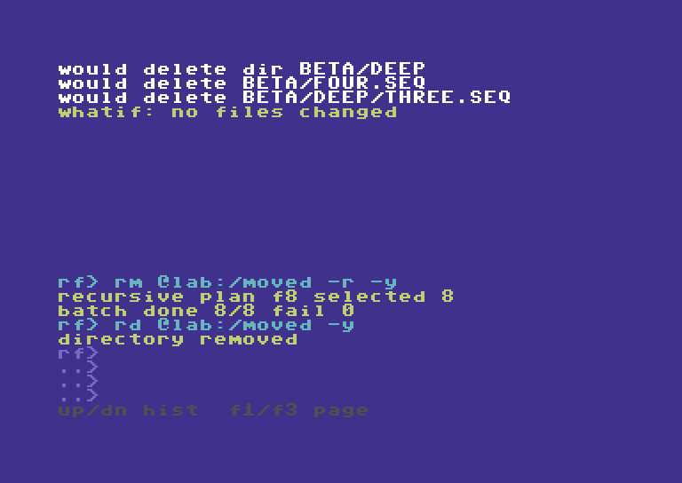

```text
WOULD DELETE DIR beta/deep
WOULD DELETE beta/four.seq
WOULD DELETE beta/deep/three.seq
WHATIF: NO FILES CHANGED


RF> RM @LAB:/MOVED -R -Y
RECURSIVE PLAN F8 SELECTED 8
BATCH DONE 8/8 FAIL 0
RF> RD @LAB:/MOVED -Y
DIRECTORY REMOVED
RF>
..>
..>
..>
UP/DN HIST  F1/F3 PAGE
```

### Step 34

Remove the remaining empty copy root.

```text
RMDIR @LAB:/COPY --yes
```

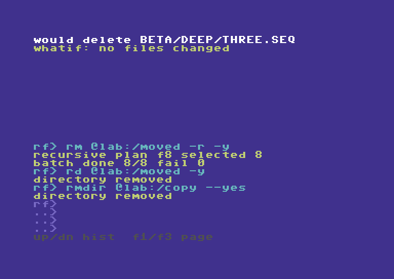

```text
WOULD DELETE beta/deep/three.seq
WHATIF: NO FILES CHANGED


RF> RM @LAB:/MOVED -R -Y
RECURSIVE PLAN F8 SELECTED 8
BATCH DONE 8/8 FAIL 0
RF> RD @LAB:/MOVED -Y
DIRECTORY REMOVED
RF> RMDIR @LAB:/COPY --YES
DIRECTORY REMOVED
RF>
..>
..>
..>
UP/DN HIST  F1/F3 PAGE
```

### Step 35

Change the current location so relative paths have a clear base.

```text
CD @LAB:/SOURCE
```

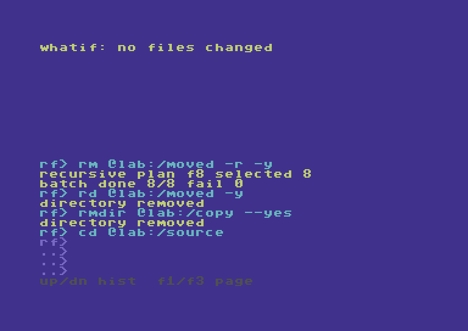

```text
WHATIF: NO FILES CHANGED


RF> RM @LAB:/MOVED -R -Y
RECURSIVE PLAN F8 SELECTED 8
BATCH DONE 8/8 FAIL 0
RF> RD @LAB:/MOVED -Y
DIRECTORY REMOVED
RF> RMDIR @LAB:/COPY --YES
DIRECTORY REMOVED
RF> CD @LAB:/SOURCE
RF>
..>
..>
..>
UP/DN HIST  F1/F3 PAGE
```

### Step 36

List the current directory; disk files use classic names, types and block counts.

```text
DIR
```

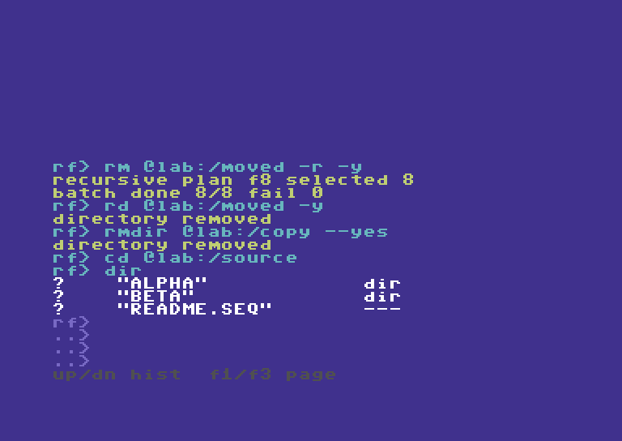

```text


RF> RM @LAB:/MOVED -R -Y
RECURSIVE PLAN F8 SELECTED 8
BATCH DONE 8/8 FAIL 0
RF> RD @LAB:/MOVED -Y
DIRECTORY REMOVED
RF> RMDIR @LAB:/COPY --YES
DIRECTORY REMOVED
RF> CD @LAB:/SOURCE
RF> DIR
?    "alpha"            DIR
?    "beta"             DIR
?    "readme.seq"       ---
RF>
..>
..>
..>
UP/DN HIST  F1/F3 PAGE
```

### Step 37

Show the folder structure and nested files.

```text
TREE .
```

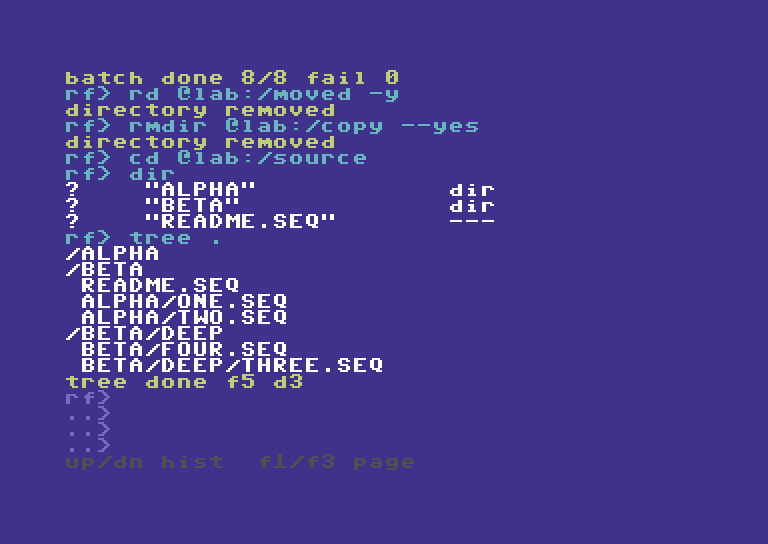

```text
BATCH DONE 8/8 FAIL 0
RF> RD @LAB:/MOVED -Y
DIRECTORY REMOVED
RF> RMDIR @LAB:/COPY --YES
DIRECTORY REMOVED
RF> CD @LAB:/SOURCE
RF> DIR
?    "alpha"            DIR
?    "beta"             DIR
?    "readme.seq"       ---
RF> TREE .
/alpha
/beta
 readme.seq
 alpha/one.seq
 alpha/two.seq
/beta/deep
 beta/four.seq
 beta/deep/three.seq
TREE DONE F5 D3
RF>
..>
..>
..>
UP/DN HIST  F1/F3 PAGE
```

## 09 · Checks complete

62 checks passed; original settings restored.


## 10 · Parameterized batch backup

Read one script, preview it, then verify a backup.

This appended chapter uses a new owned host folder and the current DOS-style scripting build. LAB is assigned during omitted setup:

```text
ALIAS LAB u:/USB1/READYFS_TEST/readyfs-20261014-045212-78988
```

[Download the exact BACKUP.SEQ](../examples/BACKUP.SEQ). TYPE displays its real contents before execution.

### Step 38

A named session variable counts successful backups across runs.

```text
SET BACKUPS=0
```

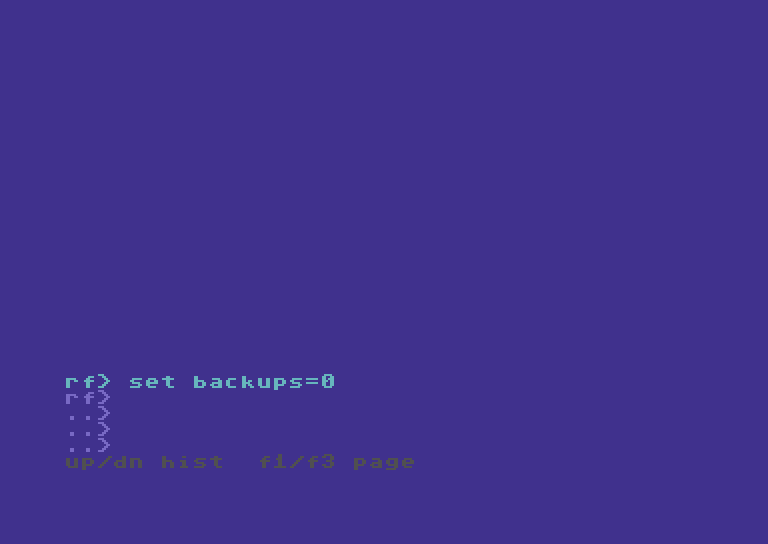

```text


RF> SET BACKUPS=0
RF>
..>
..>
..>
UP/DN HIST  F1/F3 PAGE
```

### Step 39

Read the actual script: arguments, conditions, labels, a local CALL and a counter.

```text
TYPE @LAB:/BACKUP.SEQ
```

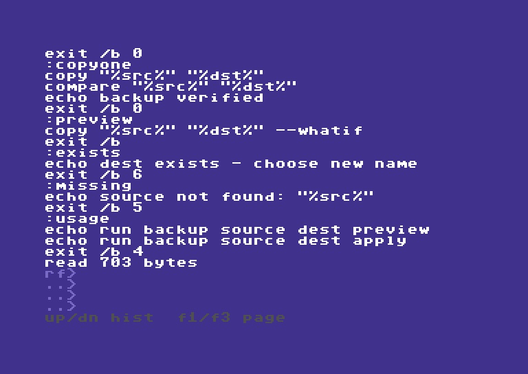

```text
EXIT /B 0
:COPYONE
COPY "%SRC%" "%DST%"
COMPARE "%SRC%" "%DST%"
ECHO BACKUP VERIFIED
EXIT /B 0
:PREVIEW
COPY "%SRC%" "%DST%" --WHATIF
EXIT /B
:EXISTS
ECHO DEST EXISTS - CHOOSE NEW NAME
EXIT /B 6
:MISSING
ECHO SOURCE NOT FOUND: "%SRC%"
EXIT /B 5
:USAGE
ECHO RUN BACKUP SOURCE DEST PREVIEW
ECHO RUN BACKUP SOURCE DEST APPLY
EXIT /B 4
READ 703 BYTES
RF>
..>
..>
..>
UP/DN HIST  F1/F3 PAGE
```

Script page 1:

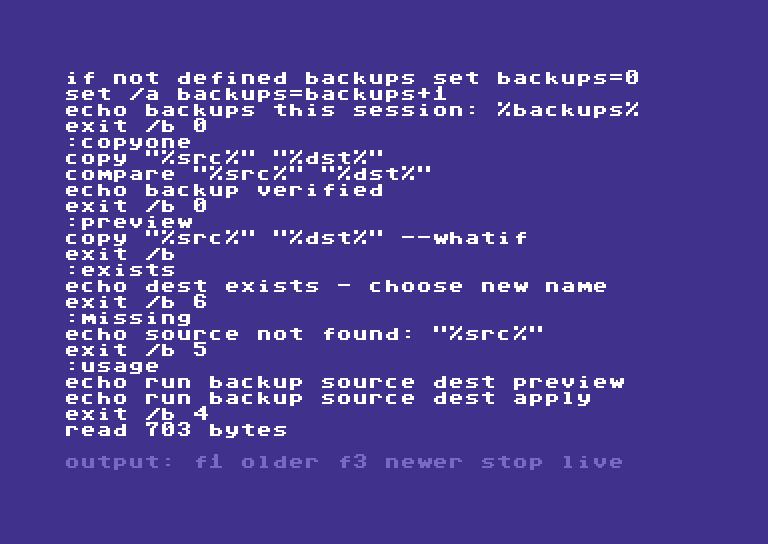

```text
IF NOT DEFINED BACKUPS SET BACKUPS=0
SET /A BACKUPS=BACKUPS+1
ECHO BACKUPS THIS SESSION: %BACKUPS%
EXIT /B 0
:COPYONE
COPY "%SRC%" "%DST%"
COMPARE "%SRC%" "%DST%"
ECHO BACKUP VERIFIED
EXIT /B 0
:PREVIEW
COPY "%SRC%" "%DST%" --WHATIF
EXIT /B
:EXISTS
ECHO DEST EXISTS - CHOOSE NEW NAME
EXIT /B 6
:MISSING
ECHO SOURCE NOT FOUND: "%SRC%"
EXIT /B 5
:USAGE
ECHO RUN BACKUP SOURCE DEST PREVIEW
ECHO RUN BACKUP SOURCE DEST APPLY
EXIT /B 4
READ 703 BYTES

OUTPUT: F1 OLDER F3 NEWER STOP LIVE
```

Script page 2:


```text
REU: 256 BANKS
OVERLAY: CMDPATH: READY
PLANNER: READY
JOURNAL: READY BACKEND: READY
BATCH: READY
RF> ALIAS LAB U:/USB1/READYFS.TEST/READY
FS-20261014-045212-78988
ALIAS SET
RF> CLEAR
RF> SET BACKUPS=0
RF> CLEAR
RF> TYPE @LAB:/BACKUP.SEQ
REM BACKUP SOURCE DEST PREVIEW OR APPLY
ONERROR STOP
SET "SRC=%1"
SET "DST=%2"
IF "%SRC%"=="" GOTO USAGE
IF "%DST%"=="" GOTO USAGE
IF NOT EXIST "%SRC%" GOTO MISSING
IF "%3"=="PREVIEW" GOTO PREVIEW
IF NOT "%3"=="APPLY" GOTO USAGE
IF EXIST "%DST%" GOTO EXISTS
CALL :COPYONE

OUTPUT: F1 OLDER F3 NEWER STOP LIVE
```

### Step 40

Pass source, destination and PREVIEW as %1, %2 and %3; no file is written.

```text
RUN @LAB:/BACKUP.SEQ @LAB:/SOURCE/README.SEQ @LAB:/SAVED.SEQ PREVIEW
```

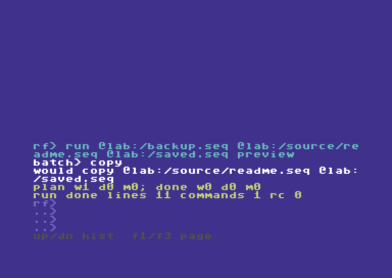

```text


RF> RUN @LAB:/BACKUP.SEQ @LAB:/SOURCE/RE
ADME.SEQ @LAB:/SAVED.SEQ PREVIEW
BATCH> COPY
WOULD COPY @LAB:/SOURCE/README.SEQ @LAB:
/SAVED.SEQ
PLAN W1 D0 M0; DONE W0 D0 M0
RUN DONE LINES 11 COMMANDS 1 RC 0
RF>
..>
..>
..>
UP/DN HIST  F1/F3 PAGE
```

### Step 41

Pass APPLY to copy and compare; CALL shares SRC/DST and arithmetic increments BACKUPS.

```text
RUN @LAB:/BACKUP.SEQ @LAB:/SOURCE/README.SEQ @LAB:/SAVED.SEQ APPLY
```

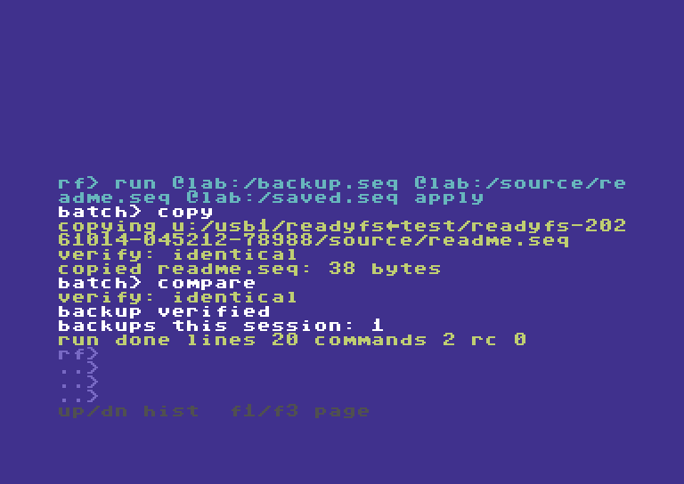

```text


RF> RUN @LAB:/BACKUP.SEQ @LAB:/SOURCE/RE
ADME.SEQ @LAB:/SAVED.SEQ APPLY
BATCH> COPY
COPYING U:/USB1/READYFS.TEST/READYFS-202
61014-045212-78988/SOURCE/README.SEQ
VERIFY: IDENTICAL
COPIED README.SEQ: 38 BYTES
BATCH> COMPARE
VERIFY: IDENTICAL
BACKUP VERIFIED
BACKUPS THIS SESSION: 1
RUN DONE LINES 20 COMMANDS 2 RC 0
RF>
..>
..>
..>
UP/DN HIST  F1/F3 PAGE
```

### Step 42

An existing destination takes the refusal branch, returns 6 and leaves the counter unchanged.

```text
RUN @LAB:/BACKUP.SEQ @LAB:/SOURCE/README.SEQ @LAB:/SAVED.SEQ APPLY
```

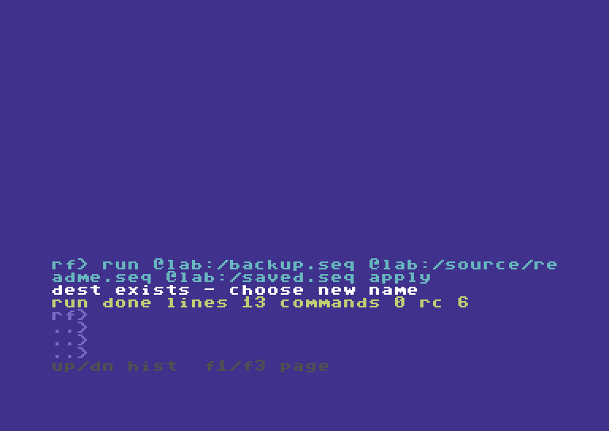

```text


RF> RUN @LAB:/BACKUP.SEQ @LAB:/SOURCE/RE
ADME.SEQ @LAB:/SAVED.SEQ APPLY
DEST EXISTS - CHOOSE NEW NAME
RUN DONE LINES 13 COMMANDS 0 RC 6
RF>
..>
..>
..>
UP/DN HIST  F1/F3 PAGE
```

### Step 43

Read the copied file and see the original fixture text.

```text
TYPE @LAB:/SAVED.SEQ
```

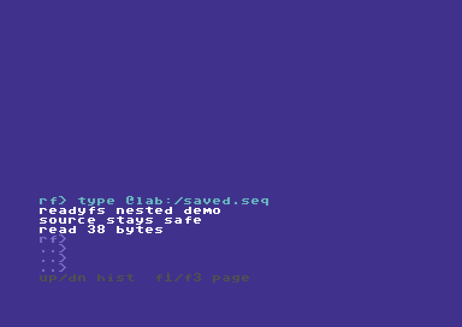

```text


RF> TYPE @LAB:/SAVED.SEQ
READYFS NESTED DEMO
SOURCE STAYS SAFE
READ 38 BYTES
RF>
..>
..>
..>
UP/DN HIST  F1/F3 PAGE
```

### Step 44

Script changes to named variables remain available at the interactive prompt.

```text
ECHO COMPLETED BACKUPS: %BACKUPS%
```

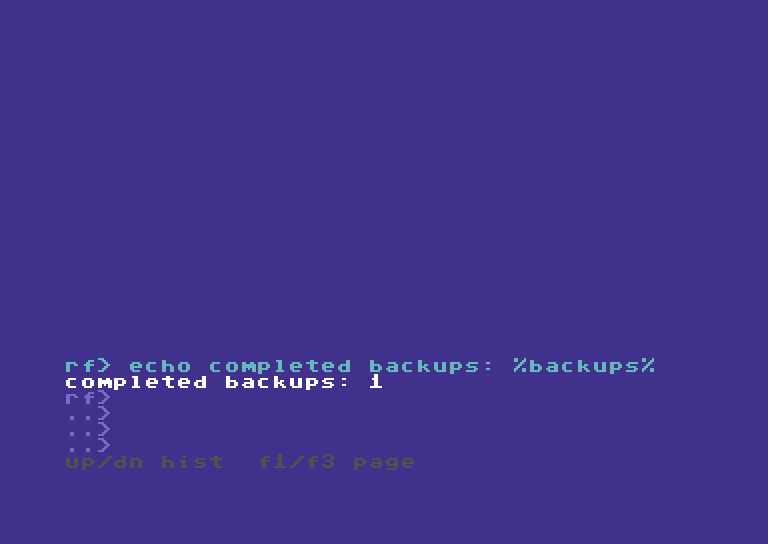

```text


RF> ECHO COMPLETED BACKUPS: %BACKUPS%
COMPLETED BACKUPS: 1
RF>
..>
..>
..>
UP/DN HIST  F1/F3 PAGE
```
