# ReadyFS native SD2IEC screenshot walkthrough

These physical C64 Ultimate and attached-SD2IEC screenshots follow folder round trips and explicit image transitions. Device 10 and the named fixture roots belong to that recorded setup. Use a fresh folder of your own; consult the native support reference before making changes.

[User guide](../READYFS_USER_GUIDE.md) · [Current acceptance](../READYFS_ACCEPTANCE.md)

## Setup omitted from the edited video

LAB points to this run’s owned host root. CARD is assigned visibly in chapter 1. Use a new folder of your own rather than reusing these evidence fixtures.

```text
ALIAS LAB u:/USB1/READYFS_TEST/readyfs-20261013-162951-8006
```

## 01 · Find the SD2IEC

Device, partition and folder are separate choices.

### Step 1

Detect the attached SD2IEC through native IEC.

```text
PROBE IEC 10:
```

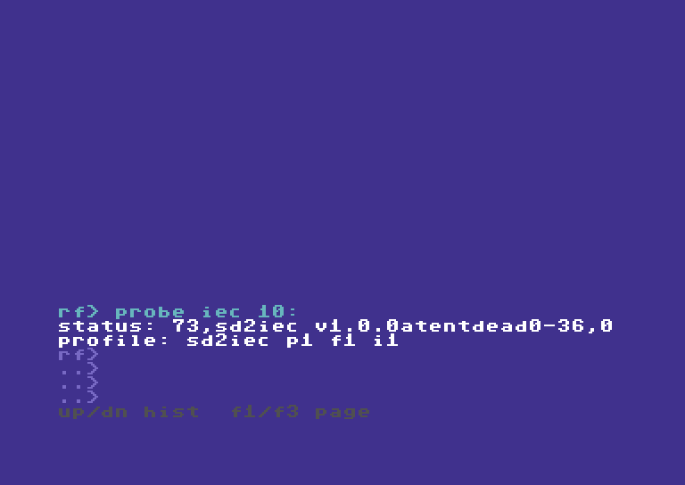

```text


RF> PROBE IEC 10:
STATUS: 73,SD2IEC V1.0.0ATENTDEAD0-36,0
PROFILE: SD2IEC P1 F1 I1
RF>
..>
..>
..>
UP/DN HIST  F1/F3 PAGE
```

### Step 2

Inspect settings without changing or saving them.

```text
IEC 10: CONFIG
```

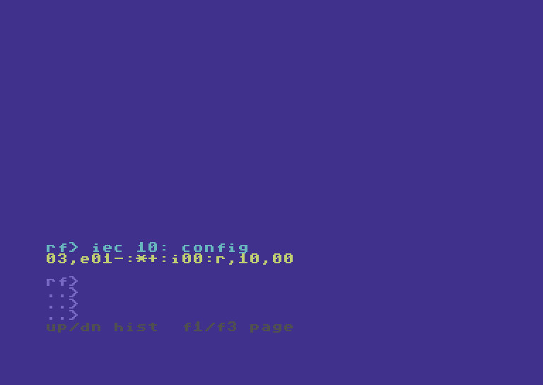

```text


RF> IEC 10: CONFIG
03,E01-:*+:I00:R,10,00

RF>
..>
..>
..>
UP/DN HIST  F1/F3 PAGE
```

### Step 3

The partition reply distinguishes mounted flat images from FAT/DNP.

```text
IEC 10: PARTITION 1
```

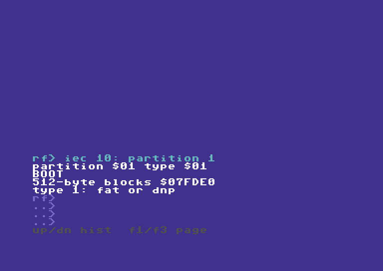

```text


RF> IEC 10: PARTITION 1
PARTITION $01 TYPE $01
boot
512-BYTE BLOCKS $07fde0
TYPE 1: FAT OR DNP
RF>
..>
..>
..>
UP/DN HIST  F1/F3 PAGE
```

### Step 4

Create a fresh folder inside the owned SD test root.

```text
MKDIR 10.1:/rf261013085527/out/v163325
```

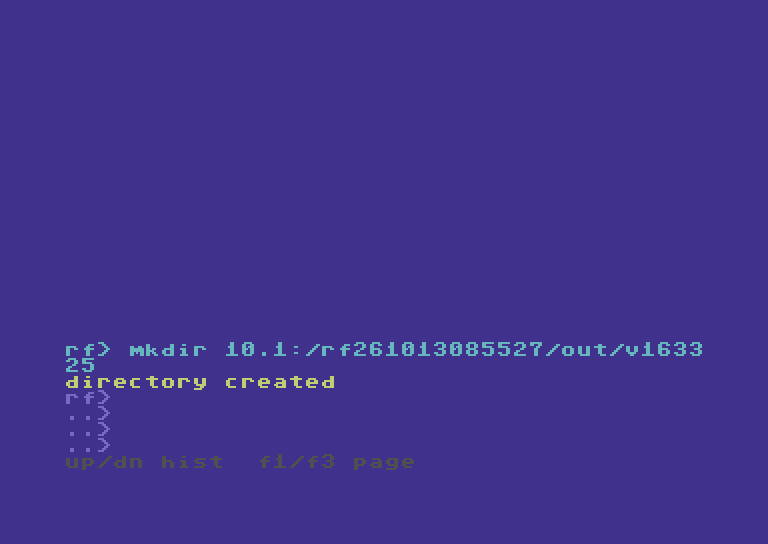

```text


RF> MKDIR 10.1:/RF261013085527/OUT/V1633
25
DIRECTORY CREATED
RF>
..>
..>
..>
UP/DN HIST  F1/F3 PAGE
```

### Step 5

CARD names this SD folder; it does not change its capabilities.

```text
ALIAS CARD 10.1:/rf261013085527/out/v163325
```

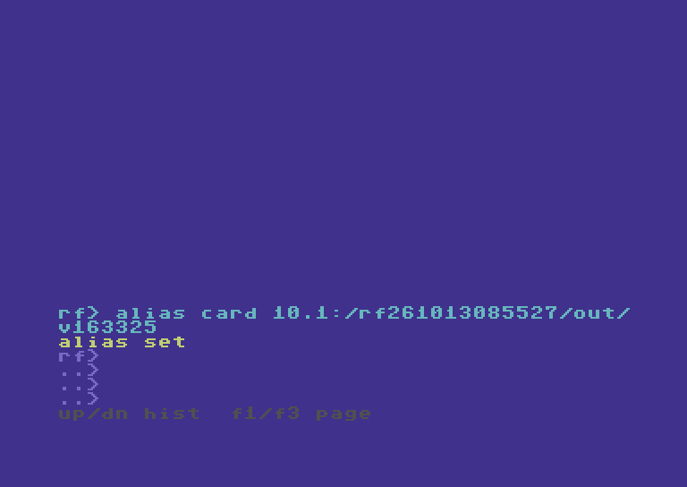

```text


RF> ALIAS CARD 10.1:/RF261013085527/OUT/
V163325
ALIAS SET
RF>
..>
..>
..>
UP/DN HIST  F1/F3 PAGE
```

## 02 · Copy a nested tree

Five files, three subfolders, one recursive copy.

### Step 6

Five source files span alpha, beta and beta/deep.

```text
TREE @LAB:/SOURCE
```


```text


RF> TREE @LAB:/SOURCE
/alpha
/beta
 readme.seq
 alpha/one.seq
 alpha/two.seq
/beta/deep
 beta/four.seq
 beta/deep/three.seq
TREE DONE F5 D3
RF>
..>
..>
..>
UP/DN HIST  F1/F3 PAGE
```

### Step 7

Prepare the destination container.

```text
MD @CARD:/TREE
```

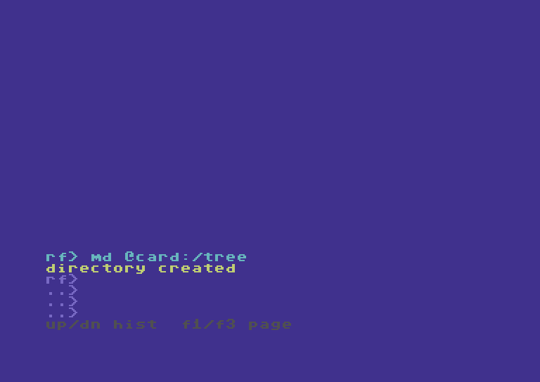

```text


RF> MD @CARD:/TREE
DIRECTORY CREATED
RF>
..>
..>
..>
UP/DN HIST  F1/F3 PAGE
```

### Step 8

Preview every selected file and folder without writing. What-if previews the plan without changing storage.

```text
COPY @LAB:/SOURCE @CARD:/TREE -R -W
```


```text
WOULD COPY DIR alpha
WOULD COPY DIR beta
WOULD COPY readme.seq
WOULD COPY alpha/one.seq
WOULD COPY alpha/two.seq
WOULD COPY DIR beta/deep
WOULD COPY beta/four.seq
WOULD COPY beta/deep/three.seq
WHATIF: NO FILES CHANGED


RF>
..>
..>
..>
UP/DN HIST  F1/F3 PAGE
```

### Step 9

Copy the complete tree; destination verification is enabled.

```text
COPY @LAB:/SOURCE @CARD:/TREE --recursive
```

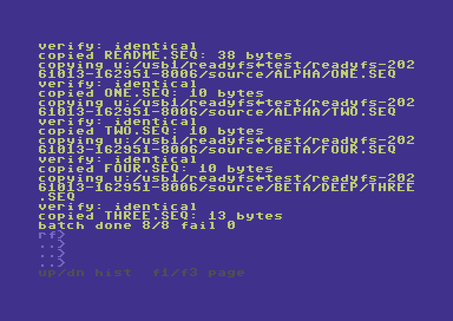

```text
VERIFY: IDENTICAL
COPIED readme.seq: 38 BYTES
COPYING U:/USB1/READYFS.TEST/READYFS-202
61013-162951-8006/SOURCE/alpha/one.seq
VERIFY: IDENTICAL
COPIED one.seq: 10 BYTES
COPYING U:/USB1/READYFS.TEST/READYFS-202
61013-162951-8006/SOURCE/alpha/two.seq
VERIFY: IDENTICAL
COPIED two.seq: 10 BYTES
COPYING U:/USB1/READYFS.TEST/READYFS-202
61013-162951-8006/SOURCE/beta/four.seq
VERIFY: IDENTICAL
COPIED four.seq: 10 BYTES
COPYING U:/USB1/READYFS.TEST/READYFS-202
61013-162951-8006/SOURCE/beta/deep/three
.seq
VERIFY: IDENTICAL
COPIED three.seq: 13 BYTES
BATCH DONE 8/8 FAIL 0
RF>
..>
..>
..>
UP/DN HIST  F1/F3 PAGE
```

### Step 10

The SD destination keeps the nested layout.

```text
TREE @CARD:/TREE
```

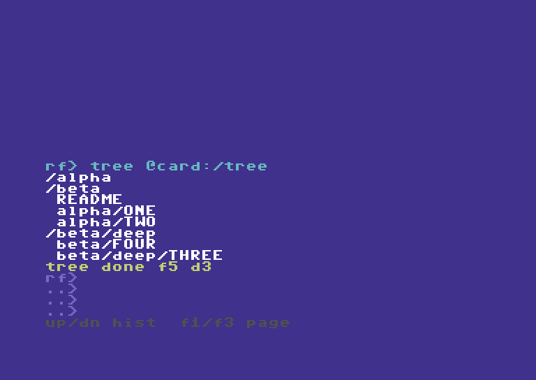

```text


RF> TREE @CARD:/TREE
/ALPHA
/BETA
 readme
 ALPHA/one
 ALPHA/two
/BETA/DEEP
 BETA/four
 BETA/DEEP/three
TREE DONE F5 D3
RF>
..>
..>
..>
UP/DN HIST  F1/F3 PAGE
```

## 03 · Bring the tree back

Copy SD folders back to Ultimate storage.

### Step 11

Create a separate host destination for the return copy.

```text
MKDIR @LAB:/RETURNED
```

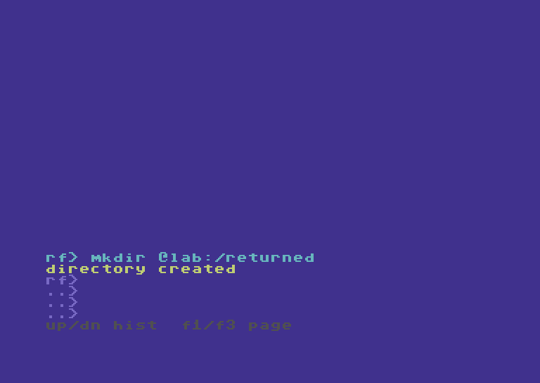

```text


RF> MKDIR @LAB:/RETURNED
DIRECTORY CREATED
RF>
..>
..>
..>
UP/DN HIST  F1/F3 PAGE
```

### Step 12

The short CP and -R forms copy all five files back.

```text
CP @CARD:/TREE @LAB:/RETURNED -R
```

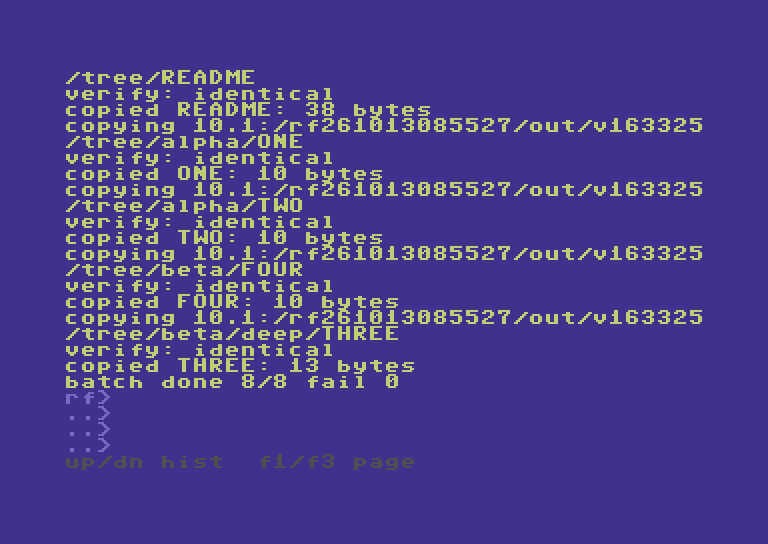

```text
/TREE/readme
VERIFY: IDENTICAL
COPIED readme: 38 BYTES
COPYING 10.1:/RF261013085527/OUT/V163325
/TREE/ALPHA/one
VERIFY: IDENTICAL
COPIED one: 10 BYTES
COPYING 10.1:/RF261013085527/OUT/V163325
/TREE/ALPHA/two
VERIFY: IDENTICAL
COPIED two: 10 BYTES
COPYING 10.1:/RF261013085527/OUT/V163325
/TREE/BETA/four
VERIFY: IDENTICAL
COPIED four: 10 BYTES
COPYING 10.1:/RF261013085527/OUT/V163325
/TREE/BETA/DEEP/three
VERIFY: IDENTICAL
COPIED three: 13 BYTES
BATCH DONE 8/8 FAIL 0
RF>
..>
..>
..>
UP/DN HIST  F1/F3 PAGE
```

### Step 13

Read the returned tree; SD logical names can omit type suffixes.

```text
TREE @LAB:/RETURNED
```


```text


RF> TREE @LAB:/RETURNED
/ALPHA
/BETA
 readme
 ALPHA/one
 ALPHA/two
/BETA/DEEP
 BETA/four
 BETA/DEEP/three
TREE DONE F5 D3
RF>
..>
..>
..>
UP/DN HIST  F1/F3 PAGE
```

## 04 · Other IEC endpoints

Select two files when the destination is flat.

### Step 14

SoftwareIEC is a mapped endpoint, separate from SD2IEC.

```text
AL SOFT s0:/READYFS_TEST/readyfs-20261013-162951-8006/
```

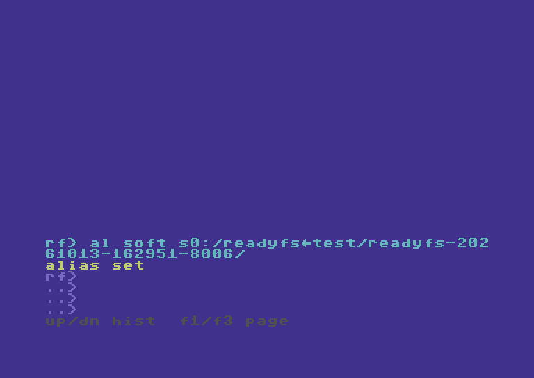

```text


RF> AL SOFT S0:/READYFS.TEST/READYFS-202
61013-162951-8006/
ALIAS SET
RF>
..>
..>
..>
UP/DN HIST  F1/F3 PAGE
```

### Step 15

Copy a chosen nested file into the flat IEC image.

```text
COPY @CARD:/TREE/ALPHA/one 9:/V163325A
```

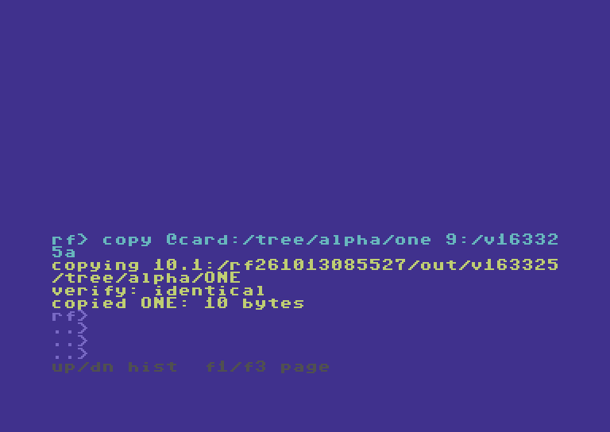

```text


RF> COPY @CARD:/TREE/ALPHA/ONE 9:/V16332
5A
COPYING 10.1:/RF261013085527/OUT/V163325
/TREE/ALPHA/one
VERIFY: IDENTICAL
COPIED one: 10 BYTES
RF>
..>
..>
..>
UP/DN HIST  F1/F3 PAGE
```

### Step 16

Copy the same chosen file through SoftwareIEC.

```text
CP @CARD:/TREE/ALPHA/one @SOFT:/V163325A
```

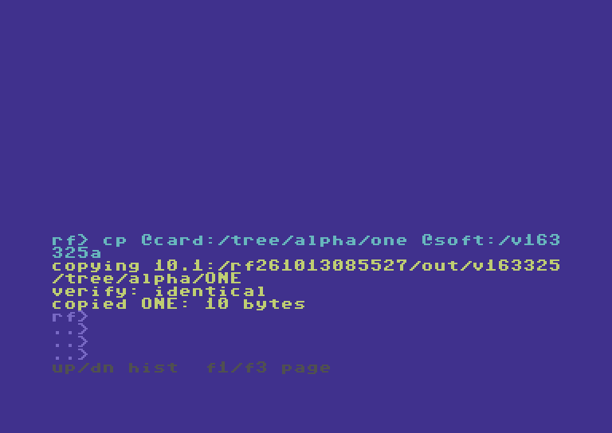

```text


RF> CP @CARD:/TREE/ALPHA/ONE @SOFT:/V163
325A
COPYING 10.1:/RF261013085527/OUT/V163325
/TREE/ALPHA/one
VERIFY: IDENTICAL
COPIED one: 10 BYTES
RF>
..>
..>
..>
UP/DN HIST  F1/F3 PAGE
```

### Step 17

Copy a chosen nested file into the flat IEC image.

```text
COPY @CARD:/TREE/ALPHA/two 9:/V163325B
```

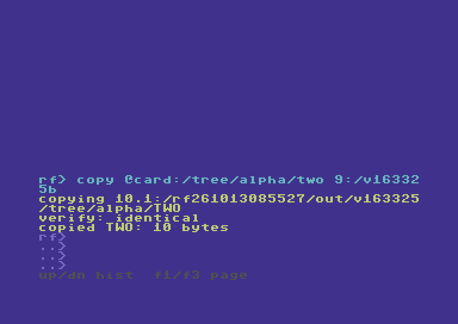

```text


RF> COPY @CARD:/TREE/ALPHA/TWO 9:/V16332
5B
COPYING 10.1:/RF261013085527/OUT/V163325
/TREE/ALPHA/two
VERIFY: IDENTICAL
COPIED two: 10 BYTES
RF>
..>
..>
..>
UP/DN HIST  F1/F3 PAGE
```

### Step 18

Copy the same chosen file through SoftwareIEC.

```text
CP @CARD:/TREE/ALPHA/two @SOFT:/V163325B
```

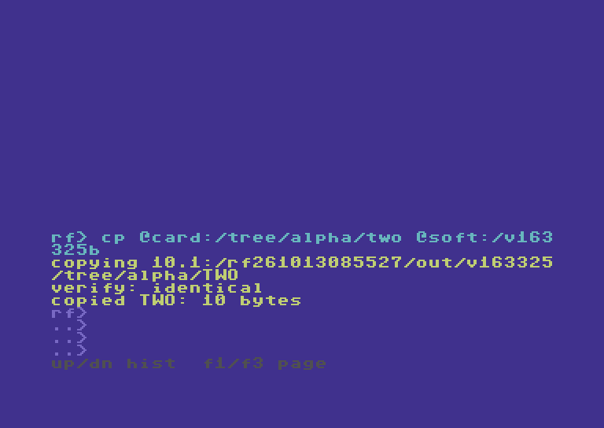

```text


RF> CP @CARD:/TREE/ALPHA/TWO @SOFT:/V163
325B
COPYING 10.1:/RF261013085527/OUT/V163325
/TREE/ALPHA/two
VERIFY: IDENTICAL
COPIED two: 10 BYTES
RF>
..>
..>
..>
UP/DN HIST  F1/F3 PAGE
```

## 05 · Open an SD disk image

Mount first; then address files through device 10.

### Step 19

Mount only the owned test image; device 10 now shows its contents.

```text
MOUNT 10.1:/rf261013085527/out/i1013100749.d64 --force
```

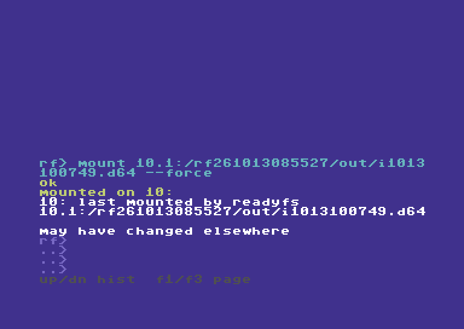

```text


RF> MOUNT 10.1:/RF261013085527/OUT/I1013
100749.D64 --FORCE
OK
MOUNTED ON 10:
10: LAST MOUNTED BY READYFS
10.1:/RF261013085527/OUT/I1013100749.D64

MAY HAVE CHANGED ELSEWHERE
RF>
..>
..>
..>
UP/DN HIST  F1/F3 PAGE
```

### Step 20

The native reply confirms the mounted D64 view.

```text
IEC 10: PARTITION 1
```

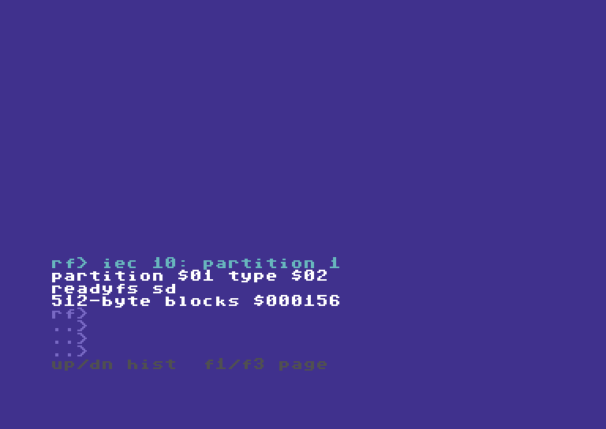

```text


RF> IEC 10: PARTITION 1
PARTITION $01 TYPE $02
READYFS SD
512-BYTE BLOCKS $000156
RF>
..>
..>
..>
UP/DN HIST  F1/F3 PAGE
```

### Step 21

Inspect the actual disk-image directory.

```text
DIR 10.1:/
```


```text
1    "BC-SDS125515.SEQ" SEQ
1    "BD-HDS125515.SEQ" SEQ
3    "BD-HDP125515.PRG" PRG
1    "BD-HDU125515.USR" USR
1    "BD-IDS125515.SEQ" SEQ
1    "BD-SDS125515.SEQ" SEQ
631 BLOCKS FREE.


RF>
..>
..>
..>
UP/DN HIST  F1/F3 PAGE
```

## 06 · Copy inside both images

SD mounts and Ultimate slash paths work differently.

### Step 22

Use the host return copy while the SD FAT folder is unavailable.

```text
COPY @LAB:/RETURNED/ALPHA/one 10.1:/V163325A
```


```text


RF> COPY @LAB:/RETURNED/ALPHA/ONE 10.1:/
V163325A
COPYING U:/USB1/READYFS.TEST/READYFS-202
61013-162951-8006/RETURNED/ALPHA/ONE
VERIFY: IDENTICAL
COPIED ONE: 10 BYTES
RF>
..>
..>
..>
UP/DN HIST  F1/F3 PAGE
```

### Step 23

Write directly inside the separate, unmounted Ultimate D64.

```text
CP 10.1:/V163325A @LAB:/HOST.D64/one.SEQ
```


```text


RF> CP 10.1:/V163325A @LAB:/HOST.D64/ONE
.SEQ
COPYING 10.1:/V163325A
VERIFY: IDENTICAL
COPIED V163325A: 10 BYTES
RF>
..>
..>
..>
UP/DN HIST  F1/F3 PAGE
```

### Step 24

Use the host return copy while the SD FAT folder is unavailable.

```text
COPY @LAB:/RETURNED/ALPHA/two 10.1:/V163325B
```

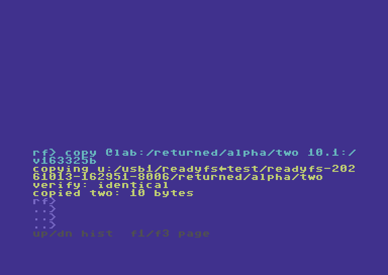

```text


RF> COPY @LAB:/RETURNED/ALPHA/TWO 10.1:/
V163325B
COPYING U:/USB1/READYFS.TEST/READYFS-202
61013-162951-8006/RETURNED/ALPHA/TWO
VERIFY: IDENTICAL
COPIED TWO: 10 BYTES
RF>
..>
..>
..>
UP/DN HIST  F1/F3 PAGE
```

### Step 25

Write directly inside the separate, unmounted Ultimate D64.

```text
CP 10.1:/V163325B @LAB:/HOST.D64/two.SEQ
```

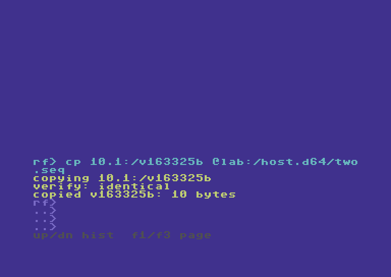

```text


RF> CP 10.1:/V163325B @LAB:/HOST.D64/TWO
.SEQ
COPYING 10.1:/V163325B
VERIFY: IDENTICAL
COPIED V163325B: 10 BYTES
RF>
..>
..>
..>
UP/DN HIST  F1/F3 PAGE
```

### Step 26

Reverse the direction and preserve the PRG type.

```text
COPY @LAB:/HOST.D64/HELLO.PRG 10.1:/V163325P
```

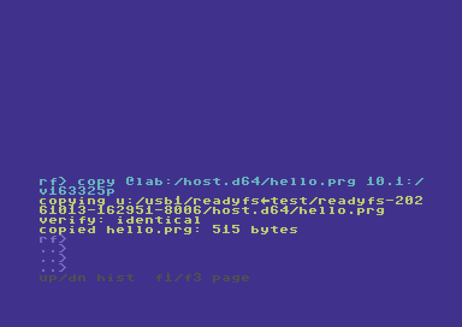

```text


RF> COPY @LAB:/HOST.D64/HELLO.PRG 10.1:/
V163325P
COPYING U:/USB1/READYFS.TEST/READYFS-202
61013-162951-8006/HOST.D64/HELLO.PRG
VERIFY: IDENTICAL
COPIED HELLO.PRG: 515 BYTES
RF>
..>
..>
..>
UP/DN HIST  F1/F3 PAGE
```

### Step 27

The native directory reports PRG, not just matching bytes.

```text
STAT 10.1:/V163325P
```


```text


RF> STAT 10.1:/V163325P
10: LAST MOUNTED BY READYFS
10.1:/RF261013085527/OUT/I1013100749.D64

MAY HAVE CHANGED ELSEWHERE
DISPLAY: V163325P
TYPE: $11
RAW: V163325P
SIZE EST: 3 C64 BLOCKS
RF>
..>
..>
..>
UP/DN HIST  F1/F3 PAGE
```

### Step 28

Save an intermediate file before returning to SD folders.

```text
COPY 10.1:/V163325P @LAB:/FROMIMG.PRG
```

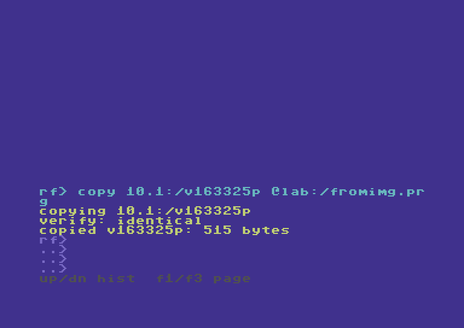

```text


RF> COPY 10.1:/V163325P @LAB:/FROMIMG.PR
G
COPYING 10.1:/V163325P
VERIFY: IDENTICAL
COPIED V163325P: 515 BYTES
RF>
..>
..>
..>
UP/DN HIST  F1/F3 PAGE
```

## 07 · Return to SD folders

Close image access before copying back onto SD.

### Step 29

Return partition 1 to its FAT directory view.

```text
DISMOUNT 10.1:/ --force
```

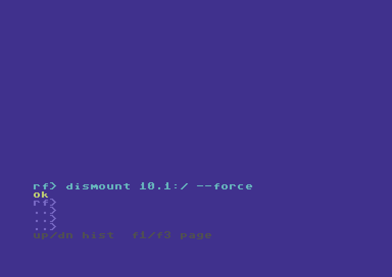

```text


RF> DISMOUNT 10.1:/ --FORCE
OK
RF>
..>
..>
..>
UP/DN HIST  F1/F3 PAGE
```

### Step 30

Complete image-to-SD-folder transfer through the intermediate host file.

```text
COPY @LAB:/FROMIMG.PRG @CARD:/FROMIMG.PRG
```

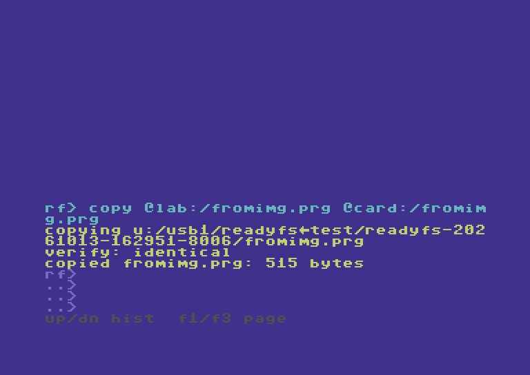

```text


RF> COPY @LAB:/FROMIMG.PRG @CARD:/FROMIM
G.PRG
COPYING U:/USB1/READYFS.TEST/READYFS-202
61013-162951-8006/FROMIMG.PRG
VERIFY: IDENTICAL
COPIED FROMIMG.PRG: 515 BYTES
RF>
..>
..>
..>
UP/DN HIST  F1/F3 PAGE
```

### Step 31

Both image styles and the final SD file contain the same PRG bytes.

```text
COMPARE @CARD:/FROMIMG.PRG @LAB:/HOST.D64/HELLO.PRG
```

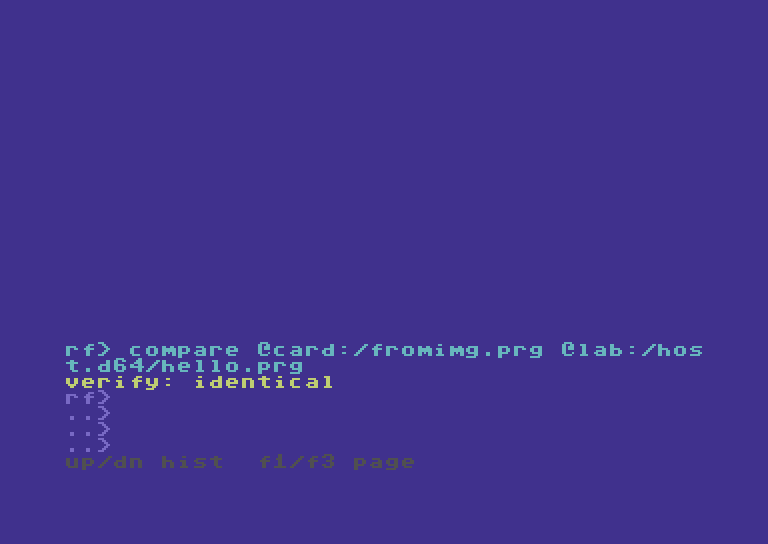

```text


RF> COMPARE @CARD:/FROMIMG.PRG @LAB:/HOS
T.D64/HELLO.PRG
VERIFY: IDENTICAL
RF>
..>
..>
..>
UP/DN HIST  F1/F3 PAGE
```

### Step 32

Configuration is unchanged; no EEPROM save was needed.

```text
IEC 10: CONFIG
```


```text


RF> IEC 10: CONFIG
03,E01-:*+:I00:R,10,00

RF>
..>
..>
..>
UP/DN HIST  F1/F3 PAGE
```
