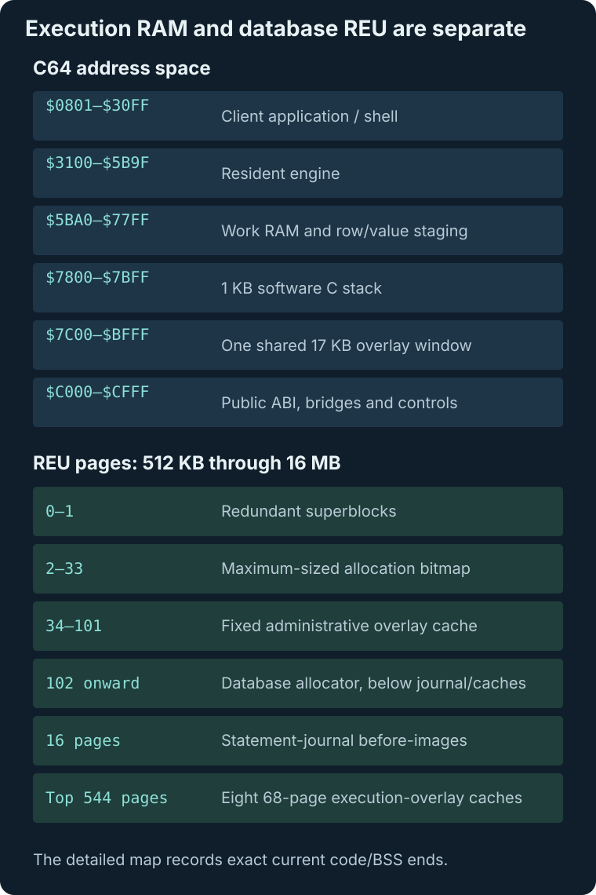

# C64 and REU Memory Map

There are two maps to keep separate: C64 address space holds the client and active
execution phase, while the REU holds persistent pages, rollback before-images and cached
overlays. Fixed boundaries are checked after linking.

*The active overlay occupies one C64 window. Its other payloads are cached in reserved
REU regions, outside the database allocator.*

## C64 RAM

- `$0801-$30FF`: client application; must remain untouched by engine loading,
  BSS, stack, or DMA staging. The interactive shell is the largest special
  client layout: code/data plus its 161-byte line buffer end at `$3080`,
  leaving `$3081-$30FF` free before the engine.
- `$3100-$5B9F`: resident engine region. Current code ends at `$5B9C`.
- `$5BA0-$77FF`: work RAM, row/value staging, parser workspace, and two shared
  256-byte metadata scratch pages. Shared BSS currently ends at `$7700`; the
  shell/export adapter is the largest current APPBSS and ends at `$77DE`,
  leaving `$77DF-$77FF` before the fixed C stack.
- `$7800-$7BFF`: reserved 1KB cc65 software C stack.
- `$7C00-$BFFF`: shared 17KB overlay window. RAM is exposed under BASIC ROM
  while executing code in `$A000-$BFFF`. Current ends are metadata `$BFF6`,
  row/aggregate `$BFEF`, parser `$BF71`, executor/index/lifecycle `$BFDD`,
  joined/subquery shaping `$BFBE`, ordinary result shaping `$BF9B`,
  joined/correlated aggregation `$BFBC`, administration `$BFEA`, and direct
  wide execution/shaping `$BB38`.
- `$C000-$CFFF`: public JMP table, phase-neutral query glue, and resident
  BASIC-ROM float trampoline. The jump table is fixed at `$C000`, with
  checkpoint at `$C01B` and restore at `$C01E`. Normal ABI code ends at `$CFEE`; `$CFEF` is the
  Peddle BASIC-FLOAT activity marker and `$CFF0-$CFF6` are automation controls.
  A final resident predicate bridge occupies `$CFF7-$CFFE`; `$CFFF` is the
  checkpoint test-adapter handshake. The post-link verifier checks every fixed
  address and boundary.

## REU

REU addresses are 24-bit. The detected size is converted to a page count from 2,048
pages (512KB) through 65,536 pages (16MB).

- Page 0: superblock A.
- Page 1: superblock B.
- Pages 2-33: allocation bitmap reservation.
- Pages 34-101: fixed administrative sidecar cache.
- Pages 102 through `page_count-561`: database allocator.
- The following 16 pages are statement-journal before images.
- Top 544 pages: eight 68-page (17KB) overlay slots.

### Why the cache reservations are fixed

The shell reuses the caches. Direct wide execution owns the eighth top slot;
administration remains fixed at pages 34-101. This reservation is recorded by storage
version 4 so older raw images cannot be opened with overlapping data.

### Capacity-independent page identities

The bitmap is deliberately reserved at its maximum size on every supported REU so
physical page identities and format offsets do not depend on capacity.
