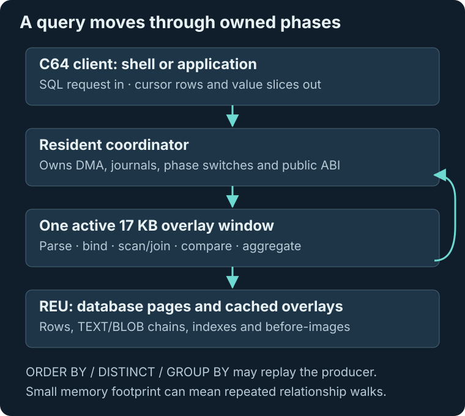
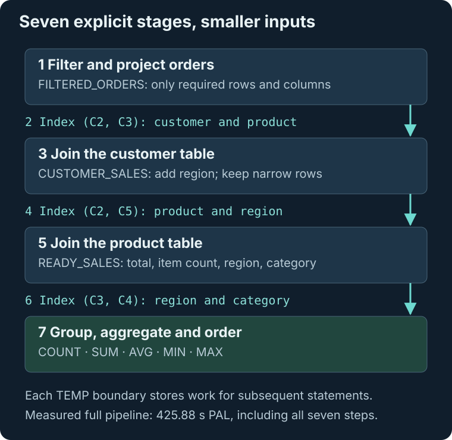

# Query performance and staged SQL

ReuSQL64 makes advanced SQL possible with a small, fixed amount of C64 RAM. The cost is repeated work: a query may revisit the same rows, joined relationships, values or groups many times. This guide explains the current execution model and the tested way to make a demanding analytical query cheaper.

> **Performance: some advanced queries are very slow right now.**
>
> For advanced queries, it is often best for speed to project the useful rows and columns into TEMP tables, add appropriate explicit indexes, and run subsequent queries on those intermediate results. The current engine does not choose those stages for you.

## Why relationships may be walked repeatedly

### Nested loops revisit related tables

A join walks a source and then its related source. A correlated subquery may rescan its inner table for each outer row or joined pair. With three live sources, that work can compound. An explicit USING INDEX supplies a named leaf-chain access path; it does not turn the whole statement into an optimized join strategy.

### ORDER BY, DISTINCT and grouping can replay the producer

The engine keeps row IDs, joined pairs or triples instead of holding a complete joined table or sorted result in C64 RAM. Bounded selection may restart the producer to choose each next ordered result. Exact DISTINCT compares a candidate with earlier qualifying rows or groups; grouped aggregates may rescan a group's members to recompute a value.

Those restarts can repeat ON/WHERE evaluation, correlated predicates, streamed value reads and relationship walks. This is why a statement with a small final result can still be expensive. “Bounded” describes memory use, not a promise of low runtime.



*Source identities keep RAM use predictable. Replaying those identities trades time for memory.*

## Materialize useful boundaries explicitly

A useful starting strategy is:

1. **Filter early.** Keep only the rows needed for the next stage.
2. **Project narrowly.** Carry the join keys and output values you still need, rather than wide unused columns.
3. **Create a TEMP table.** `CREATE TEMP TABLE ... AS SELECT` stores that intermediate result in REU-backed pages.
4. **Index the next access path.** Create a supported fixed-width index on the useful intermediate keys and select it with USING INDEX.
5. **Continue with a smaller query.** Join, group, order or deduplicate the intermediate data.

Materialization has its own row, payload, index-build and REU-space costs. A simple scan or small query may be cheaper without it. TEMP tables are reclaimed by shutdown/checkpoint or the next initialization; they are session workspaces, not a durable replacement for the base tables.



*Three CTAS steps and three intermediate index builds precede one grouped SELECT. The fixture creates the customer/product indexes separately.*

## The tested seven-step pipeline

This is the exact staged workload from `src/pipeline_benchmark_main.c`, with whitespace added for reading. It assumes SALES_ORDERS, CUSTOMERS and PRODUCTS, plus CUSTOMER_ID_REGION and PRODUCT_ID_CATEGORY, have already been created by the benchmark fixture.

```sql
CREATE TEMP TABLE FILTERED_ORDERS AS
SELECT ORDER_ID,CUSTOMER_ID,PRODUCT_ID,ORDER_TOTAL,ITEM_COUNT
FROM SALES_ORDERS
WHERE ORDER_TOTAL>=1000 AND ITEM_COUNT>=2 AND DETAILS LIKE 'A%';

CREATE INDEX FILTERED_BUYER_PRODUCT ON FILTERED_ORDERS(C2,C3);

CREATE TEMP TABLE CUSTOMER_SALES AS
SELECT O.C1,O.C3,O.C4,O.C5,C.REGION
FROM FILTERED_ORDERS AS O USING INDEX FILTERED_BUYER_PRODUCT
JOIN CUSTOMERS AS C USING INDEX CUSTOMER_ID_REGION
  ON C.CUSTOMER_ID=O.C2
WHERE C.ACTIVE=TRUE;

CREATE INDEX CUSTOMER_PRODUCT_REGION ON CUSTOMER_SALES(C2,C5);

CREATE TEMP TABLE READY_SALES AS
SELECT S.C3,S.C4,S.C5,P.CATEGORY_ID
FROM CUSTOMER_SALES AS S USING INDEX CUSTOMER_PRODUCT_REGION
JOIN PRODUCTS AS P USING INDEX PRODUCT_ID_CATEGORY
  ON P.PRODUCT_ID=S.C2
WHERE P.ACTIVE=TRUE;

CREATE INDEX READY_REGION_CATEGORY ON READY_SALES(C3,C4);

SELECT C3,C4,COUNT(*),SUM(C1),AVG(C2),MIN(C1),MAX(C1)
FROM READY_SALES USING INDEX READY_REGION_CATEGORY
GROUP BY C3,C4 ORDER BY C3,C4;
```

### Read the generated column names

CTAS derives C1..Cn from projection order. The same name can mean something different at the next boundary:

| TEMP table | C1 | C2 | C3 | C4 | C5 |
|---|---|---|---|---|---|
| FILTERED_ORDERS | Order ID | Customer ID | Product ID | Order total | Item count |
| CUSTOMER_SALES | Order ID | Product ID | Order total | Item count | Region |
| READY_SALES | Order total | Item count | Region | Category | — |

Each intermediate table has 33 rows in this fixture. The [full benchmark evidence](tested-queries.md#opt-in-staged-temp-table-benchmark) retains the original query, expected results, page counts and instruction counts.

## What the benchmark measured

| Execution | VICE jiffies | PAL at 50 Hz | NTSC at 60 Hz |
|---|---:|---:|---:|
| Original three-table grouped SELECT | 115,010 | 2,300.2 seconds | 1,916.833 seconds |
| Full staged pipeline, including three CTAS and three index builds | 21,294 | 425.88 seconds | 354.90 seconds |
| Repeat only the final grouped SELECT on READY_SALES | 6,015 | 120.30 seconds | 100.25 seconds |

The complete staged pipeline is about **5.4× faster** than the original query in these recorded runs. The 120.30-second number is only the repeated final query; it excludes preparation and must not be presented as the full pipeline cost.

The original fixture contains 2,054 rows across five tables, but the hot sales table has **128 rows**. The archive is not part of the joined hot workload. The original query's timing excludes D81 loading, schema/fixture creation and initial indexes. The staged timer includes its intermediate table and index work. These are target execution measurements from the opt-in benchmark lanes, not new timings taken for this editorial revision or a scaling guarantee.

Peddle reports 504,420,468 instructions for the original grouped join, 81,867,885 for the staged pipeline, and 26,600,681 for the repeated final query. See the evidence catalog for the independently measured correlated EXISTS query and all storage totals.

## Could a future query planner help?

A future planner could help if it chooses more effective source order, access paths or intermediate materialization and avoids unnecessary rescans. Those execution changes—not merely recording a plan—would be what saves time. They would need new design and target measurements.

The present engine deliberately has **no optimizer or stored execution plan**. Source order and explicit USING INDEX clauses control access. TEMP staging is an explicit strategy you can use now; automatic planning remains a possible future design direction rather than an implemented feature or a promised fix.

## Reproduce or investigate

The long benchmarks are opt-in:

```sh
make emu-benchmark-test
make vice-benchmark-test
make emu-pipeline-benchmark-test
make vice-pipeline-benchmark-test
```

Ordinary `make test` and `make vice-test` exclude both benchmark lanes. Benchmark clients use the engine API; the formatted statements above exceed the shell's 160-byte input line. Tests use Peddle and VICE, with no physical C64 Ultimate automation.

[Architecture and replay ownership](architecture.md#result-shaping-through-bounded-replay) · [SQL materialization rules](sql-language.md#materialize-query-results-with-ctas) · [Full tested-query catalog](tested-queries.md)
