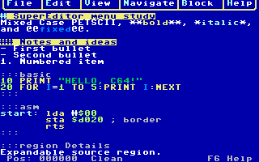
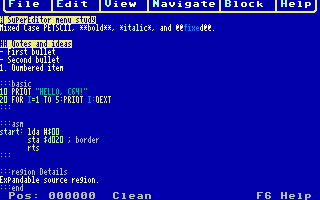

# SuperEditor



**[Download the SuperEditor development preview](../downloads/SuperEditor-preview.zip)** — the ZIP contains
`SUPEREDITOR.D81`, a quick-start `README.txt`, exact SHA-256 sums and build
metadata.

SuperEditor is a standalone C64 editor written in 6510 assembly. It edits raw
PETSCII using **SuperMark**, a Markdown-lite dialect adapted to the C64 keyboard,
screen and color system. One document moves between native 40 columns, custom
60/80-column bitmap text, editable proportional GEOS-font hires, and a separate
formatted GEOS preview.

This is a development preview, not yet a ReadyOS application. Performance and
wider standalone qualification continue, but the downloadable runtime contains
the real editor, production overlays and complete font pack—not test probes.

## What works

- Mixed-case PETSCII editing, insert/delete, preferred-column movement, line and
  document ends, page movement, ±40-character jumps, GOTO, literal/case-folded
  search and word navigation.
- Mark/selection, copy, cut, paste, grouped Undo/Redo and replacement of selected
  text.
- F1 Turbo-Pascal-style menus, F6 three-page help, F7 typed commands, direct
  Commodore-key shortcuts, one status row and rounded PETSCII menu borders.
- Color presentation for headings, emphasis, strong text, inline code, lists,
  BASIC V2 and 6502/6510 assembler. Parsing can be Plain, Markdown or Full so
  syntax work can be disabled.
- Soft wrap and horizontal pan without changing source bytes.
- Collapsible headings, fenced code blocks and nested explicit regions. Hidden
  text remains in the source and participates in selection, copy and save.
- D81 open, save and save-as dialogs with recovery handling for raw PETSCII SEQ
  files.
- Read-only formatted preview with genuine GEOS bitmap-font sizes, bold, italic,
  underline, role colors and aligned fixed-width code.
- Session settings for Body, H1–H6 and Code fonts, sizes, ink, paper and styles.




See the [screenshot gallery](SCREENSHOTS.md) for menus, multiple folds,
formatted preview, settings, wrapping and panning.

## Start it

The tested small-document workflow needs at least a 2 MiB REU; 16 MiB is
recommended for larger documents and the full feature set. A 512 KiB REU is
rejected. Attach the supplied D81 as an unpartitioned 1581 disk on device 8,
keep it mounted for overlay/font loading, then enter:

```basic
LOAD"SUPEREDITOR",8,1
RUN
```

F1 opens menus, F6 opens help, F7 opens the typed command prompt and F8 cycles
40→60→80→GEOS. CTRL-O opens a file, CTRL-S saves, F4 toggles wrapping, F2 starts
a selection, and CBM-S opens appearance settings. Every implemented command has
a menu or typed route for host keyboards where a physical chord is inconvenient.

## SuperMark at a glance

SuperMark keeps familiar lightweight forms while making the differences explicit:

```text
# Heading
**strong**  *emphasis*  @@inline code@@
- bullet
1. numbered item
:::basic
10 PRINT "HELLO"
:::
:::region Collapsible notes
Nested source remains editable and saveable.
:::end
```

The native pound key is the escape introducer: `£*`, `£#`, `£@` and `££` make
literal syntax characters where they would otherwise be controls. There are no
backtick fences, underscore emphasis, links, images, HTML, tables, block quotes
or JSON highlighting. Files use PETSCII bytes and CR line endings, not UTF-8.

## Guides

- [Complete user guide](USER_GUIDE.md): every key, command, dialog,
  SuperMark rule, folding behavior and recovery path.
- [Screenshot gallery](SCREENSHOTS.md): verified captures across the editor.
- [GEOS preview and settings](GEOS_PREVIEW.md): font catalog, profiles and
  C64 color-cell constraints.
- [Capacity and tested limits](CAPACITY.md): REU/document boundaries.
- [Performance](PERFORMANCE.md) and
  [optimization plan](OPTIMIZATION_PLAN.md): measured costs and open work.
- [Build and package](BUILD.md): prerequisites, runtime-disk allowlist and
  deterministic ZIP production.

## Build

Building requires Python 3.11+, cc65, VICE's `c1541`, the local GEOS bitmap-font
source media, and a C64 character ROM. The release D81 contains only the extracted
data-only font records—metrics, glyph indexes/advances and bitmap rows—not a GEOS
system disk, application, filesystem or executable font software.

```sh
make runtime-disk
python3 tools/package_release.py
```

`make runtime-disk` creates the 53-member production medium. The deterministic
packager publishes exactly the D81, README, build metadata and checksums. See the
[build guide](BUILD.md) for verification and site-publication commands.

Future ReadyOS lifecycle integration and UltimateDOS storage remain separate
work. The standalone memory map preserves ReadyOS's reserved 1 KiB region so the
editor can move toward suspend/resume integration without reclaiming it.
