# ReadyFS user guide

**Paths, commands, and a complete folder workflow** · Guide updated 12 October 2026 · Screenshots recorded 9 October 2026

ReadyFS is a DOS-like command shell for the Commodore 64. Its central idea is simple: **say where a file lives, then say what you want to do with it**. The same command language can address a floppy drive, an Ultimate host folder, a SoftwareIEC mapping, or sequential tape. The storage devices still have different capabilities.

This guide starts with that model, explains command arguments and options, then follows the real nested-folder demonstration. Screenshots are frames from a physical C64 Ultimate running at 1 MHz; they show actual results. Other examples are identified as recipes or syntax examples. The complete [video walkthrough](https://readyfs-editor-demo.klumsy.chatgpt.site/) remains available alongside this guide.

## Contents

1. [Start here](#1-start-here)
2. [The path system](#2-the-path-system)
3. [Commands, arguments, and options](#3-commands-arguments-and-options)
4. [Patterns and selection](#4-patterns-and-selection)
5. [Editing and the two histories](#5-editing-and-the-two-histories)
6. [Inspect files before changing them](#6-inspect-files-before-changing-them)
7. [Worked example: copy, move, and delete a nested tree](#7-worked-example-copy-move-and-delete-a-nested-tree)
8. [Create text, compare files, and save a session](#8-create-text-compare-files-and-save-a-session)
9. [Devices, images, and advanced operations](#9-devices-images-and-advanced-operations)
10. [Complete command reference](#10-complete-command-reference)
11. [Limits, troubleshooting, and evidence](#11-limits-troubleshooting-and-evidence)

## 1. Start here

### Use the full application

Use **`readyfs-overlay.prg`** with **`readyfs-overlay-lab.d81`** on IEC device 8. The disk contains the 24 sidecars that startup caches in the REU. This build needs a detected REU of at least **1 MiB**. Keep the sidecars available during startup; loading them can take time on the C64. The smaller `readyfs.prg` is a diagnostic version and does not provide the complete editor and command-help experience described here.

From BASIC, with the lab image mounted on drive 8:

```text
LOAD"READYFS-OVERLAY",8,1
RUN
```

Wait for the `rf>` prompt and the editor legend before typing.

### Three useful first commands

```text
HELP
HELP DIR
PWD
```

`HELP` lists the command families. `HELP DIR` explains one command. `PWD` prints the shell's current location. You can also use the exact short names: `H DIR`, `H CP`, and `PW`.

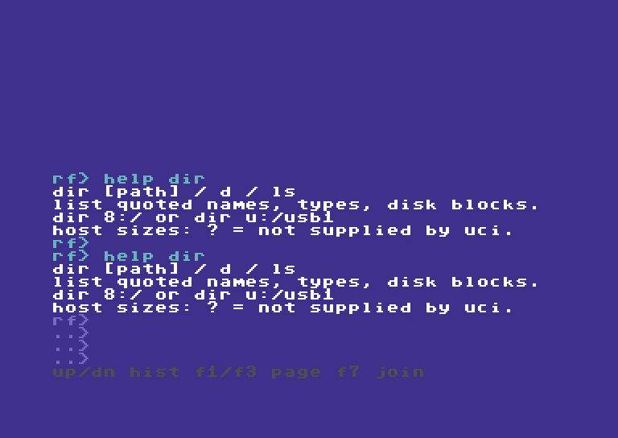

*Figure 1. Cyan identifies submitted commands; white identifies results. The four input rows and gray legend belong to the live editor.*

### Read the screen

| What you see | Meaning |
| --- | --- |
| `rf>` | Start of the editable command. Do not type the prompt itself. |
| `..>` | Another visible row of the same command, or a continuation. |
| `ov>` | Overwrite mode is active. Insert toggles it. |
| Cyan command text | Your input and submitted command echoes. |
| White text | Ordinary command output, listings, and help. |
| Yellow text | Completion and plan summaries, plus the `-- more --` prompt. |
| Red text | Errors and failed operations in the 12 October source build. |
| Gray legend | Available editor or output-history keys. |
| `-- more --` | A listing or recursive preview is waiting for a key. Read the page, then continue. |

The 12 October source build adds these summary/error colors and two or more examples per command-help topic. These changes passed host and VICE checks; the latest physical tour also verifies cyan input, white help, yellow paging and red errors. The sixteen retained screenshots in this guide were recorded on 9 October and retain their original output colors, footer and shorter help. They have not been recolored. Two additional transfer screenshots from 12 October show the named preview and explicit skip-readback result. The companion site’s recorded script provides the latest capture evidence alongside the video.

The shell is a filesystem laboratory. It can address real storage. The recorded test runner restricted its writes to a fresh, marker-owned test folder; **manual shell commands do not automatically inherit that external ownership check**. An alias is a convenient path shortcut, not a general write-protection mechanism.

## 2. The path system

### A path has an endpoint and a location

```text
u: /usb1/READYFS_TEST/my-run/source/readme.seq
│  └──────────────── location ──────────────┘
└─ endpoint
```

The text before `:` selects the storage endpoint. The slash-separated part after it selects a location on that endpoint. `/` is the hierarchy separator; it is not a Windows backslash.

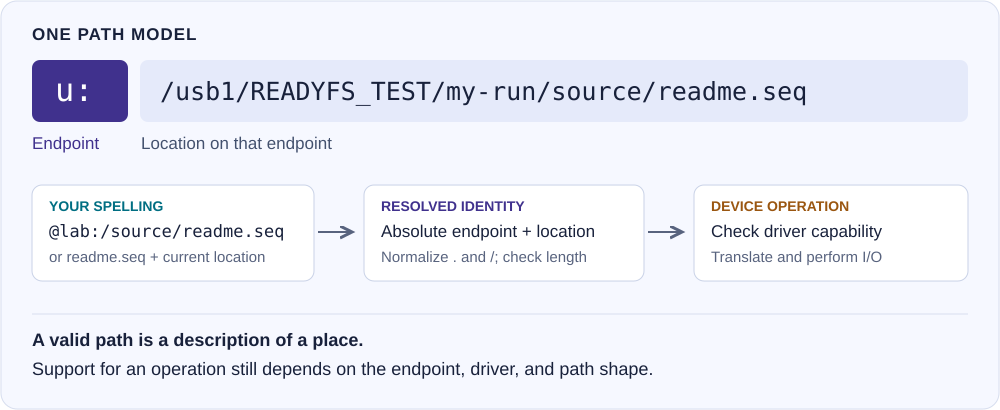

*Diagram 1. Different user spellings resolve to a canonical path. The driver then checks whether it can perform the requested operation.*

### Endpoint vocabulary

| Example | Read it as | Current meaning |
| --- | --- | --- |
| `8:/README` | Device 8, root, file README | A normal IEC device, often a floppy or an emulated floppy. |
| `9:/PROGRAM` | Device 9, root, file PROGRAM | The same syntax for another IEC unit. Supported units are 8–30. |
| `11.3:/games/HELLO` | Device 11, partition 3, folder games | A partitioned IEC path. Folder and partition operations require a suitable probed driver. |
| `u:/usb1/music/theme.sid` | Ultimate host storage, USB1 | Direct UltimateDOS access to a host filesystem. USB and SD roots depend on the hardware. |
| `s3:/games/HELLO` | SoftwareIEC logical partition 3 | A mapped SoftwareIEC root, reached through its discovered IEC bus. It is not IEC device 3. |
| `t:/NOTES` | Sequential tape, name NOTES | Tape has sequential read/write behavior, not a browsable folder tree. |
| `@lab:/source/readme.seq` | Alias lab, then this suffix | Expand the saved alias root and append the suffix. |
| `u:/usb1/demo.d81!/HELLO` | Host image, then contained file | `!/` explicitly marks an image boundary. Parsing it does not mean direct contained-file access is implemented. |

**One syntax does not imply identical devices.** A floppy has C64 block counts and short names. Ultimate host storage has folders and host names. Tape cannot rename, delete, or recurse. SoftwareIEC behavior depends on firmware and the mapping. Use `CAPABILITIES path`, `PROBE IEC 8:`, and `PROFILE IEC 8:` to inspect the relevant model and detected profile; capability summaries are not guarantees for every path shape.

### Absolute, relative, and endpoint-root paths

Suppose `PWD` prints:

```text
u:/usb1/READYFS_TEST/my-run/source
```

| Input path | Resolved location |
| --- | --- |
| `readme.seq` | `u:/usb1/READYFS_TEST/my-run/source/readme.seq` |
| `beta/deep/three.seq` | `u:/usb1/READYFS_TEST/my-run/source/beta/deep/three.seq` |
| `.` | The current source folder. |
| `..` | `u:/usb1/READYFS_TEST/my-run` |
| `/usb1` | `u:/usb1` — the root of the current endpoint, then usb1. |
| `8:/README` | Device 8; the current `u:` location does not affect it. |

`/` alone means the root of the current **endpoint**, not the root of your alias or current test folder. Prefer a full endpoint path when crossing devices. Use explicit absolute endpoint forms such as `8:/...`; endpoint-relative forms such as `8:README` are not the ordinary file-operation contract.

`CD path` changes ReadyFS's current location. `CD` without a path prints it. `PWD` prints it too. A successful `CD` resolves and stores a path; it is **not proof that the directory exists or is readable**. Follow it with `DIR` or `TREE .` when you need to check access.

```text
CD @lab:/source
PWD
DIR
TREE .
CD ..
```

### Aliases shorten long paths

An alias is an exact-place bookmark. In this syntax example, substitute your own fresh test root:

```text
ALIAS LAB u:/usb1/READYFS_TEST/YOUR_FRESH_RUN
ALIAS
HEAD @lab:/source/readme.seq 2
```

The first command stores the bookmark. The second lists saved bookmarks. The third expands `@lab:/` to that root. `AL LAB ...` is equivalent to `ALIAS LAB ...`; `UA LAB` removes it.

Aliases have up to eight slots and names up to sixteen bytes. They live in the current REU session unless saved with `CONFIG SAVE`. Alias expansion does not chain aliases. Its suffix rejects `..` components, so `@lab:/../outside` is invalid. Ordinary relative `..` navigation is allowed within the endpoint root; it is not confined to an alias's subtree.

Paths are normalized: redundant slashes and `.` components are simplified; `..` cannot climb above the endpoint or image root. Both typed commands and expanded canonical paths have a 255-byte ceiling. A short alias can still expand into a path that exceeds that limit.

### Host files, displayed names, and images

UltimateDOS can expose an access spelling with bracketed hex bytes or an added C64 file-type annotation. ReadyFS keeps the actual access identity separate from the readable name used in selection. The current lookup accepts both an actual host spelling such as `work.seq` and its decoded logical spelling where applicable. Use the exact host filename when you know it; `STAT` can show display, access, and host identities.

`demo.d81` is a **host file**. `demo.d81!/HELLO` describes a **file inside its filesystem**. The latter is a useful, explicit part of the path model, but the documented build rejects explicit image-contained file operations. For supported hardware, mount the image on an IEC drive, then address the contained file through that drive, for example `8:/HELLO`. Mounting changes drive media; it is not the same as changing `CD`. Direct image access is being worked on; see the status and examples below.

### Boundaries and possibilities: what are you copying?

**Start by deciding whether the path names a host file, a contained disk file, or a mounted device.** The same image can appear in two roles: `u:/usb1/readyos.d81` is one host file; with that image mounted on device 8, `8:/SHEET2` is one file inside its Commodore filesystem. Copying one does not mean copying the other.

| Location | What it addresses | Possibilities and boundaries |
| --- | --- | --- |
| `u:/usb1/folder/file.seq` | An ordinary Ultimate host file | Host files and nested folders. Recursive copy, move, and delete are demonstrated in this guide. Host names and C64 file types are separate concerns. |
| `8:/SHEET2` | A file on device 8's current media | Stream a supported file to/from another endpoint. A plain mounted D81 has a flat directory; adding slashes does not create host-style folders. Other IEC drivers may offer partitions or folders. |
| `u:/usb1/readyos.d81` | The entire image as one host file | Copy or back up the image as a whole. Its contained directory, allocation data, and file structures remain within the image. This does not extract any individual file. |
| `u:/usb1/readyos.d81/SHEET2` | Requested direct access to a contained file | Under implementation and not yet verified in ReadyFS. Do not assume this slash form works in the documented build. The explicit `!/` boundary is parsed but rejected by current file operations. |
| `s3:/games/HELLO` | A logical SoftwareIEC mapping | Access depends on the discovered bus, firmware, mapped root, and driver. `s3:` is not device 3. SoftwareIEC is not required to copy a file from an already mounted drive 8. |
| `@disk:/SHEET2` | An alias expanded to an underlying path | Same operations and limits as that underlying path. An alias adds neither image access nor write protection. |
| `t:/NOTES` | A named sequential tape stream | Sequential read/write, not a folder filesystem. No directory tree, rename, delete, or move. |

#### 1. Extract a file from the image already mounted on drive 8

With `readyos.d81` already mounted on device 8:

```text
DIR 8:/
COPY 8:/SHEET2 u:/usb1/SHEET2 --whatif
COPY 8:/SHEET2 u:/usb1/SHEET2
COMPARE 8:/SHEET2 u:/usb1/SHEET2
```

The source is **`8:/SHEET2`**, with the slash. `8:SHEET2` is an endpoint-relative spelling outside the current COPY contract and can report `unsupported`. For a single-file copy, name the destination file explicitly: `u:/usb1/SHEET2`. Do not use only `u:/usb1` and assume the shell will append the source name. This recipe writes the USB destination when executed; use an unused name if you want to retain an existing file.

These are syntax recipes, not a claim that your particular `SHEET2` was copied or tested. A preview shows intent; it does not establish that the later device I/O will succeed.

#### 2. Use aliases and shorter commands for the same transfer

```text
ALIAS DISK 8:/
AL USB u:/usb1
CP @disk:/SHEET2 @usb:/SHEET2 -w
CP @disk:/SHEET2 @usb:/SHEET2
COMPARE @disk:/SHEET2 @usb:/SHEET2
```

`AL` is `ALIAS`; `CP` is `COPY`; `-w` is `--whatif`. Here `@disk:/SHEET2` expands to `8:/SHEET2`. An alias to `u:/usb1/readyos.d81` would instead identify the host image file; it would not turn that file into a working browsable directory.

#### 3. Back up the whole image instead

Assuming `backups` already exists and the new destination name is unused:

```text
COPY u:/usb1/readyos.d81 u:/usb1/backups/readyos-copy.d81 --whatif
COPY u:/usb1/readyos.d81 u:/usb1/backups/readyos-copy.d81
COMPARE u:/usb1/readyos.d81 u:/usb1/backups/readyos-copy.d81
```

This transfers the entire image, not just `SHEET2`. Use an image that is not actively being written by a mounted drive so the backup has a stable source. An ordinary contained-file copy does not preserve every disk-level feature; a whole-image copy retains the image's stored structures.

#### 4. Put a host file into a mounted disk

For this recipe, device 9 must already contain a **writable disposable test disk**, with enough space and no existing file named `DEMO`:

```text
COPY u:/usb1/demo.prg 9:/DEMO --whatif
COPY u:/usb1/demo.prg 9:/DEMO
COMPARE u:/usb1/demo.prg 9:/DEMO
```

The destination is a Commodore directory entry. Its name, type, and size must fit the destination filesystem. COPY does not convert a SID, MP3, WAV, or document into an executable C64 program. Byte equality from COMPARE is useful evidence of file data, not proof of REL record structure, copy-protection data, or every item of disk metadata.

#### 5. Direct image paths in both directions — requested, not yet verified

The intended convenience forms are:

```text
COPY u:/usb1/someimage.d81/SHEET2 u:/usb1/somefolder/
COPY u:/usb1/somefolder/SHEET2 u:/usb1/someimage.d81/
```

Both **direct contained-file access** and **keeping the source filename when the destination ends in `/`** are work in progress. These two lines are feature examples, not instructions confirmed to work in the documented build. The mounted-drive recipes above are the current route. A contained-file write will also need writable media, free disk space, a supported file type, and safe handling of any concurrently mounted image.

### Why a path can parse but an operation can fail

Path resolution, driver support, and successful I/O are separate steps. A valid path can still encounter an unsupported operation, read-only media, a missing file, a name/type restriction, or insufficient space. `--force` does not add capabilities. `--whatif` does not prove read/write access. An alias does not bypass these boundaries.

Use `CAPABILITIES path` for the endpoint model, then `PROBE IEC 8:` and `PROFILE IEC 8:` for an IEC device. Use `DIR`, `STAT`, and a disposable test file to establish the behavior you actually need. For cross-endpoint transfers, ordinary PRG/SEQ/USR byte streams are the intended scope; REL and special disk structures require separate support rather than an assumption that every file is interchangeable.

### Can we tell which image is mounted on device 8 or 9?

**ReadyFS remembers mounts it makes itself, during the current session.** The normal REU-backed overlay build shows this context in `DRIVES` / `DV`, before a classic `DIR` listing, and in `STAT` and `VOLUME` for an IEC device. No network, REST connection, Mac relay, or saved disk registry is used by this feature.

```text
MOUNT u:/usb1/lab/demo.d81 9:
DRIVES
DIR 9:/
STAT 9:/HELLO
VOLUME 9:/
```

After an accepted native mount, the context looks like:

```text
9: last mounted by readyfs
u:/usb1/lab/demo.d81
may have changed elsewhere
```

**This is a historical hint, not a live check.** Changing the disk through the Ultimate menu, a disk-swap button, another application, or another client can make the remembered path out of date. The warning appears alongside the path each time. Mounts made before ReadyFS started, and mounts made elsewhere, show `image path unknown`. Unknown does not mean the drive has no disk.

Aliases are resolved before the path is remembered: `AL DISK u:/usb1/lab` then `MO @disk:/demo.d81 9:` remembers the absolute host path. `DISMOUNT` and `SWAP` invalidate the affected unit's hint when the real native operation is attempted. A mount attempt invalidates the old hint before issuing the native request and records the new path only after an OK response. `--whatif` does not change any hints. All hints clear when ReadyFS restarts. Remembering a path does not give permission to overwrite a disk or prove that writes will reach that host image; writable, read-only, and unlinked media remain separate concerns.

**Why not query the Ultimate directly?** The native UCI drive-information command (`0x29`) reports drive type, IEC bus number, and power state, but not the mounted image path. Native DOS `GET_PATH` returns that DOS target's current working directory, not the image mounted on device 8 or 9. The firmware's network API has more information, but ReadyFS deliberately does not use it. A firmware extension to expose mounted-image identity through native UCI would allow live discovery later. See the [native drive-information implementation](https://github.com/GideonZ/1541ultimate/blob/master/software/io/command_interface/control_target.cc) and [native DOS implementation](https://github.com/GideonZ/1541ultimate/blob/master/software/filemanager/dos.cc).

The compact monolithic diagnostic build retains the earlier drive listing; these remembered-path displays belong to the normal overlay build. Firmware acknowledgement is the signal available to ReadyFS: the checked firmware's native mount handler does not propagate every internal mount-action error, so an OK response is still not proof of current media. A directory's title and ID identify disk contents, not the host `.d81` filename.

## 3. Commands, arguments, and options

### Read a command from left to right

```text
COPY @lab:/source @lab:/copy --recursive --whatif
│    │            │          │           │
│    source       destination│           preview only
command                      include descendants
```

The **command** chooses the action. **Positional arguments** supply required values in order. **Options** modify that action; some take a following value. Put options after the command's required positional arguments.

These spellings have the same meaning:

```text
COPY @lab:/source @lab:/copy --recursive --whatif
CP   @lab:/source @lab:/copy -r -w
```

Command names and their registered aliases match whole tokens, case-insensitively. `CP` works because it is registered; `CO` is not an inferred abbreviation. Options are command-specific: recognizing an option token does not mean every command implements it.

### Quotes and command limits

Use double quotes around a complete argument containing spaces:

```text
WRITE "@lab:/field notes.seq" "First observation" --line --whatif
HEAD "@lab:/field notes.seq" 3
```

The quoted text is one argument. Quotes group arguments; they are not stored as part of the filename or text. The parser is deliberately small: at most **twelve tokens including the command**, inside a **255-byte logical line**. It is not a Unix shell: do not assume pipes, redirection, variables, semicolon command lists, or general backslash escapes.

An open double quote or a trailing backslash followed by Return continues the same command by joining with a space. F7 or Shift+Return also joins. This does not insert a newline into file data. Use `--line` on WRITE or APPEND for a trailing carriage return.

### Options at a glance

| Long form | Short form | Purpose and scope |
| --- | --- | --- |
| `--whatif` or `--dry-run` | `-w` | Preview a supported mutation. Remove the preview option to execute an ordinary operation. |
| `--no-verify` | `-nv` | Skip destination readback for COPY/MOVE, including recursive transfers. Verification is on by default. |
| `--recursive` | `-r` | Select a tree for COPY, MOVE, or DELETE; ordinary single-file operations do not need it. |
| `--include PATTERN` | `-i PATTERN` | Select matching relative names for commands with filtering support. |
| `--exclude PATTERN` | `-x PATTERN` | Exclude matching relative names after inclusion. |
| `--force` | `-f` | Bypass a replacement/confirmation prompt where supported. It does not add driver capabilities. |
| `--yes` | `-y` | Explicit confirmation. Current confirmation lookup also accepts it where force is tested; use it carefully. |
| `--line` | `-l` | Append a carriage return after WRITE or APPEND text. |
| `--type seq` | `-t seq` | File creation type: SEQ, PRG, or USR. Default is SEQ. REL creation/transfer is not a general supported path. |
| `--continue` | `-c` | Let a recursive execution attempt later actions after a failure; default is stop on error. |
| `--native-pattern` | `-np` | Ask a supported IEC backend to enumerate its own pattern syntax. See section 9. |
| `--apply` | `-a` | Explicit execution opt-in for native-pattern mutations and formatting; not required for ordinary recursive COPY/MOVE/DELETE. |
| `--name NAME` | `-n NAME` | SoftwareIEC mapping identifier. |
| `--label LABEL` | `-lb LABEL` | Format label on supported disposable media. |
| `--id ID` | `-id ID` | Format disk ID on supported disposable media. |
| `--disposable` | `-ds` | Required disposable-media assertion for the format workflow. |

Recursive COPY, MOVE and DELETE previews print the source root, destination root when applicable, and each selected relative filename or folder. `would copy alpha/one.seq` means that exact file below the printed source root. A `dir` label identifies a folder. Unselected entries are omitted. Longer lists pause at the yellow `-- more --`; press a key after reading each page. The final `whatif: no files changed` confirms that the preview did not execute the plan.


*Current capture A · 12 October. Eight selected entries are individually named. Source and destination roots appear on the preceding preview page, available in the companion video and recorded script.*

**Preview does not queue an operation for later.** A what-if prints a plan and returns. To execute, enter another command with the same source/destination and selection options, but without `-w` / `--whatif` / `--dry-run`. A preview is not a guarantee that the later operation can complete: conflicts, device support, and I/O still matter.

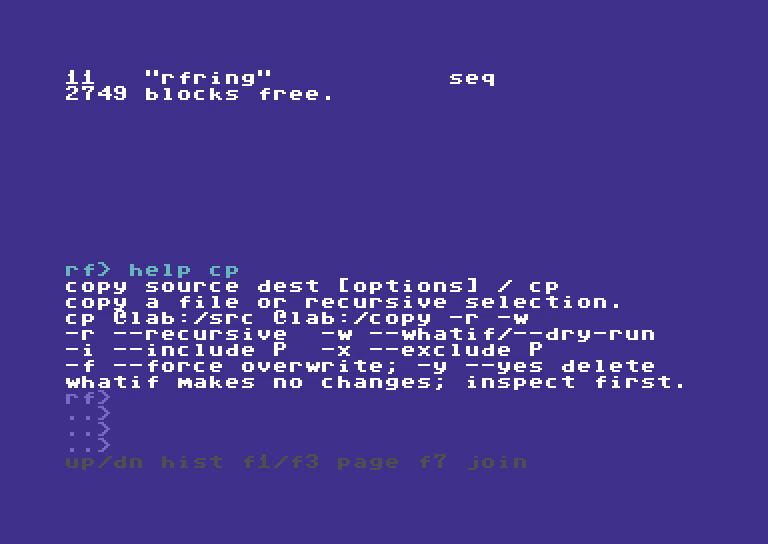

*Figure 2. Per-command help accepts short names. `HELP CP` and `HELP COPY` select the same help topic.*

## 4. Patterns and selection

ReadyFS's normal matcher operates on a **complete relative stem**, not merely the last filename. A nested file might have the stem `beta/deep/three.seq` relative to the selected source root.

| Pattern | Meaning | Example |
| --- | --- | --- |
| `*` | Zero or more characters within a component; does not cross `/` or `!`. | `*.seq` matches a root-level SEQ name. |
| `?` | One character, excluding hierarchy/image separators. | `one.?eq` matches `one.seq`. |
| `**` | Zero or more characters, including separators. | `beta/**` reaches descendants below beta. |
| `**/` | Zero or more complete directory prefixes. | `**/*.seq` includes root-level and nested SEQ names. |

Test a pattern without touching storage:

```text
MATCH "*.seq" "alpha/one.seq"
MATCH "**/*.seq" "alpha/one.seq"
```

The first is no; the second is yes. Matching is case-folded. The matcher does not provide a general regular-expression or bracket-character-class language. Quote patterns when useful for clarity; ordinary path arguments are not automatically wildcard-expanded.

For a read-only tree search:

```text
TREE @lab:/source
FIND @lab:/source --include "beta/**"
FI @lab:/source -i "**/*.seq" -x "alpha/**"
```

An Ultimate directory entry may carry an extra type annotation. Selection normalizes that representation and retains the access name separately. Inspect the actual TREE/FIND results before applying a filter to mutations. A suffix in host storage is not itself a universal C64 type guarantee.

For filtered copying, preview the selection first:

```text
COPY @lab:/source @lab:/subset -r -i "beta/**" -w
```

Do not interpret a small selected count as proof that a filter is correct. It is a count of the plan's selected entries; directories can be entries too. The worked example deliberately uses an unfiltered tree to make every folder and file easy to account for.

## 5. Editing and the two histories

The `-- more --` prompt is yellow: press a key to continue a paged listing. The next page returns to ordinary white output.

### One logical command, four visible rows

The editor holds 255 bytes but displays four rows of 36 command characters. The view follows the cursor through longer input. Wrapping changes the view, not the command. Ordinary typing updates the changed cells, rather than repainting the entire display on every key.

| Key | Action |
| --- | --- |
| Left / Right | Move within the command. |
| Home / Shift+Home | Go to its beginning / end. |
| Delete | Delete the character before the cursor. |
| Insert | Toggle insert and overwrite; `ov>` marks overwrite mode. |
| Return | Execute a complete command. |
| F7 / Shift+Return | Join another part with a space. This shortcut remains active but is omitted from the bottom legend. |
| Run/Stop at live input | Cancel the draft. |

In the demonstration, `HED @lab:/source/readme.seq 2` is corrected by moving to the beginning, moving right twice, and inserting `A`. The resulting `HEAD` reads two lines. This is an edit to the command before execution, not a rename of the file.

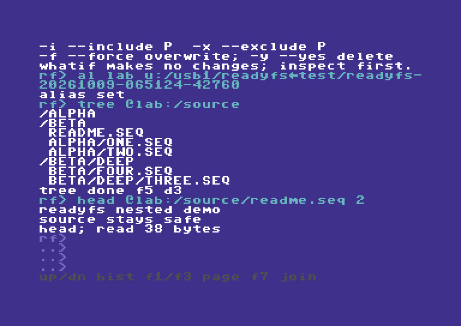

*Figure 3. HEAD displays the beginning of the file. The source text says “source stays safe.”*

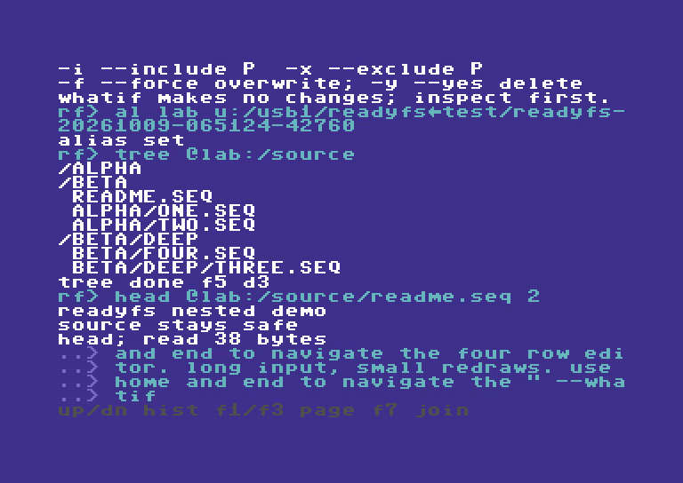

*Figure 4. A 255-byte command still fits the logical buffer even when only its end is visible. The recorded WRITE uses what-if and creates no file.*

### Command recall versus output paging

| Task | Keys | What is preserved |
| --- | --- | --- |
| Recall a command to edit or run again | Up / Down | Your unfinished draft, cursor, and insert mode return when you go Down past the newest command. |
| Read earlier results | F1 older / F3 newer | The live screen, colors, and unfinished input are restored on return. |
| Leave output history immediately | Run/Stop or Return | Return to the live editor; this Return does not execute its draft. |

Commodore+Up/Down also provide output paging. F1 enters the recent output page and continues older. F3 at the newest page returns to live input; F3 while already live leaves the draft alone. Command recall stores 32 entries. Output history stores 800 physical screen rows and their colors, with up to 23 rows per page. Oldest rows are replaced when full. `CLEAR` clears the live display while retaining scrollback. History is a session feature, not a permanent audit log.

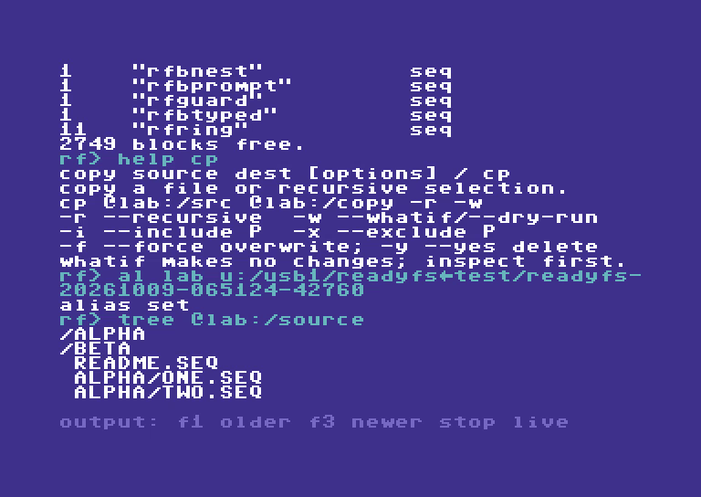

*Figure 5. This is output history, not command recall. The gray `output:` legend distinguishes the mode. Cyan command echoes keep their color.*

## 6. Inspect files before changing them

### DIR: one directory, in familiar C64 form

```text
DIR 8:/
LS @lab:/source
```

IEC disk listings show a quoted reverse-video disk header, a block count, a quoted name, and a type such as PRG, SEQ, USR, REL, or DIR. The final `BLOCKS FREE.` count is also in C64 blocks, not bytes. A long listing pauses at `-- more --`; continue only when you have read it.

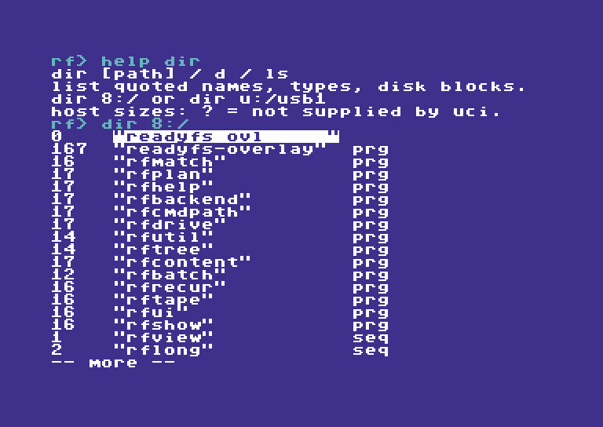

*Figure 6. A real lab D81 listing. The numbers on the left are blocks; the names and types retain the familiar C64 directory layout.*

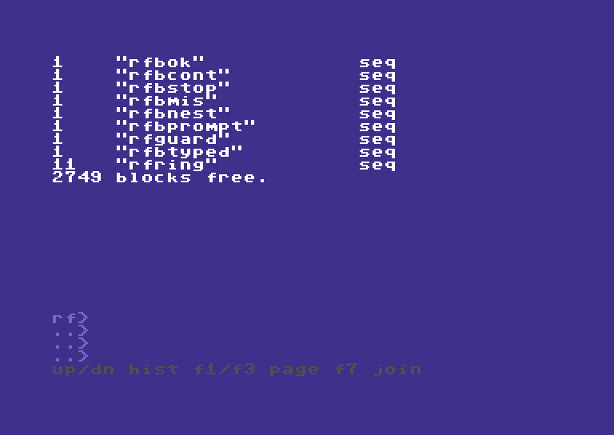

*Figure 7. The free-space line is real device output. It will differ on other media.*

Ultimate host DIR uses the same quoted-name presentation, but shows `?` when the listing stream supplies no size. Host directories show DIR; an unknown file type can show `---`. It would be misleading to invent block counts for those entries. `STAT file` can retrieve more metadata, including exact byte size on a supported Ultimate host file.

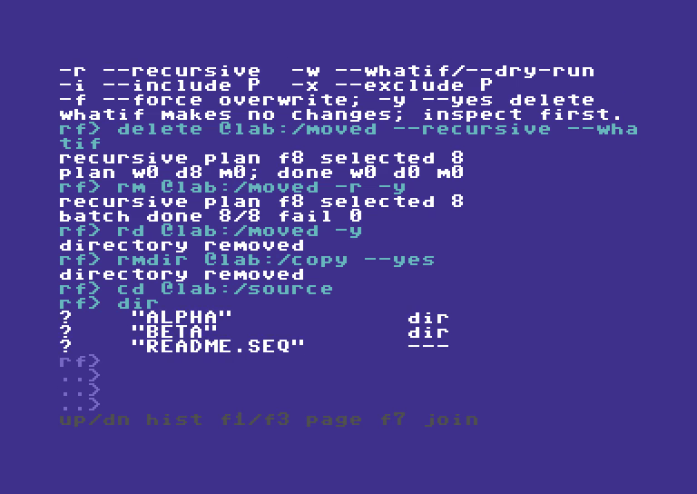

*Figure 8. `CD @lab:/source`, then `DIR`, uses the shell's current directory. A `?` is missing size metadata, not a zero-byte file.*

### TREE and FIND: see the descendants

`DIR` shows one level. `TREE path` traverses a supported tree. `FIND path [pattern]` uses the same walker with selection; `--include` and `--exclude` make the selection explicit. A regular floppy root can be listed, but does not gain nested folders merely because TREE exists.

### TYPE, HEAD, TAIL, and CRC32

```text
TYPE @lab:/source/readme.seq
HEAD @lab:/source/readme.seq 2
TL @lab:/source/readme.seq 1
CRC32 @lab:/source/readme.seq
```

TYPE prints text; bytes outside its printable range appear as dots. HEAD and TAIL default to ten lines and accept counts from 1 to 255. HEAD can stop after enough lines. TAIL reads the input and retains a small ring of trailing content, so very long lines or a large requested tail can be truncated; read the report. These are bounded C64 views, not a desktop text editor. CRC32 reads a file and prints a checksum. COMPARE reads two files to check equality; unlike a matching directory block count, that is a content check.

## 7. Worked example: copy, move, and delete a nested tree

### Prepare a disposable workspace

The recorded run used a newly created folder under `/usb1/READYFS_TEST/`, an exact ownership marker checked externally, and this source tree:

```text
source/
├── readme.seq                 38 bytes
├── alpha/
│   ├── one.seq                10 bytes
│   └── two.seq                10 bytes
└── beta/
    ├── four.seq               10 bytes
    └── deep/
        └── three.seq          13 bytes
```

Five files, three child folders, and 81 source bytes make the results easy to verify. The exact recorded root names in screenshots are historical evidence. **Do not reuse or clean up those roots.** For your own exercise, prepare a different empty, disposable folder and point LAB there. If an agent runs it on the physical C64U, it must also create and validate the matching ownership marker before mutations, as required by the repo's AGENTS rules.

A manual setup recipe, after LAB has been pointed at your fresh workspace, is:

```text
MKDIR @lab:/source
MKDIR @lab:/source/alpha
MKDIR @lab:/source/beta
MKDIR @lab:/source/beta/deep
WRITE @lab:/source/readme.seq "READYFS NESTED DEMO" -l
APPEND @lab:/source/readme.seq "SOURCE STAYS SAFE" -l
WRITE @lab:/source/alpha/one.seq "ALPHA ONE" -l
WRITE @lab:/source/alpha/two.seq "ALPHA TWO" -l
WRITE @lab:/source/beta/four.seq "BETA FOUR" -l
WRITE @lab:/source/beta/deep/three.seq "THREE LEVELS" -l
TREE @lab:/source
```

This is a recipe, not another executed hardware test. Enter one command at a time and wait for the prompt. Confirm the names and source contents before proceeding.


*Diagram 2. Copy duplicates descendants into COPY. Move transfers those descendants into MOVED. Delete removes the demonstration descendants and then their empty roots. SOURCE remains throughout.*

### Step A: preview the copy

```text
CP @lab:/source @lab:/copy -r -w
```

`-r` selects descendants. `-w` plans only. The recorded display reports eight selected entries: five files plus three directories. The historical capture’s `DONE W0 D0 M0` line says no writes, deletes, or metadata actions were completed. The current build additionally lists all eight selected relative paths and ends with `whatif: no files changed`; the new companion video shows the complete pages. Independent before/after snapshots also matched; the display alone was not the test's only evidence.


*Figure 9. A preview can enumerate and read. It does not create the COPY destination or write its files.*

### Step B: create the destination, then copy

```text
MD @lab:/copy
COPY @lab:/source @lab:/copy --recursive
TREE @lab:/copy
```

For this workflow, the destination is a **container you create first**. ReadyFS copies the source's descendants into that container, so the result is `copy/alpha/one.seq`, not `copy/source/alpha/one.seq`. A single-file COPY is different: its destination argument names the destination file; do not assume desktop-style implicit directory handling.

By default, COPY stages a file, rereads that staged destination to check its signature, then commits the replacement. The current display names the full source path before transfer and prints the filename with its byte count afterward, for example `copied one.seq: 10 bytes`. Verification status is explicit: `verify: identical` or `verify: skipped`. A recursive transfer concludes with `BATCH DONE 8/8 FAIL 0`. That eight is the batch's action count here, not “eight files.”


*Figure 10. Five verified file transfers plus directory actions complete the eight-entry copy plan. Independent hashes and directory-shape checks matched the source.*


*Figure 11. The copied tree has five files and three child directories. SOURCE is still present and unchanged.*

### Step C: preview and execute the move

```text
MKDIR @lab:/moved
MOVE @lab:/copy @lab:/moved --recursive --whatif
MV @lab:/copy @lab:/moved -r
TREE @lab:/moved
```

MOVE normally means copy and verify, then remove the source entries. With `--no-verify` / `-nv`, it copies and commits successfully before removing each source, but skips the destination integrity readback. It can take longer than COPY. It is not a claim of an atomic filesystem rename, and a failure can leave partial progress that should be inspected.


*Figure 12. The preview shows both sides of the move. The independent snapshot stayed unchanged.*

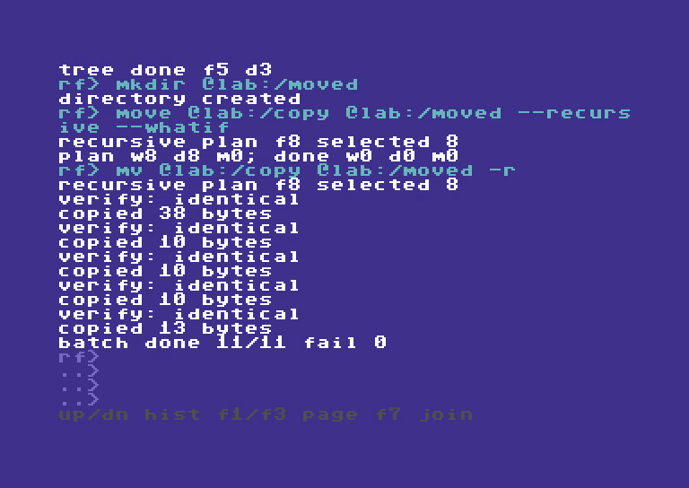

*Figure 13. The move's 11 actions include source-directory cleanup. The completed action total can differ from the eight selected entries. Checks confirmed the MOVED subtree matched SOURCE and COPY had no remaining descendants.*

### Optional readback: choose when to check

Verification remains enabled for every ordinary COPY/MOVE unless that command includes `--no-verify` or `-nv`. The setting is per command, including all files in a recursive batch; it is not a sticky session preference. Remove the switch for the next verified transfer.

```text
COPY @lab:/source/readme.seq @lab:/checked.seq
CP @lab:/source/readme.seq @lab:/fast.seq --no-verify
COMPARE @lab:/source/readme.seq @lab:/fast.seq
COPY @lab:/source @lab:/copy -r -nv
MV @lab:/copy @lab:/moved -r --no-verify
```

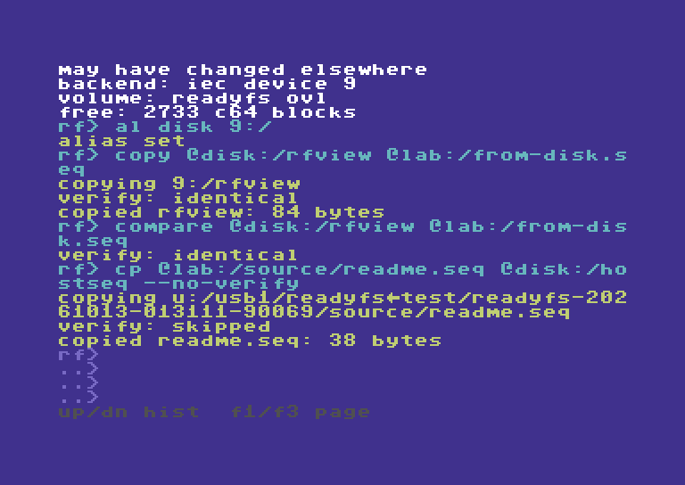

*Current capture B · 12 October. The disk-to-host copy above was verified by default. The next host-to-disk copy explicitly skips readback; the following recorded COMPARE checks it independently.*

These are alternatives to use with fresh, inspected disposable destinations, not an extra sequence to repeat over the worked example. `COMPARE` (aliases `CM` and `VERIFY`) explicitly reads both files later. For a MOVE, the moved source is gone, so compare against a separate preserved original when available, such as `COMPARE @lab:/source/alpha/one.seq @lab:/moved/alpha/one.seq`.

Skipping readback saves an extra destination read. It retains source opening, checked writes, staging, replacement/rollback handling and normal move-source cleanup, but **cannot detect a silently corrupted completed write before committing or removing the moved source**. Source-byte accounting/signature accumulation remains in the transfer loop. Tape destinations already cannot provide immediate readback and report that limitation; the switch does not make tape verifiable. WRITE, APPEND, RENAME and explicit COMPARE keep their own checking behavior.

The COPY root itself remains empty. The workflow removes that root explicitly later. The original SOURCE was never the move input.

### Step D: preview deletion, then remove only the demonstration copies

```text
H RM
DELETE @lab:/moved --recursive --whatif
RM @lab:/moved -r -y
RD @lab:/moved -y
RMDIR @lab:/copy --yes
```

The first DELETE plans the descendants. The real recursive DELETE removes files and child directories, then leaves the selected root. `RMDIR` removes an empty root; it is not a second spelling of recursive DELETE. `-y` provides explicit confirmation for these deliberate, disposable targets.

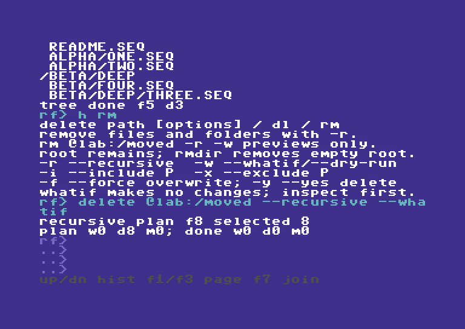

*Figure 14. The selected target is MOVED. SOURCE and the outer run root are not deletion targets.*

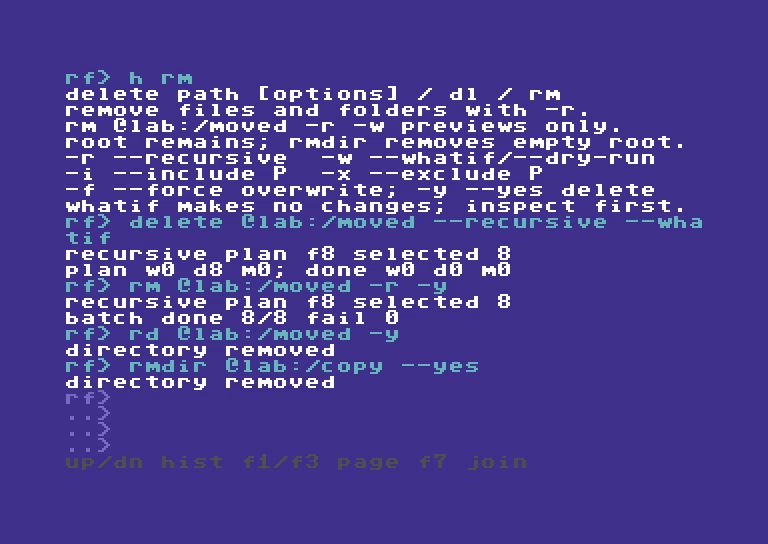

*Figure 15. The real delete reports completion, then RD/RMDIR remove the empty MOVED and COPY roots. Nothing outside this run's designated copies was a cleanup target.*

### Step E: check the survivors

```text
CD @lab:/source
DIR
TREE .
HEAD readme.seq 2
```


*Figure 16. The final source tree is intact. Independent snapshots checked names, directory shape, file sizes, and SHA-256 for all five files; the ownership marker was checked separately.*

### Understand the reports

| Report | Read it as |
| --- | --- |
| `RECURSIVE PLAN F8 SELECTED 8` | Eight serialized entries, including directories. Do not read the letter F here as a five-versus-eight file census. |
| `PLAN W8 D0 M0; DONE W0 D0 M0` | Planned writes/deletes/metadata actions; completed counts remain zero in what-if. |
| `VERIFY: IDENTICAL` | The staged file passed the transfer verification step. |
| `COPIED README.SEQ: 38 BYTES` | The transferred source filename and byte count, not disk blocks. Historical captures show the shorter byte-only form. |
| `VERIFY: SKIPPED` | This COPY/MOVE explicitly omitted destination readback. It is not an integrity check. |
| `WOULD COPY ALPHA/ONE.SEQ` | A selected relative file under the printed roots; a preview only. |
| `BATCH DONE 11/11 FAIL 0` | Completed/attempted execution actions and failures. Actions can include folder cleanup. |
| `TREE DONE F5 D3` | The walk saw five files and three directories. |

If a move reports `COPY OK; DELETE FAIL`, treat it as partial progress: inspect both paths before retrying. Do not assume the source was removed. If a batch fails, preserve evidence and inspect what completed; a script or `--continue` setting is not a transaction-wide undo facility.

## 8. Create text, compare files, and save a session

These are **syntax recipes**, not additional screenshot-backed execution claims. Keep write examples inside your own disposable LAB root.

### NEW, WRITE, and APPEND do different jobs

```text
NEW @lab:/empty.seq --type seq
WRITE "@lab:/notes with spaces.seq" "First line" --line --whatif
WRITE "@lab:/notes with spaces.seq" "First line" --line
APPEND "@lab:/notes with spaces.seq" "Second line" -l
HEAD "@lab:/notes with spaces.seq" 2
```

NEW creates an empty file and refuses an existing destination. WRITE writes the supplied text; replacing a file can prompt. APPEND adds to an existing file and follows the supported append/staging path. Use `--type seq`, `--type prg`, or `--type usr` where creation types are supported; the implementation reads the **option**. Marking text as PRG does not make it executable program code.

`--line` adds one carriage return after the text. Without it, repeated text operations can concatenate on one line. Text arguments are not a mechanism for pasting arbitrary binary data. `-f` / `--force` bypasses supported replacement prompts; it does not verify that you chose the right file.

### Single-file copy, move, rename, and compare

```text
CP @lab:/source/readme.seq @lab:/readme-copy.seq -w
CP @lab:/source/readme.seq @lab:/readme-copy.seq
COMPARE @lab:/source/readme.seq @lab:/readme-copy.seq
MV @lab:/readme-copy.seq @lab:/readme-moved.seq
RENAME @lab:/readme-moved.seq @lab:/readme-final.seq
```

COPY keeps the source. MOVE removes its source after the supported copy commits; verification is included unless explicitly skipped. RENAME is a supported same-endpoint rename; it is not a substitute for moving across devices. Ordinary Ultimate host rename currently requires the same parent folder. IEC rename rules depend on the driver. COMPARE / VERIFY checks two file contents; CRC32 provides a checksum you can record separately. Staged transfer verification uses its own bounded signature policy; do not confuse it with the CRC32 command or the external SHA-256 checks used for the filmed demo.

### Save aliases and profiles

```text
CONFIG SAVE @lab:/readyfs.cfg
CONFIG LOAD @lab:/readyfs.cfg
ALIAS
```

Configuration saves/restores aliases and drive-profile state; it does not save command/output history or the contents of your files. With no explicit path, CONFIG uses `8:/readyfs.cfg`. Saving is a filesystem write and replacement can require confirmation. Loading restores configuration state; it is not a no-change query.

### Run a small script

Prepare a SEQ text file containing real line breaks, for example:

```text
# Read-only inspection
ONERROR STOP
PWD
EXPECT RC 0
MATCH "**/*.seq" "alpha/one.seq"
EXPECT RC 0
HEAD @lab:/source/readme.seq 2
```

Then run it:

```text
RUN @lab:/inspect.seq
```

RUN stages the complete script in REU before executing it. It accepts up to 16 KiB of script data and applies the command-line length/token limits per line. `#` starts a comment when it begins the first token. `ONERROR STOP` is the default; `ONERROR CONTINUE` deliberately changes it. `EXPECT RC N` checks the preceding result and currently accepts one digit, 0–9. Nested RUN is disabled. Interactive confirmation prompts are denied in batch mode; appropriate explicit options are needed for authorized mutations.

Use STATUS after an interactive command for its typed result, but also read the operation's output. Typed-result reporting is still being adopted across handlers; a general RC alone is not a substitute for checking transfer/failure reports or postconditions.

## 9. Devices, images, and advanced operations

### Learn what the endpoint can do

```text
DRIVES
PROBE UCI
PROBE UDOS
PROBE SOFTIEC
PROBE IEC 8:
PROFILE IEC 8:
CAPABILITIES u:/usb1
```

DRIVES discovers responding IEC units and reports Ultimate/SoftwareIEC/tape endpoints. PROBE checks an interface or detects a specific IEC driver's identity. PROFILE queries the saved detected profile, optionally for an operation such as `PROFILE IEC 11: MOUNT`. CAPABILITIES prints the endpoint model, size units, path/leaf limits, and whether support is provisional. A broad `images` capability does not remove the current direct `!/` access limitation.

### Native translation and native patterns

NATIVE is a **translation diagnostic**. For example:

```text
NATIVE OPEN 11.3:/games/HELLO.PRG
NATIVE RENAME 11.3:/games/OLD.SEQ 11.3:/games/NEW.SEQ
```

It shows the backend command spelling; it does not perform the named write or rename. Its operation words are OPEN, DIR, SCRATCH, MKDIR, RMDIR, RENAME, MOUNT, and UNMOUNT. This is useful for understanding why a parsed path may need a particular driver.

`--native-pattern` is separate from normal shell filtering. It permits a supported IEC backend to enumerate a native pattern as a read-only directory query. It must never become a wildcard scratch/write command. The execution plan freezes the exact returned names.

```text
DIR 8:/RF* --native-pattern
COPY 8:/RF* 9:/ --native-pattern --whatif
```

The second example is a **preview syntax example**, not permission to modify any mounted media. A real native-pattern mutation needs explicit `--apply`, plus ordinary conflict/confirmation checks and disposable targets. Native multi-file IEC destinations must use the supported flat-root form. Unsupported directory or REL selections can reject the entire plan. Ordinary recursive host COPY does not require `--apply`; this extra gate is specific to native-pattern execution.

### Mount, dismount, and swap

```text
MOUNT u:/usb1/images/example.d81 8: --whatif
MOUNT u:/usb1/READYFS_TEST/YOUR_FRESH_RUN s3: --name LAB --whatif
DISMOUNT 8: --whatif
SWAP 8: --whatif
```

These are preview examples. Executing a mount changes media on an IEC drive, or creates a SoftwareIEC mapping. DISMOUNT detaches media or removes a supported mapping. **SWAP currently takes only `DRIVE:` and advances the firmware disk-swap list**; it does not take an image path. Do not replace the lab disk on device 8 casually while using the application.

SoftwareIEC is provisional and firmware-sensitive. Some firmware versions have incomplete directory enumeration, folder-operation restrictions, or limits when a parent contains many host entries. Prefer dedicated shallow test roots. Tape uses `t:/NAME` with names up to sixteen bytes and sequential SEQ read/write behavior; do not expect directory browsing, deletion, rename, append, or move.

### Formatting is a separate, deliberate operation

FORMAT is exposed as `FORMAT path --label LABEL --id ID` with a supported backend. Real formatting additionally requires `--disposable` and `--apply`; `--whatif` is the preview path. It destroys media contents and belongs only in the dedicated disposable-media workflow. This guide does not execute formatting or ask you to format the lab disk. Check `HELP FORMAT` and the repo safety documentation before planning that separate task.

## 10. Complete command reference

Square brackets mean optional input in this reference; do not type the brackets. `PATH`, `SOURCE`, `DEST`, and uppercase placeholders describe values you supply. Every command below has an exact registered name; short names have the same validation and behavior. `PRG`, `SEQ`, and `USR` are type words, not additional executable shell commands.

### Orientation and session

| Command and aliases | Syntax / example | Use and detail |
| --- | --- | --- |
| **HELP** · H | `HELP [command]` · `H RM` | List families or show a command topic; aliases work as topics. |
| **EXIT** · Q, QUIT | `EXIT` | Leave ReadyFS for BASIC. |
| **PWD** · PW | `PWD` | Print the canonical current location. |
| **CD** | `CD [path]` · `CD ..` | Store a resolved current path; without an argument, print it. Verify access separately. |
| **HISTORY** · HI | `HISTORY` | List the session's recalled commands; Up/Down performs interactive recall. |
| **CLEAR** · CL, CLS | `CLEAR` | Clear the live screen while retaining output scrollback. |
| **STATUS** · SS | `STATUS` | Show the previous typed result and session information; read operation output too. |
| **ALIAS** · AL | `ALIAS [name path]` · `AL LAB u:/usb1/test` | List bookmarks or set an absolute root. Does not create the folder. |
| **UNALIAS** · UA | `UNALIAS LAB` | Remove one saved bookmark. Does not delete its folder. |
| **CONFIG** · CF | `CONFIG SAVE [path]` / `CONFIG LOAD [path]` | Save/restore aliases and profiles; default path is `8:/readyfs.cfg`. |
| **RUN** · RU | `RUN @lab:/inspect.seq` | Stage and execute a SEQ script. No nested RUN; batch prompts are denied. |
| **TEST** · TS | `TEST` | Run built-in core self-tests; not a destructive storage test suite. |

### Inspect, search, and verify

| Command and aliases | Syntax / example | Use and detail |
| --- | --- | --- |
| **DIR** · D, LS | `DIR [path]` · `DIR 8:/` | One directory; default is current location. IEC sizes are blocks; host listing sizes can be `?`. |
| **TREE** · TR | `TREE path [-i pattern] [-x pattern]` | Traverse a supported tree and report files/directories. |
| **FIND** · FI | `FIND path [pattern]` · `FI @lab:/source -i "beta/**"` | Search with the tree walker and shell filters. |
| **STAT** · ST | `STAT @lab:/source/readme.seq` | Inspect file metadata/identities; Ultimate host exact-byte size when available. |
| **VOLUME** · VL, FREE | `VOLUME [path]` · `FREE 8:/` | Space or mapping information when supported; not all endpoints expose free bytes. |
| **MATCH** · MT | `MATCH pattern text` · `MT "**/*.seq" "a/b.seq"` | Test the pure matcher without filesystem writes. |
| **TYPE** · TY, CAT | `TYPE path` | Read printable text; nonprintable bytes appear as dots. |
| **HEAD** · HD | `HEAD path [lines]` · `HD readme.seq 2` | First lines, default ten; count 1–255. |
| **TAIL** · TL | `TAIL path [lines]` | Bounded trailing content; long tails can truncate. |
| **CRC32** · CR | `CRC32 path` | Read the file and calculate its CRC32. |
| **COMPARE** · CM, VERIFY | `COMPARE source dest` | Compare two file contents; does not synchronize them. |

### Change files and folders

| Command and aliases | Syntax / example | Use and detail |
| --- | --- | --- |
| **NEW** · NW | `NEW path [--type seq]` | Create an empty new file; existing destination is a conflict. |
| **WRITE** · WR | `WRITE path text [--line] [--type seq]` | Write supplied text; replacement can prompt. `--whatif` previews. |
| **APPEND** · AP | `APPEND path text [--line]` | Add text to an existing file on a supported endpoint. |
| **COPY** · CP | `COPY source dest [-r] [-w] [-nv]` | Keep source; single-file dest is a filename, recursive dest is the prepared container. |
| **MOVE** · MV | `MOVE source dest [-r] [-w] [-nv]` | Copy, normally verify, then source cleanup; `-nv` skips readback. Inspect partial failures. |
| **RENAME** · RN, REN | `RENAME source dest` | Supported same-endpoint rename; ordinary host path requires the same parent. |
| **DELETE** · DL, RM | `DELETE path [-r] [-y] [-w]` | Delete one file or selected tree descendants; recursive root remains. |
| **MKDIR** · MD | `MKDIR path` | Create one directory, not an implicit chain of missing parents. |
| **RMDIR** · RD | `RMDIR path [-y]` | Remove an empty directory. Use DELETE -r for descendants first. |

### Device and advanced commands

| Command and aliases | Syntax / example | Use and detail |
| --- | --- | --- |
| **DRIVES** · DV | `DRIVES` | Discover responding IEC devices and report other endpoints. |
| **PROBE** · PB | `PROBE [ALL\|UCI\|UDOS\|SOFTIEC\|RECOVER]` / `PROBE IEC 8:` | Inspect interface/driver state; RECOVER services the UCI recovery path. |
| **PROFILE** · PF | `PROFILE IEC 8: [operation]` | Query the saved detected driver/capability record. |
| **CAPABILITIES** · CA | `CAPABILITIES [path]` | Report endpoint model and limits; default is current location. |
| **NATIVE** · NT | `NATIVE operation path [dest]` | Display translated backend syntax; does not execute that native mutation. |
| **MOUNT** · MO | `MOUNT image drive:` / `MOUNT folder s3: --name NAME` | Mount media or add a SoftwareIEC mapping. Preview with `--whatif`. |
| **DISMOUNT** · UM, UNMOUNT | `DISMOUNT drive:` · `UM s3:` | Detach media / remove a mapping when supported. |
| **SWAP** · SW | `SWAP 8:` | Advance the existing firmware disk-swap list on that drive. |
| **FORMAT** · FM | `FORMAT path --label LABEL --id ID` | Supported disposable-media formatting; real execution also requires `--disposable --apply`. |

## 11. Limits, troubleshooting, and evidence

### Practical boundaries

| Boundary | Current value or rule |
| --- | --- |
| Command / canonical path | 255 bytes each; alias expansion must also fit. |
| Parsed tokens | Twelve including the command. |
| Visible input | Four rows × 36 command characters. |
| Command recall | 32 entries, session only. |
| Output history | 800 physical rows with colors; oldest rows are replaced. |
| Aliases | Eight, names up to sixteen bytes. |
| Directory/tree work | Bounded at 512 entries and tree depth 32; serialized queue/plan byte capacity can limit it earlier. |
| Script staging | Up to 16 KiB; line and token limits still apply. |
| Legacy IEC / tape names | Typically sixteen bytes; driver-specific translation may impose additional limits. |
| Image-contained `!/` I/O | Modeled by syntax, not general direct-access support in this build. |
| Cross-tree mutation | Can have partial progress; no promise of a global undo/atomic transaction. |

### If something is unexpected

| Symptom | Next useful check |
| --- | --- |
| A name with spaces is split | Quote the entire argument, beginning with `"`. |
| A short command is unknown | Use the registered aliases in section 10; prefixes are not abbreviations. |
| `CD` succeeds but listing fails | CD stores a resolved location; check existence/access with DIR, and confirm the endpoint. |
| `?` in DIR | Host directory metadata does not include size; use STAT on a supported file. |
| Filter misses nested names | Test with MATCH; use `**/` when a pattern must cross folders. Inspect normalized TREE/FIND stems. |
| Alias path rejects `..` | Alias suffixes prohibit parent components. Navigate with ordinary relative paths if appropriate. |
| Input seems to stop accepting text | Check the 255-byte limit; shorten it or remove text with Delete. |
| What-if reports a plan but nothing changed | That is expected; remove the preview option for a separately authorized real run. |
| COPY/MOVE sees an existing destination | Inspect it before choosing replacement; do not add force blindly. |
| RMDIR cannot remove a folder | Confirm it is empty, or preview a descendant DELETE inside the intended disposable scope. |
| `COPY OK; DELETE FAIL` | Inspect source and destination. The destination may be valid while the source still exists. |
| An image or partition operation is unsupported | Check driver/profile/path shape. Parsed syntax alone does not enable a backend. |
| A batch failed or STATUS looks optimistic | Read the command's reports and inspect postconditions; typed-result coverage is still evolving. |
| SoftwareIEC can see only some host entries | Consider firmware enumeration limits and a dedicated shallow mapping; preserve failed evidence. |

### What the screenshots prove

The sixteen retained guide screenshots come from the earlier 10:20 demonstration, recorded from the physical VIC video stream at 1 MHz. That historical video joins passing editor chapters from one take to the passing folder workflow from a fresh take. It has 31,100 frames, no missing source frames, and no speed changes within the selected demonstrations. It records 37 passing checks. Those historical images were reused without extra storage mutations. The two new transfer images come from the current marker-owned hardware test tour.

The nested workflow's source had five files and three child directories. External checks compared directory shape, byte counts, and SHA-256 hashes, checked moved-source absence and deleted-copy absence, and verified unchanged what-if snapshots. The source and ownership marker were preserved. The hardware's original CPU and drive settings were restored. Other command-reference examples explain the implementation; they are not all claims of fresh physical execution on every device.

The updated 12 October companion tour uses the same passing physical take, edited to about 8:06. Repeated command entry, directory pages and per-file transfer waits are condensed with edit notices above the picture. Complete commands, meaningful editing actions and named file outcomes remain; the first named-file preview receives extra reading time. Input typing and editing retain the 1.4× presentation speed. Concise descriptions appear in a separate band above the C64 picture; the navigation track contains chapter titles only. It includes native session mount hints, device 8/9 context, alias-based disk-to-host and host-to-disk copies, the yellow pager and a red unsupported error, plus the named COPY/MOVE/DELETE preview pages and optional readback. Its 9 chapters and 37 recorded steps have fresh screenshots and actual console snapshots in the site’s [complete recorded script](https://readyfs-editor-demo.klumsy.chatgpt.site/#script-tour). All 62 recording checks passed with no missing source frames. Separate saved-evidence checks confirm all five files and three directories are named in each recursive preview, skipped verification works for a single file and a recursive move, and default verification returns on the next ordinary copy. The exported disk image independently contains the 38-byte host file as SEQ; the 84-byte disk-to-host copy matches its source. Original drive and CPU settings were restored. The earlier 55-check tour remains preserved. The two current transfer screenshots in this guide supplement its sixteen historical stills.

### Source map and keeping this guide current

- Command names and aliases: `src/apps/readyfs/readyfs_commands.c`.
- Command dispatch, I/O, and device boundaries: `src/apps/readyfs/readyfs.c`.
- Path parsing, normalization, and matching: `readyfs_path.c`, `readyfs_match.c`.
- Editor, option shorthand, and help: `readyfs_ui.c`, `readyfs_present.c`.
- Scripts and bounded text views: `readyfs_batch.c`, `readyfs_content.c`.
- Further notes: [Interactive editor](READYFS_INTERACTIVE_UI.md), [path research](READYFS_PATH_RESEARCH.md), [safety rules](READYFS_SAFETY.md), and the project `AGENTS.md`.
- Historical screenshot times and source-video hash: [guide-assets/screenshots.json](guide-assets/screenshots.json). New transfer capture provenance: [guide-assets/transfer-screenshots-2026-10-12.json](guide-assets/transfer-screenshots-2026-10-12.json).
- Printable/offline edition: [READYFS_USER_GUIDE.html](READYFS_USER_GUIDE.html).

This guide follows the current overlay implementation. On-device HELP is compact but now includes varied examples; NEW documents `--type` and SWAP documents `drive:`. The retained screenshots show the older help. When behavior changes, update this Markdown source, its evidence captions, and regenerate the HTML rather than letting the editions drift.


## Native IEC configuration under development

The SD2IEC development build adds `iec 10: status`, `iec 10: config`, partition
queries and explicit configuration setters. See the [configuration reference](READYFS_IEC_CONFIGURATION.md)
for all commands, examples and the distinction between running and saved settings.
This new command family is not shown in the earlier published demonstration;
its physical acceptance and the broader SD2IEC filesystem work are in progress.
