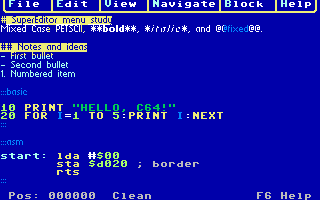
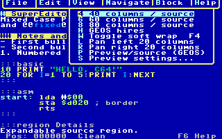
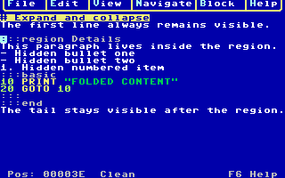
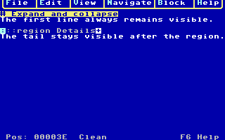
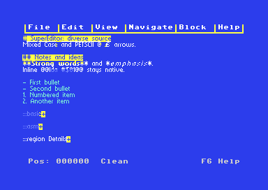
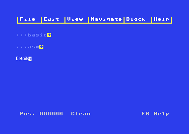
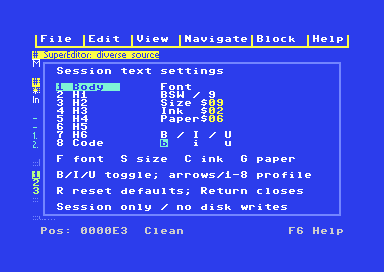
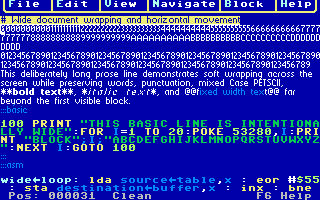
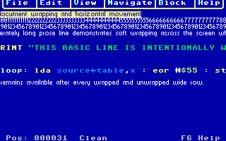

# SuperEditor screenshot gallery

These captures come from the real assembled editor running in VICE through the
project's .NET UI automation. The document, menu, folding, wrapping, panning,
preview and settings screens are product output rather than website mockups.

## Four editable presentations

### 40 columns

The native grid leaves all PETSCII Markdown-lite controls visible and editable.
Headings, emphasis, code and list structure are represented through C64 colors.

### 60 columns

The 60-column view uses the same source and commands with a custom narrow font.
It is reached with F8 or `mode 60`; the current gallery concentrates on the two
endpoint grid widths and proportional GEOS view.

### 80 columns

The 80-column bitmap view keeps the one-line menu and status layout while fitting
twice the native text width into the 320×200 display.

### Editable GEOS-font hires

GEOS source mode is still an editor: controls stay visible, source is selectable,
and the same clipboard, Undo, navigation and file operations apply.

## Menus

F1 opens the Turbo-Pascal-style menu bar. Pulldowns are content-sized, attached
with PETSCII T junctions, use rounded lower corners, and highlight the letter that
selects each item. Arrows and Return work too.

## Expand and collapse

Headings, fenced code blocks and explicit `:::region` blocks are foldable. The
opener remains visible with an inverse summary marker; saved source bytes are
not removed. Nested regions can be collapsed independently, and navigation into
hidden text opens its ancestors.

## Formatted preview and settings

Preview renders heading, body and fixed-width code profiles without rewriting
the PETSCII source. It supports genuine font sizes, bold, italic and underline,
subject to the C64's two-color-per-8×8-cell restriction.

Settings selects Body, H1–H6 or Code, then changes font family, genuine size,
ink, paper and styles. It can also switch Plain, Markdown and Full source
processing. Changes are session-only in the current preview.

## Wrap and horizontal pan

F4 toggles soft wrapping without changing source. With wrapping off, menu or
typed commands pan by 20 columns in grid views and 20 pixels in GEOS. Ordinary
caret movement reveals the caret again after a manual pan.
