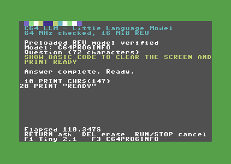
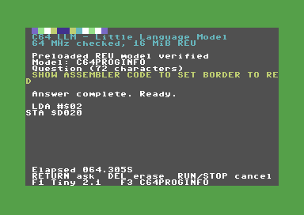

# C64 LLM - Little Language Model

Version **0.7** runs two selectable character models in native 6502/6510 assembly on a **64 MHz C64 Ultimate with a 16 MB REU**. **Tiny 2.1** answers general short questions. **C64PROGINFO** focuses on Commodore 64 hardware, BASIC V2, and 6502 assembly.

[Download and setup](docs/DOWNLOAD.md) · [Technical details](docs/TECHNICAL.md) · [Build from source](docs/BUILD.md) · [Online guide](https://readyos-c64.github.io/UltimateExperiments/tiny21/) · [GitHub release](https://github.com/ReadyOS-C64/UltimateExperiments/releases/tag/v0.7)

## v0.8 branch

The v0.8 console adds **F5** for English to Japanese. Type a short English
sentence and press **RETURN** for polite, spaced romaji. For example,
`i ate an apple` produces `watashi wa ringo o tabemashita`.
[Japanese model and training](training/JAPANESE.md) ·
[Build the three-model console](docs/BUILD.md#build-the-v08-three-model-console)

## Use the console

Unzip the v0.7 package and copy `PROBE.PRG`, `MODEL.BIN`, and `C64PROGINFO.BIN` to `/USB1/TINY64-MODELS`. Enable the **16 MB REU** and **Command Interface**, set **Turbo Control** to **C64U Turbo Registers**, and run `PROBE.PRG` from the Ultimate menu. It starts with Tiny 2.1.

## Switch models

| Key | Model | Context |
| --- | --- | ---: |
| **F1** | Tiny 2.1 for general short questions | 128 positions |
| **F3** | C64PROGINFO for C64 hardware and programming | 224 positions |

1. Wait until the console is ready. If it is answering, hold **RUN/STOP** until **Cancelled. Ready.** appears.
2. Press **F1** or **F3**. When the selection changes, the console shows **Checking selected model...**. Wait for **Model ready.** and confirm the name on the **Model:** line.
3. Type a question and press **RETURN**. **DEL** edits the prompt. Questions stay visible with their answers, and typing starts a new prompt.

Each model keeps its own REU slot. The console verifies and reuses an image already in its slot, or loads the matching file from USB through Ultimate DOS. A successful switch clears the displayed question and answer and starts a fresh context. If loading fails, the previous model stays active. [Setup and troubleshooting](docs/DOWNLOAD.md#switch-models-and-ask-questions) · [REU layout and validation](docs/TECHNICAL.md#model-and-resident-6510-engine)

## Video

<iframe class="tiny21-video" src="https://www.youtube-nocookie.com/embed/qnYL4ZUhqow?start=13" title="C64 LLM programmers’ guide and C64PROGINFO demo" width="640" height="360" loading="lazy" referrerpolicy="strict-origin-when-cross-origin" allowfullscreen></iframe>

[Watch the C64PROGINFO programmers’ guide on YouTube](https://www.youtube.com/watch?v=qnYL4ZUhqow&t=13s)

<details>
<summary>Original Tiny 2.1 demo</summary>

<iframe class="tiny21-video" src="https://www.youtube-nocookie.com/embed/EOZRYfPyuy0" title="Original Tiny 2.1 demo on the C64 Ultimate" width="640" height="360" loading="lazy" referrerpolicy="strict-origin-when-cross-origin" allowfullscreen></iframe>

[Watch the original Tiny 2.1 demo on YouTube](https://www.youtube.com/watch?v=EOZRYfPyuy0)

</details>

## Try C64PROGINFO

Press **F3**, wait for **Model ready.**, then type a prompt below and press **RETURN**. These 17 prompts and answers are from the programmers’ demo.

### C64 facts

| Type this question | C64PROGINFO answer |
| --- | --- |
| `what cpu does the c64 use` | A MOS 6510. |
| `what is the resolution of c64 hires bitmap` | 320 by 200 pixels. |
| `how many sprites does the vic ii have` | Eight hardware sprites, numbered 0 to 7. |
| `where is the sid volume register` | The low nibble of `$D418` sets master volume. |
| `how do i acknowledge vic interrupt flags` | Write ones to the flag bits you want to clear in `$D019`. |
| `which chip reads the keyboard` | CIA 1 scans the keyboard matrix using ports A and B. |
| `what does lda do` | LDA loads the accumulator and updates N and Z. |
| `what basic is built into the c64` | Commodore BASIC V2. |

### BASIC V2

`show basic code to clear the screen and print ready`

```basic
10 PRINT CHR$(147)
20 PRINT "READY"
```

`show basic code to print the numbers 1 to 10`

```basic
10 FOR I=1 TO 10:PRINT I:NEXT I
```

`show basic code to wait for a keypress`

```basic
10 GET A$:IF A$="" THEN 10
20 PRINT A$
```

`show basic code to test fire on joystick port 2`

```basic
10 IF (PEEK(56320) AND 16)=0 THEN PRINT "FIRE"
```

`show basic code to read a number and print its square`

```basic
10 INPUT A
20 PRINT A*A
```

### 6502 assembly

`show assembler code to set sprite zero color to white and enable it`

```asm
LDA #$01
STA $D027
LDA $D015
ORA #$01
STA $D015
```

Set up sprite 0’s position and sprite data before enabling it.

`show assembler code to write 440 hz sid voice 1 frequency on pal`

```asm
LDA #$44
STA $D400
LDA #$1D
STA $D401
```

This writes the PAL pitch registers. Configure the waveform, gate, envelope, and master volume to hear the voice.

`show assembler code to wait for low raster byte 100`

```asm
WAIT: LDA $D012
CMP #100
BNE WAIT
```

`show assembler code to set border to red`

```asm
LDA #$02
STA $D020
```



C64PROGINFO was trained on **3,507 C64 facts and code examples**, expanded into alternate question wordings. It covers the 6510, VIC-II, SID, CIA, memory and registers, KERNAL calls, BASIC V2 and assembly. It works best with familiar phrasing. Check the register details and generated code before using them. [Training data, tests and results](training/README.md)

## Try Tiny 2.1

| Type this question | Answer | v0.7 measured time at 64 MHz |
| --- | --- | ---: |
| `what is 7 times 8` | 7 times 8 is 56. | 32.442 s |
| `what is the capital of peru` | Lima. | 30.678 s |

The engine generates one character at a time. On the same Ultimate, v0.7 cut the combined time for these two prompts by 10.8% from v0.6. [Benchmark methodology](docs/C64_DUNGEON_COMPARISON.md#measured-on-the-c64-ultimate)

The upstream model was trained on roughly **3,500 facts** with multiple wordings. The original physical demo covers vocabulary, grammar, translation, geography, science, literature, computing and math. [Upstream Tiny 2.1 training kit](https://github.com/WollyMonjac/Tiny-2.1/tree/main/training)

### Questions from the original demo

| Question as entered | Answer from Tiny 2.1 |
| --- | --- |
| `give me a synonym for happy` | Glad. |
| `what is the plural of mouse` | Mice. |
| `translate dog to spanish` | Dog in Spanish is perro. |
| `what is the capital of japan` | The capital is Tokyo. |
| `what planet is known as the red planet` | It is Mars. |
| `what do bees make` | Honey. |
| `who wrote hamlet` | William Shakespeare. |
| `what is the chemical symbol for gold` | It is Au. |
| `how many bits in a byte` | A byte has eight bits. |
| `what is the square root of 81` | 9. |

## Screenshots




## Credits and license

The original Tiny 2.1 checkpoint and Pentium/486 DOS implementation are by [WollyMonjac/Tiny-2.1](https://github.com/WollyMonjac/Tiny-2.1). The C64 port, documentation, and C64PROGINFO are under the [MIT license](LICENSE). Peddle keeps its [own MIT notice](third_party/peddle/LICENSE).

C64PROGINFO's training tools adapt the PyTorch decoder and training loop from [jaydarkseed757’s c64-dungeon](https://github.com/jaydarkseed757/c64-dungeon). The [c64-dungeon notice](training/LICENSE.c64-dungeon) and the [upstream Tiny 2.1 notice](training/LICENSE.tiny21-language) are included in the ZIP.
