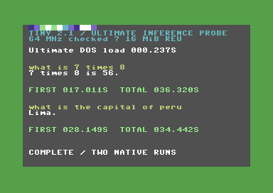

# Tiny 2.1 for the C64 Ultimate

Version **0.6** runs WollyMonjac’s Tiny 2.1 checkpoint on a physical C64 Ultimate using 6502/6510 assembly. The Ultimate’s 64 MHz turbo mode runs the transformer, and a 16 MB REU holds the model and attention history. The program loads the model through Ultimate DOS and runs standalone from the Ultimate menu.

[Quick start and download](docs/DOWNLOAD.md) · [Technical details](docs/TECHNICAL.md) · [GitHub Pages](https://readyos-c64.github.io/UltimateExperiments/tiny21/)

## Examples

| Type this question | Answer | Measured time at 64 MHz |
| --- | --- | ---: |
| `what is 7 times 8` | 7 times 8 is 56. | 36.321 s |
| `what is the capital of peru` | Lima. | 34.442 s |

On the same Ultimate, version 0.6 completed these prompts about 10.5% faster than the previous wide group-four build. The model generates text one character at a time. It works best with short questions, and its answers can be wrong.

## Video

<iframe class="tiny21-video" src="https://www.youtube-nocookie.com/embed/EOZRYfPyuy0" title="Tiny 2.1 running on the C64 Ultimate" width="640" height="360" loading="lazy" referrerpolicy="strict-origin-when-cross-origin" allowfullscreen></iframe>

[Watch the C64 Ultimate demo on YouTube](https://www.youtube.com/watch?v=EOZRYfPyuy0)

## Screenshots

## Credits and license

The original model, checkpoint and Pentium/486 DOS implementation are by the [WollyMonjac/Tiny-2.1 project](https://github.com/WollyMonjac/Tiny-2.1). This project adapts that checkpoint for the C64 Ultimate. The C64 port is [MIT licensed](LICENSE). Peddle keeps its [own MIT notice](third_party/peddle/LICENSE). The port’s license covers its own code and documentation. The upstream checkpoint is obtained separately from its author’s repository.
