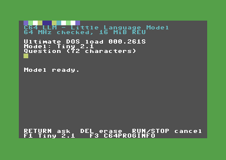

# C64 LLM - Little Language Model

Version **0.7** runs two selectable character models in native 6502/6510 assembly on a **64 MHz C64 Ultimate with a 16 MB REU**. **Tiny 2.1** answers general short questions. **C64PROGINFO** focuses on Commodore 64 hardware, BASIC V2, and 6502 assembly.

[Download and setup](docs/DOWNLOAD.md) · [Technical details](docs/TECHNICAL.md) · [Build from source](docs/BUILD.md) · [Online guide](https://readyos-c64.github.io/UltimateExperiments/tiny21/) · [GitHub release](https://github.com/ReadyOS-C64/UltimateExperiments/releases/tag/v0.7)

## Use the console

Unzip the v0.7 package and copy `PROBE.PRG`, `MODEL.BIN`, and `C64PROGINFO.BIN` to `/USB1/TINY64-MODELS`. Enable the **16 MB REU** and **Command Interface**, set **Turbo Control** to **C64U Turbo Registers**, and run `PROBE.PRG` from the Ultimate menu. It starts with Tiny 2.1.

| Key | Model | Context |
| --- | --- | ---: |
| **F1** | Tiny 2.1 | 128 positions |
| **F3** | C64PROGINFO | 224 positions |

Switch while the console is ready. Check the **Model:** line after **Model ready.** appears. The program loads the selected model if needed and reuses a verified copy already in its REU slot. Type a question and press **RETURN**. **DEL** edits the prompt. Hold **RUN/STOP** to cancel during generation. The console keeps the question on screen with its answer and starts a fresh question on your next typed character. Wrapped questions keep their color on both rows.

## Video

<iframe class="tiny21-video" src="https://www.youtube-nocookie.com/embed/EOZRYfPyuy0" title="Original Tiny 2.1 demo on the C64 Ultimate" width="640" height="360" loading="lazy" referrerpolicy="strict-origin-when-cross-origin" allowfullscreen></iframe>

[Watch the original Tiny 2.1 demo on YouTube](https://www.youtube.com/watch?v=EOZRYfPyuy0)

## Try C64PROGINFO

- `what cpu does the c64 use` → A MOS 6510.
- `what is the resolution of c64 hires bitmap` → 320 by 200 pixels.
- `show basic code to clear the screen and print ready`

  ```basic
  10 PRINT CHR$(147)
  20 PRINT "READY"
  ```

- `show assembler code to set border to red`

  ```asm
  LDA #$02
  STA $D020
  ```


C64PROGINFO was trained on **3,507 C64 facts and code examples**, expanded into alternate question wordings. It covers the 6510, VIC-II, SID, CIA, memory and registers, KERNAL calls, BASIC V2 and assembly. It works best with familiar phrasing and can give incorrect answers or code. [Training data, tests and results](training/README.md)

## Try Tiny 2.1

| Type this question | Answer | v0.7 measured time at 64 MHz |
| --- | --- | ---: |
| `what is 7 times 8` | 7 times 8 is 56. | 32.442 s |
| `what is the capital of peru` | Lima. | 30.678 s |

The engine generates one character at a time. On the same Ultimate, v0.7 cut the combined time for these two prompts by 10.8% from v0.6. [Benchmark methodology](docs/C64_DUNGEON_COMPARISON.md#measured-on-the-c64-ultimate)

The upstream model was trained on roughly **3,500 facts** with multiple wordings. The original physical demo covers vocabulary, grammar, translation, geography, science, literature, computing and math. [Upstream Tiny 2.1 training kit](https://github.com/WollyMonjac/Tiny-2.1/tree/main/training)

### Questions from the original demo

| Question as entered | Answer from Tiny 2.1 |
| --- | --- |
| `give me a synonym for happy` | Glad. |
| `what is the plural of mouse` | Mice. |
| `translate dog to spanish` | Dog in Spanish is perro. |
| `what is the capital of japan` | The capital is Tokyo. |
| `what planet is known as the red planet` | It is Mars. |
| `what do bees make` | Honey. |
| `who wrote hamlet` | William Shakespeare. |
| `what is the chemical symbol for gold` | It is Au. |
| `how many bits in a byte` | A byte has eight bits. |
| `what is the square root of 81` | 9. |

## Screenshots




## Credits and license

The original Tiny 2.1 checkpoint and Pentium/486 DOS implementation are by [WollyMonjac/Tiny-2.1](https://github.com/WollyMonjac/Tiny-2.1). The C64 port, documentation, and C64PROGINFO are under the [MIT license](LICENSE). Peddle keeps its [own MIT notice](third_party/peddle/LICENSE).

C64PROGINFO's training tools adapt the PyTorch decoder and training loop from [jaydarkseed757’s c64-dungeon](https://github.com/jaydarkseed757/c64-dungeon). The [c64-dungeon notice](training/LICENSE.c64-dungeon) and the [upstream Tiny 2.1 notice](training/LICENSE.tiny21-language) are included in the ZIP.
