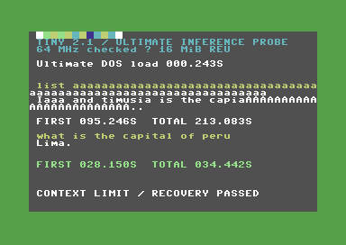

# Tiny 2.1 for the C64 Ultimate

**Development version 0.7** runs the original model with fewer CPU cycles and can load compatible checkpoints with up to 255 learned positions. [Inference-engine comparison and benchmarks](docs/C64_DUNGEON_COMPARISON.md) · [Development builds](docs/BUILD.md).

The v0.7 two-model console adds **C64PROGINFO**, a 224-position model for Commodore 64 programming questions. Press **F1** for Tiny 2.1 or **F3** for C64PROGINFO in a two-model build. The console loads each model through Ultimate DOS on first use and verifies the corresponding REU slot before reusing it. BASIC and assembler answers can span multiple screen rows. [Two-model build and install](docs/BUILD.md#build-and-install-the-two-model-console) · [Training and verification](training/README.md).

Version **0.6** runs WollyMonjac’s Tiny 2.1 checkpoint on a physical C64 Ultimate using 6502/6510 assembly. The Ultimate’s 64 MHz turbo mode runs the transformer, and a 16 MB REU holds the model and attention history. Load the model into REU from the Ultimate menu, then run the PRG from the same menu. The console verifies and reuses the preloaded model.

**Required hardware: 64 MHz C64 Ultimate and 16 MB REU.**

[Quick start and download](docs/DOWNLOAD.md) · [Technical details](docs/TECHNICAL.md) · [GitHub Pages](https://readyos-c64.github.io/UltimateExperiments/tiny21/)

## Video

<iframe class="tiny21-video" src="https://www.youtube-nocookie.com/embed/EOZRYfPyuy0" title="Tiny 2.1 running on the C64 Ultimate" width="640" height="360" loading="lazy" referrerpolicy="strict-origin-when-cross-origin" allowfullscreen></iframe>

[Watch the C64 Ultimate demo on YouTube](https://www.youtube.com/watch?v=EOZRYfPyuy0)

## Examples

| Type this question | Answer | Measured time at 64 MHz |
| --- | --- | ---: |
| `what is 7 times 8` | 7 times 8 is 56. | 36.321 s |
| `what is the capital of peru` | Lima. | 34.442 s |

On the same Ultimate, version 0.6 completed these prompts about 10.5% faster than the previous wide group-four build. The model generates text one character at a time. It works best with short questions, and its answers can be wrong.

## What the model was trained on

The upstream Tiny 2.1 README describes a small question-answering model trained on roughly **3,500 facts**, each asked in several wordings. The upstream project now publishes its fact files, question generator and training scripts alongside the DOS version. [Upstream Tiny 2.1 training kit](https://github.com/WollyMonjac/Tiny-2.1/tree/main/training)

## Questions from the C64 demo

The physical C64 Ultimate recording includes vocabulary, grammar, translation, geography, science, literature, computing, and math. These are the answers captured for the exact prompts shown.

| Question as entered | Answer from the C64 |
| --- | --- |
| `give me a synonym for happy` | Glad. |
| `what is the plural of mouse` | Mice. |
| `translate dog to spanish` | Dog in Spanish is perro. |
| `what is the capital of japan` | The capital is Tokyo. |
| `what planet is known as the red planet` | It is Mars. |
| `what do bees make` | Honey. |
| `who wrote hamlet` | William Shakespeare. |
| `what is the chemical symbol for gold` | It is Au. |
| `how many bits in a byte` | A byte has eight bits. |
| `what is the square root of 81` | 9. |

## Screenshots

## Credits and license

The original model, checkpoint and Pentium/486 DOS implementation are by the [WollyMonjac/Tiny-2.1 project](https://github.com/WollyMonjac/Tiny-2.1). This project adapts that checkpoint for the C64 Ultimate. The [MIT license](LICENSE) covers our code, documentation and C64PROGINFO model. Peddle keeps its [own MIT notice](third_party/peddle/LICENSE).

C64PROGINFO's training tools adapt the PyTorch decoder and training loop from [jaydarkseed757’s c64-dungeon](https://github.com/jaydarkseed757/c64-dungeon). Its copyright and license are included in the [training source](training/LICENSE.c64-dungeon).
